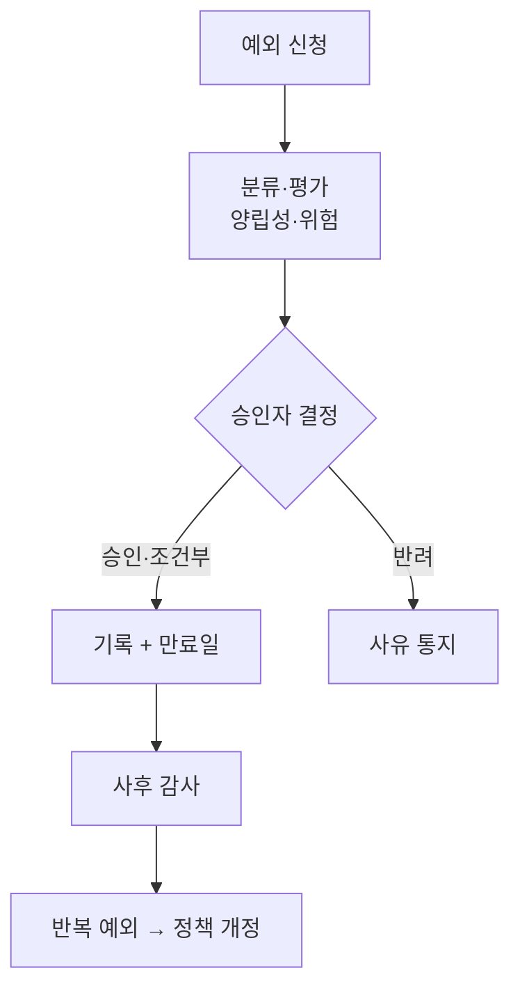
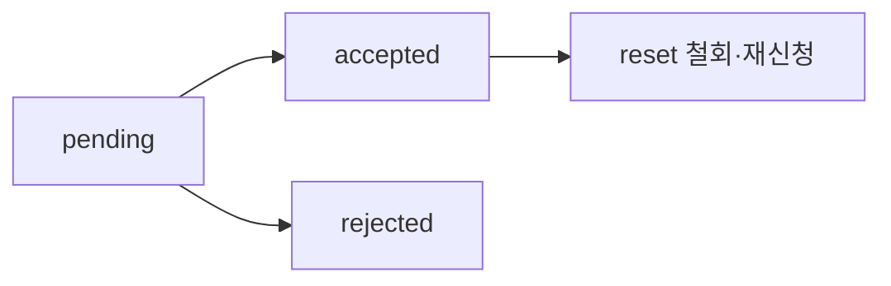

# 용도 예외 승인 절차

> 데이터 허용 용도 정책에 **없는 용도로 쓰고 싶을 때** 누가 승인하고, 무엇을 근거로 판단하며, 결정을 어떻게 기록하는지 정해 둔 절차다. 예외를 막는 것이 아니라 **눈에 보이게 만드는** 장치다.

## 쉽게 말하면
회사 출입증이 없는 방문객도 업무상 필요하면 들어갈 수 있다. 다만 접수처에서 신청서를 쓰고, 담당자가 승인하고, 방문 기록이 남는다. 예외를 허용하되 "누가 언제 왜 허락했는가"를 남기는 것이 이 절차다.

## 자세히
(HF gated datasets 문서, 영국 ICO 목적 제한 가이드, CMU 데이터 품질 이슈 처리 절차를 직접 읽었다. NIH 데이터 접근 위원회(DAC)의 세부 운영은 검색 요약만 확인했고 원문은 접근이 막혀 읽지 못했다. 아래 절차 설계는 이 지도의 제안이다.)
- **승인 상태의 예(HF 문서, 직접 읽음)**: 요청은 pending→accepted/rejected로 이동하고, 거절은 재신청을 막고, **reset**은 이전 결정을 철회하고 처음부터 다시 신청하게 한다. 거절·초기화 사유(최대 200자)를 신청자에게 보일 수 있고, **접근 보고서**로 요청 ID·상태·요청 시각·검토 시각(`reviewedAt`)을 내려받는다. 작성자는 언제든 접근을 막을 수 있다(승인 후에도).
- **판단 근거의 틀(GDPR 6조 4항, ICO — 앞선 [동의 범위와 용도 제한](#consent-scope-limit) 글에서 읽음)**: 새 용도가 원래 목적과 양립하는지를 연관성·수집 맥락·데이터 성격·결과·보호 장치로 평가한다. ICO는 목적을 처리 기록과 안내문에 적고, 목적이 바뀌면 안내문을 갱신하고 사전에 알리며, 정기적으로 검토해 목적 이탈을 잡으라고 한다. 특수 범주 데이터 재사용에는 추가 조건이 필요하다.
- **위험 수용의 선례(CMU 절차, 앞서 읽음)**: 비용이 크고 영향이 작은 경우 스튜어드가 **위험을 수용**할 수 있고 신청자에게 알린다. 우선순위·기한은 스튜어드가 영향 평가로 정한다.
- **NIH DAC 흐름(검색 요약, 직접 확인 못 함)**: 신청서는 소속 기관 서명 책임자를 거쳐 해당 데이터 접근 위원회로 가고, 위원회는 NIH 정책·기관별 요건·**데이터 사용 제한**에 맞는지 검토해 승인·거절·수정 요청을 한다. 결정은 신청자와 서명 책임자에게 통지된다고 소개된다. 승인 사례의 문서화 요구 사항은 확인하지 못했다.
- **절차 설계(제안)**
  1. **신청**: 데이터·용도·기간·접근자·기대 효과·위험 완화책을 양식으로 제출.
  2. **분류**: 정책 대비 어떤 차이인지(새 용도 vs 범위 확대) 분류.
  3. **평가**: 양립성 5요소와 위험(개인정보·민감도)을 점검, 필요 시 법무·보안 자문.
  4. **결정**: 지정된 승인자(데이터 소유자, 고위험은 위원회)가 승인·조건부 승인·반려·보완 요청. **사유를 기록**.
  5. **기록과 만료**: 결정, 승인자, 일시, 조건, **만료일**을 로그에 남기고 만료 시 재승인한다.
  6. **사후 감사**: 승인된 예외가 실제 용도와 일치하는지 표본 점검한다.
- **주의(일반 원칙)**: 예외가 반복되면 정책 자체를 고칠 신호이므로 예외 로그를 분기마다 분석한다.

## 그림으로 보기

## 예시
| 항목 | 기록 예 |
|---|---|
| 신청 | 고객 문의 로그를 외부 업체에 모델 평가용으로 제공 |
| 평가 | 개인정보 가명화, 계약 필요, 양립성 중간 |
| 결정 | 조건부 승인(가명화 후, 90일, 외부 반출 금지) |
| 만료 | 2027-02-23 재승인 |
(예시 시나리오)
- 교육 소재: "예외를 허용한 기록이 없으면 사고가 났을 때 무엇이 문제일까?"

## 헷갈리는 것과 비교
| 개념 | 차이 |
|---|---|
| 용도 예외 승인 | 정책 밖 용도를 심사·기록하는 절차 |
| [허용 용도 정책](#allowed-use-policy-data) | 평소 허용 범위를 정한 정책 |
| [용도 정의 예시](#use-definition-examples) | 모호한 용어에 예시를 붙여 예외를 줄임 |
| [카드 게이트](#card-required-gate) | 사용 신청 때 카드 존재를 확인 |

## 더 읽을거리
- [Gated datasets (Hugging Face Hub)](https://huggingface.co/docs/hub/datasets-gated) — 승인 상태·reset·접근 보고서(직접 읽음).
- [Purpose limitation (ICO)](https://ico.org.uk/for-organisations/guide-to-data-protection/guide-to-the-general-data-protection-regulation-gdpr/principles/purpose-limitation/) — 목적 기록·양립성(직접 읽음).
- [Data Quality Issue Resolution Process (CMU)](https://www.cmu.edu/data/quality/resolution-process.html) — 위험 수용 선례(직접 읽음).
