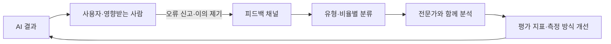

# 이의 제기 채널

> AI 시스템의 최종 사용자와 영향받는 사람들이 문제를 신고하고 AI의 결과에 이의를 제기할 수 있는 경로, 그리고 그 피드백을 시스템 평가 지표에 반영하는 체계. NIST AI RMF MEASURE 3.3이 다룬다.

## 쉽게 말하면
식당에 불만 접수함이 있어야 주방은 손님이 어떤 음식에 실망하는지 안다. 개발자와 운영자는 AI 결과가 실제 사람에게 어떻게 닿는지 대부분 볼 수 없어서, 사용자 쪽에서 알려 주는 통로가 필요하다.

## 자세히
출처: NIST AIRC Playbook의 MEASURE 3.3(열어서 읽음).
- **설명**: 영향 평가는 양방향 작업이다. 개발자·배치자는 많은 결과를 직접 볼 수 없으므로 최종 사용자와 영향받는 집단의 직접 피드백이 필요하다. 일부는 오류와 사용자·운영자 신고를 기록하는 시스템으로 자동 수집할 수 있다.
- **제안 행동(요약)**:
  - 최종 사용자·운영자의 오류 신고 절차가 얼마나 잘 작동하는지 측정
  - 이의 제기 요청과 결과를 유형과 비율별로 분류
  - 피드백 채널 참여자 수와 사람들이 그 채널의 존재를 아는지 추적
  - 피드백으로 측정 방식을 평가하고 다음 조치를 결정
  - 측정이 실제 영향에 대한 이해를 높이는지 확인
  - 사용자·공동체 피드백을 도메인 전문가와 함께 분석
- **연결**: 이 항목의 지표는 MANAGE 4.1·4.2로 이어진다고 Playbook이 설명한다.
- **설계 포인트(실무 정리)**: 채널이 있어도 사람들이 모르면 소용없으므로 접근성·인지도를 같이 잰다. 이의 제기가 실제로 결과를 바꿨는지(인용률, 처리 시간)도 지표가 된다.

## 그림으로 보기

## 예시
- 대출 심사 AI: 거절 통보서에 "이의 제기하기" 링크를 넣고, 월별 이의 건수·인용률·처리 시간을 대시보드로 추적.
- 점검 질문: "고객 중 몇 퍼센트가 이 채널의 존재를 아는가? 이의가 접수된 뒤 지표에 반영되는가?"

## 헷갈리는 것과 비교
| 개념 | 차이 |
|---|---|
| [위험의 시간별 추적](#risk-tracking-over-time) | 상위 활동, 이의 채널은 그 입력 중 하나 |
| 고객 지원 | 개별 문의 처리, 이의 채널은 시스템 평가 지표로도 환류 |
| [대체 추적 방식](#alternative-tracking) | 지표가 없는 위험의 추적(3.2) |
| [MEASURE 함수](#measure-function) | 상위 단계 |

## 더 읽을거리
- [NIST AIRC Playbook — Measure](https://airc.nist.gov/AI_RMF_Knowledge_Base/Playbook/Measure) — MEASURE 3.3 설명과 제안 행동(열어서 확인)
