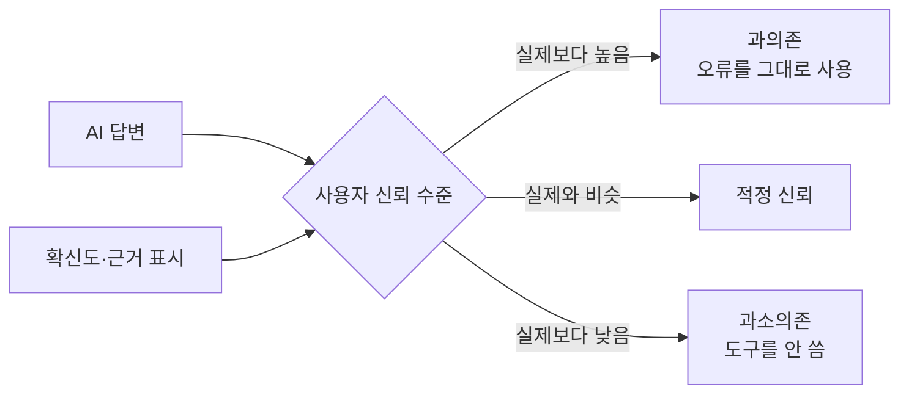

# 사용자 과의존

> AI의 답이 실제보다 정확하다고 믿고 검증 없이 따르는 현상. 모델의 오류보다 "사람이 얼마나 믿는가"가 어긋나서 생기는 문제다.

## 쉽게 말하면
내비게이션이 늘 맞았다고 해서 공사로 막힌 길에도 그대로 들어가는 운전자와 같다. 도구가 틀릴 수 있다는 감각이 무뎌지면 사고가 난다. 반대로 너무 못 믿으면 도구를 아예 안 쓰는 과소의존이 된다. 목표는 "적당히" 믿는 것, 즉 신뢰 보정이다.

## 자세히
- **핵심 연구(2024)**: 기본 설명이 붙은 LLM 답을 사람들은 실제보다 정확하다고 본다. 설명이 길면 정확도와 무관하게 확신이 더 올라간다. 설명을 모델의 내부 확신에 맞게 고치자 사람의 확신과 모델 확신의 차이(calibration gap)와 맞는 답·틀린 답을 가려내는 능력의 차이(discrimination gap)가 줄었다(arXiv 2401.13835, 초록 확인).
- **원인 후보**: 단정적 어조, 유창한 문장, 긴 설명, 자동화 편향(기계가 낸 답을 우선 믿는 경향).
- **두 방향의 오류**: 과의존(틀린 답을 따름), 과소의존(맞는 답도 무시).
- **줄이는 설계**: 확신도 표시([AI 확신도 표시](#ai-confidence-display)), 근거 링크, 낮을 때 되묻기, 중요한 결정은 사람 확인 단계 추가, 사용자가 먼저 자기 답을 쓰고 AI 답을 비교하게 하기.
- 위험이 큰 구간(의료·법무·금융)일수록 의도적 마찰을 둔다.

## 그림으로 보기

## 예시
- 계약서 검토 AI가 조항을 "문제없음"으로 요약 → 법무 담당이 원문 대조 없이 승인. 해법: 요약 옆에 근거 조항 링크, 고위험 조항은 별도 확인 체크.
- 팀 규칙: 중요한 AI 산출물은 "근거 2개 확인" 후에만 배포.

## 헷갈리는 것과 비교
| 개념 | 차이 |
|---|---|
| 사용자 과의존 | 사람 쪽의 믿음이 과함 |
| [환각](#hallucination) | 모델이 틀린 내용을 생성함 |
| [캘리브레이션](#calibration) | 모델 확신이 정확도와 맞는 정도 |

## 더 읽을거리
- [What Large Language Models Know and What People Think They Know](https://arxiv.org/abs/2401.13835) — 설명 길이와 사용자 과신 연구
