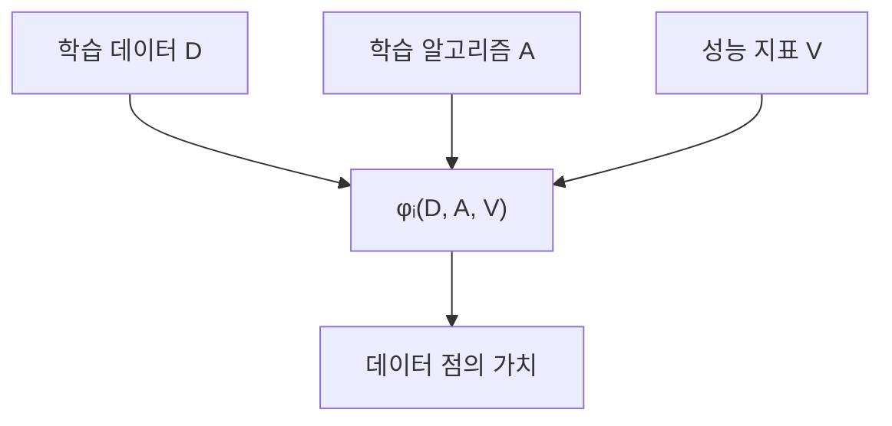
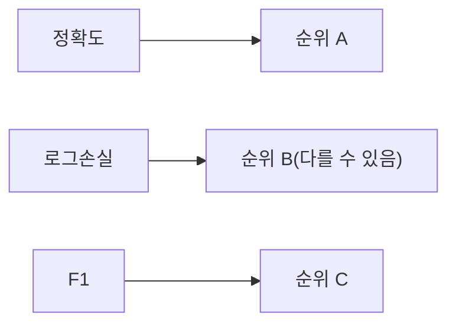

# 효용 함수 선택

> 데이터 샤플리에서 **효용 함수 V(S)** — "데이터 S로 학습한 모델을 어떻게 점수 매길 것인가" — 는 가치를 정하는 세 기둥(데이터·학습 알고리즘·성능 지표) 중 하나다. 어떤 지표·모델·시험 세트를 쓰느냐에 따라 같은 데이터 점의 가치가 달라진다.

## 쉽게 말하면
같은 직원도 "매출"로 평가하느냐 "고객 만족"으로 평가하느냐에 따라 기여도가 다르게 나온다. 데이터 한 점의 가치는 절대적인 값이 아니라 "어떤 기준으로, 어떤 모델에, 다른 데이터와 함께일 때"의 값이다.

## 자세히
- **세 기둥(Ghorbani & Zou, arXiv 1904.02868 본문 확인)**: 학습 데이터 D, 학습 알고리즘 A, 성능 지표 V. 데이터 값은 이 셋의 함수 φᵢ(D, A, V)다. 저자는 "지도 학습에서 데이터에 가치를 매기는 것은 데이터에 **보편적 가치**를 매기는 것과 다르다"고 강조한다. 로지스틱 회귀를 훈련할 때 중요한 점이 신경망에서는 덜 중요할 수 있고, 성능 지표를 바꾸면(예: 심장병 발병 여부 대신 발병 연령 회귀) 같은 환자 데이터의 가치도 달라진다. 논의 말미: "높은(낮은) 샤플리 값을 말할 때 이 모든 맥락이 주어졌다고 가정", 다른 학습 함수·지표에서의 거동 이해는 후속 과제로 남긴다.
- **흔한 효용 함수**
  | 효용 V(S) | 장점 | 주의 |
  |---|---|---|
  | 시험 세트 정확도 | 직관적 | 시험 세트가 작으면 잡음 → 가치 잡음([절단 허용오차](#truncation-tolerance)) |
  | 음의 평균 손실(−로그손실·MSE) | 연속적이라 작은 변화를 잡음 | 손실 척도에 민감 |
  | F1·AUC | 불균형에서 유용 | 부분집합이 작으면 정의 불가·불안정([미정의 지표](#stratified-metric-undefined-fix)) |
  | 시험 점 k 하나의 점수 V_k | 점마다 "누가 이 예측에 기여?" | 점별 값이 크게 흔들림 |
- **논문의 가법성 설명(본문)**: 전체 성능이 점별 손실의 합 V = −Σ_k l_k(0-1 손실, 교차 엔트로피 등)처럼 **합 구조**이면 φᵢ(V) = Σ_k φᵢ(V_k) — 데이터 i의 값은 각 시험 점 예측에 대한 기여의 합이다. 시험 점별 분해로 "이 학습 점이 어떤 시험 점을 돕는가"를 볼 수 있다.
- **선택 지침(권장)**
  1. 최종 업무 지표와 일치시킨다(서비스가 재현율 중심이면 재현율/F-β).
  2. **검증 세트는 학습·최종 시험과 분리**. 같은 검증 세트를 모든 부분집합 평가에 써서 과적합되지 않도록 크기를 충분히.
  3. 부분집합이 작아 지표가 정의되지 않는 경우 기준값(예: 최빈 클래스 성능)을 정의.
  4. 모델을 **실제 배포 모델**과 같은 계열로. 작은 대리 모델로 값을 구하면 가치가 달라질 수 있다.
  5. 보고 시 "(모델, 지표, 검증 세트 크기)"를 함께 적는다([범위 명시](#citing-ai-research-scope)).
- **한계**: 효용 함수가 바뀌면 순위·가치 합계(U(전체)−U(∅))가 바뀌어 [효율성](#shapley-efficiency-axiom)의 총량도 달라진다.

## 그림으로 보기



## 예시
```python
def utility_acc(S):   return accuracy(train(model, S), X_val, y_val)
def utility_nll(S):   return -log_loss(y_val, train(model, S).predict_proba(X_val))
# 두 효용으로 샤플리를 각각 구해 하위 10% 점의 겹침(자카드)을 비교한다
```
- 불균형 사기 탐지: 정확도 효용은 대부분 0.99로 포화되어 가치 차가 거의 없으므로 PR-AUC나 재현율 기반 효용을 쓴다.

## 헷갈리는 것과 비교
| 개념 | 설명 |
|---|---|
| 효용 함수 V(S) | 데이터 부분집합의 모델 점수 |
| 손실 | 오차(낮을수록 좋음), 효용은 부호 반전 |
| 평가 지표 | 최종 성능 보고 지표(효용과 같게 맞추는 것이 좋음) |
| [TMC-Shapley](#tmc-shapley) | 효용 평가 횟수를 줄이는 근사 |

## 더 읽을거리
- [Data Shapley (arXiv 1904.02868)](https://arxiv.org/abs/1904.02868) — 세 기둥과 가법성 설명(PDF 본문 확인).
