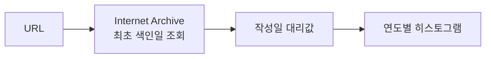
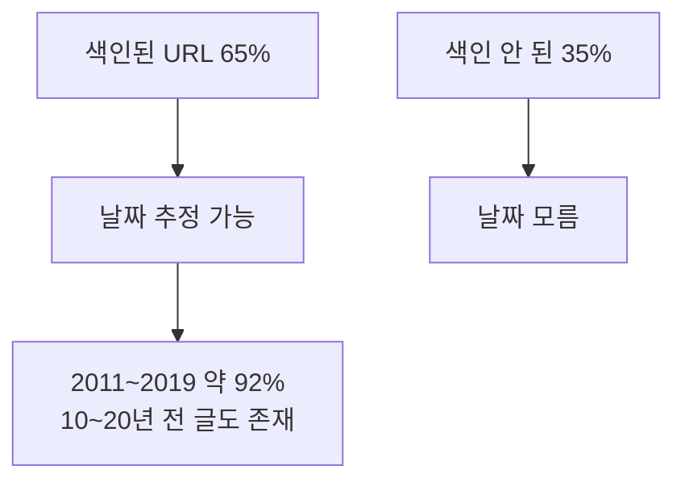

# 작성 시기 대리 지표

> 웹 문서가 **언제 쓰였는지** 알기 어려울 때, 그 URL이 **인터넷 아카이브에 처음 색인된 날짜**를 대신 쓰는 방법. 코퍼스가 얼마나 최신인지 가늠하는 단서다.

## 쉽게 말하면
책에 출간일이 없으면 도서관에 처음 들어온 날짜로 "이 책이 대략 언제 나왔나"를 짐작한다. 책이 한참 뒤에 들어왔다면 날짜는 실제보다 늦다.

## 자세히
(Dodge 외, arXiv 2104.08758 §3.2를 ar5iv로 직접 읽음)
- **방법**: 웹 문서는 진짜 작성일이 없는 경우가 많아, Internet Archive(Wayback Machine)가 그 URL을 **가장 먼저 색인한 날짜**를 작성일의 대리로 썼다.
- **범위**: 아카이브는 C4.en URL의 약 **65%**만 색인했다. 날짜 분석에는 무작위 **100만 URL**을 뽑았다.
- **결과**: 표본의 약 **92%가 2011~2019년**에 쓰인 것으로 추정됐다. 분포는 긴 꼬리를 가져서 수집 시점보다 **10~20년 전**에 쓰인 글도 적지 않았다.
- **한계(논문)**: 아카이브는 페이지를 만든 지 몇 달 뒤에 색인하기도 해서 날짜는 근사값이다. 색인되지 않은 35%의 날짜는 모른다. 또한 첫 색인 후 내용이 바뀐 페이지는 작성일과 현재 내용이 어긋난다(일반 설명).
- **왜 중요한가**: 말뭉치의 시기 분포는 모델이 아는 사실의 최신성, 낡은 정보의 비중, 시대별 표현 변화에 영향을 준다(제안). 학습 컷오프 이후의 정보를 모른다는 점과도 연결된다.
- **쓰임(제안)**: 시기별 문서 수 히스토그램을 만들고, 최신 정보가 중요한 과제(법·기술·가격)에서는 최신 데이터를 보강하거나 검색(RAG)으로 보완한다.

## 그림으로 보기

## 예시
| 지표 | 값(Dodge 외) |
|---|---|
| 아카이브 색인 비율 | 약 65% |
| 날짜 분석 표본 | 100만 URL |
| 2011~2019 작성 추정 | 약 92% |
- 업무 장면: 사내 지식 챗봇이 오래된 규정을 말하는 문제가 있다면, 학습·검색 문서의 작성 연도 분포부터 그려 낡은 문서 비중을 확인한다.

## 헷갈리는 것과 비교
| 개념 | 차이 |
|---|---|
| 작성 시기 대리 지표 | 최초 색인일로 짐작한 작성일 |
| 크롤 날짜 | 수집된 날짜. 작성일과 다름 |
| [지리 대리 지표](#geolocation-proxy) | 위치의 대리 지표 |
| [웹 출처 분포 분석](#web-source-distribution) | 출처 도메인 분포 |

## 더 읽을거리
- [Documenting Large Webtext Corpora (arXiv 2104.08758)](https://arxiv.org/abs/2104.08758) — 인터넷 아카이브 날짜 분석(ar5iv 본문 직접 읽음).
