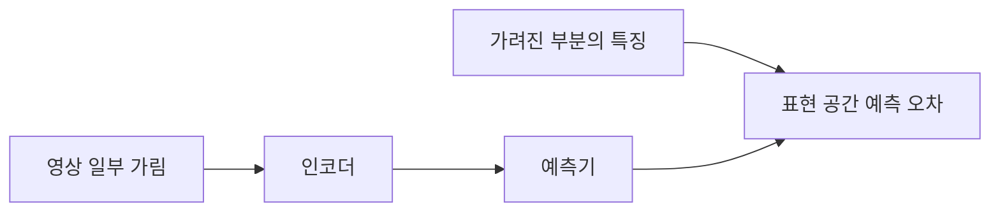
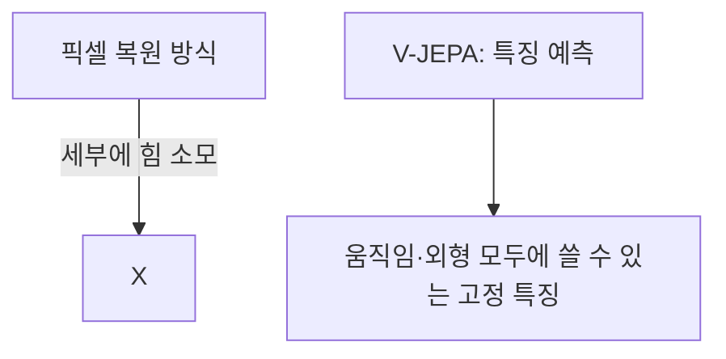

# V-JEPA

> **V-JEPA**는 영상에서 **특징(표현) 예측만**을 학습 목표로 삼아 시각 표현을 배우는 [JEPA](#jepa)의 영상 버전이다(Bardes 외, arXiv 2404.08471, 2024-02). 이미지 인코더·텍스트·부정 예시·복원 없이 학습한다.

## 쉽게 말하면
영상의 일부를 가리고 "거기서 무슨 일이 일어날지"를 **의미 수준**에서 맞히게 한다. 화면의 픽셀을 그리는 게 아니라 장면의 요점을 예측하는 셈이다.

## 자세히
(논문 초록 확인)
- **학습 목표**: 특징 예측이 **유일한** 목표. 사전학습 이미지 인코더, 텍스트, 부정 예시, 픽셀 복원, 그 밖의 지도 신호를 쓰지 않는다.
- **데이터**: 공개 데이터셋의 약 **200만 개 영상**.
- **고정 백본**: 학습된 특징을 **파라미터 갱신 없이** 움직임 기반·외형 기반 과제에 모두 쓸 수 있다.
- **결과**(ViT-H/16, 영상만으로 학습): Kinetics-400 **81.9%**, Something-Something-v2 **72.2%**, ImageNet-1K **77.9%**.
- 월드 모델·로봇 계획과의 연결은 이 글에서 확인하지 않았다(JEPA를 월드 모델 부품으로 보는 관점은 일반 지식).

## 그림으로 보기

## 예시
- 라벨 없는 영상 수만 시간으로 사전학습한 뒤, 적은 라벨로 동작 인식기를 얹는 방식.

## 헷갈리는 것과 비교
| 개념 | 차이 |
|---|---|
| V-JEPA | 영상, 특징 예측 |
| [I-JEPA](#jepa) | 이미지, 블록 표현 예측 |
| 영상 생성 모델 | 픽셀·프레임 생성 |
| [생성형 월드 모델](#genie-world-generation) | 행동에 반응하는 영상 생성 |

## 더 읽을거리
- [Revisiting Feature Prediction for Learning Visual Representations from Video](https://arxiv.org/abs/2404.08471)
