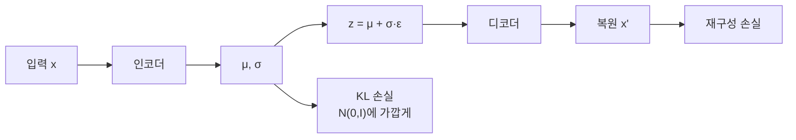

# VAE의 KL 손실

> VAE 손실의 한 항으로, 인코더가 만든 잠재 분포가 표준 정규분포(사전분포)에서 너무 벗어나지 않도록 눌러 주는 정규화 항이다.

## 쉽게 말하면
학생들에게 답안을 자유롭게 쓰게 하되 "공통 양식 안에서 쓰라"고 하는 것과 같다. 복원 점수만 보면 각자 자기만 아는 암호로 쓰지만, 양식(KL)을 지키게 하면 잠재 공간이 정돈되어 새 값을 뽑아도 쓸 만한 결과가 나온다.

## 자세히
Lilian Weng 글 기준 VAE 손실은
`L = −E[log p(x|z)] + KL(q(z|x) ‖ p(z))`
- 첫 항: 복원 품질(재구성 손실).
- 둘째 항(KL): 인코더 분포 `q`와 사전분포 `p(z)=N(0,I)`의 거리. 정규화기 역할.
- KL ≥ 0이라서 `−L`은 `log p(x)`의 하한(ELBO)이고 손실 최소화 = 하한 최대화.
- **재매개변수화 트릭**: `z = μ + σ ⊙ ε, ε~N(0,I)`로 써서 무작위성을 ε에 몰아 역전파가 가능하게 한다.
- β-VAE: KL에 가중치 β를 곱해 키우면 풀림(disentangle)이 좋아질 수 있으나 복원 품질이 떨어질 수 있다.
- 이미지 생성용 VAE(SD VAE 등)는 KL 가중치를 매우 작게 두고 복원·지각 손실 위주로 학습하는 것이 일반적이다(Latent Diffusion 논문 기준, 이번에 원문 재확인은 하지 않음). 그래서 `scaling_factor`로 분산을 따로 맞춘다.

## 그림으로 보기


## 예시
```python
kl = -0.5 * torch.sum(1 + logvar - mu.pow(2) - logvar.exp())
loss = recon_loss + beta * kl
```
beta를 키우면 잠재가 정돈되지만 흐릿한 복원, 줄이면 선명하지만 잠재가 들쭉날쭉.

## 헷갈리는 것과 비교
| 개념 | 차이 |
|---|---|
| 재구성 손실 | 복원 정확도 |
| KL 손실 | 잠재 분포 정규화 |
| 일반 오토인코더 | KL 없음, 잠재가 점 |
| [잠재 공간](#latent-space) | KL이 다듬는 대상 |

## 더 읽을거리
- [Lilian Weng, From Autoencoder to Beta-VAE](https://lilianweng.github.io/posts/2018-08-12-vae/) — 손실식·재매개변수화.
- [Kingma & Welling 논문](https://huggingface.co/papers/1312.6114v11) — 원 논문.
