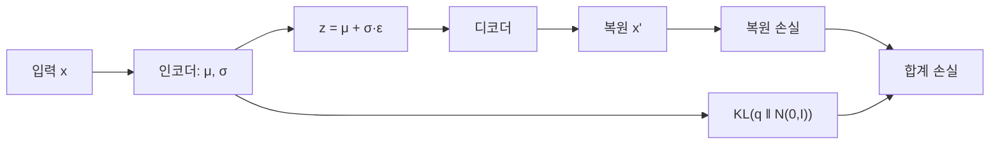

# VAE의 KL 항

> VAE의 손실은 "복원 오차 + KL 항"이다. KL 항은 인코더가 만드는 잠재 변수의 분포를 사전분포(보통 표준정규분포)에 가깝게 묶는 정규화 역할을 한다.

## 쉽게 말하면
각자 마음대로 번호표를 붙이면 창고가 엉망이 되지만, "모두 중앙 구역 근처에 배치"하라는 규칙이 있으면 비슷한 물건이 이웃하고 빈틈도 줄어든다. KL 항이 그 규칙이다. 덕분에 잠재 공간에서 아무 점이나 뽑아도 쓸 만한 결과가 나온다.

## 자세히
- 손실(Lilian Weng 글): L = −E_q[log p(x|z)] + KL(q(z|x) ‖ p(z)). 앞은 디코더가 x를 복원하는 정도, 뒤는 [KL 발산](#kl-divergence) 정규화.
- 이는 ELBO(증거 하한)의 음수다. 진짜 사후분포 p(z|x)는 계산이 불가능해, KL이 음수가 아님을 이용해 log p(x)의 하한을 최대화한다.
- **재매개변수화**: z = μ + σ⊙ε, ε~N(0,I). 무작위성을 ε로 빼 μ와 σ로 역전파한다.
- **β-VAE**: KL에 β를 곱한다. β>1이면 잠재 공간이 더 제약되어 요인이 분리(disentangled)되기 쉽지만 복원 품질이 떨어질 수 있다.
- KL이 너무 강하면 잠재 변수를 무시하게 되고(posterior collapse, 일반적으로 알려진 현상), 너무 약하면 사전분포에서 뽑은 샘플이 엉뚱해진다.

## 그림으로 보기

## 예시
- 얼굴 이미지 VAE: 잠재 벡터를 N(0,I)에서 뽑아 디코더에 넣으면 새 얼굴이 생성된다. KL 항이 이를 가능하게 한다.
- Stable Diffusion 계열의 잠재 공간 인코더도 KL 정규화를 쓰는 VAE다([VAE](#vae) 참고).

## 헷갈리는 것과 비교
| 개념 | 차이 |
| --- | --- |
| VAE의 KL 항 | 잠재 분포를 사전분포로 묶음 |
| [파인튜닝 KL 페널티](#kl-penalty-finetuning) | 모델 출력을 기준 모델에 묶음 |
| 복원 손실 | 입력을 얼마나 잘 되살리나 |

## 더 읽을거리
- [From Autoencoder to Beta-VAE (Lilian Weng)](https://lilianweng.github.io/posts/2018-08-12-vae/) — VAE 손실·ELBO·β-VAE 유도
