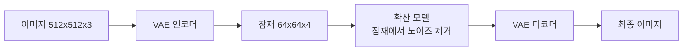
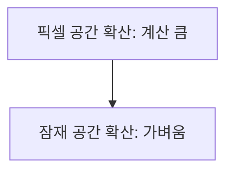

# VAE 오토인코더와 잠재 공간

> VAE는 이미지를 훨씬 작은 잠재(latent) 표현으로 압축(encode)하고 다시 이미지로 복원(decode)하는 모델로, 확산 모델은 픽셀이 아니라 이 잠재 공간에서 작동한다.

## 쉽게 말하면
큰 사진을 ZIP처럼 작게 압축해 두고, 편집은 압축본에서 빠르게 한 뒤, 마지막에 압축을 풀어 사진으로 돌리는 방식이다. 압축본에서 작업하니 훨씬 가볍다.

## 자세히
HF diffusers `AutoencoderKL` 문서(v0.42.1) 기준:
- Kingma·Welling의 *Auto-Encoding Variational Bayes*에서 나온 모델. diffusers에서 이미지를 잠재로 `encode`, 잠재를 이미지로 `decode`하는 데 쓴다.
- 기본값: 입력 3채널(RGB), `latent_channels=4`. 인코더 출력은 평균·로그분산을 가진 가우시안 분포(`DiagonalGaussianDistribution`)이고 거기서 샘플링한다.
- **`scaling_factor`(기본 0.18215)**: 잠재의 표준편차를 1로 맞추려고 `z = z × scaling_factor`로 곱한 뒤 확산 모델에 넣고, 디코딩 때 `1/scaling_factor`로 되돌린다(Latent Diffusion 논문 §4.3.2, D.1 참조).
- `force_upcast=True`: SDXL 같은 고해상도 파이프라인에서 VAE를 float32로 돌린다(fp16에서 수치 문제). fp16용으로 미세조정한 `sdxl-vae-fp16-fix`도 있다.
- **타일링**(`tiled_encode`/`tiled_decode`): 이미지를 겹치는 타일로 나눠 처리해 해상도와 무관하게 메모리 사용을 일정하게 유지한다. 타일 경계 흔적이 약간 남을 수 있다.
- 압축 배율은 구성에 따라 다르다(SD는 가로·세로 8배 압축이 일반적 — 이번 문서에 직접 서술은 없음).

## 그림으로 보기



## 예시
```python
from diffusers import AutoencoderKL
vae = AutoencoderKL.from_pretrained("stabilityai/sd-vae-ft-mse")
latents = vae.encode(images).latent_dist.sample() * vae.config.scaling_factor
recon = vae.decode(latents / vae.config.scaling_factor).sample
```
(일반적 사용 패턴 예시이며 이번에 실행하지 않았다.) 이미지가 흐릿하거나 색이 깨질 때 VAE를 교체하는 것이 흔한 해결책이다.

## 헷갈리는 것과 비교
| 개념 | 차이 |
|---|---|
| VAE | 이미지↔잠재 변환(압축기) |
| [U-Net](#unet-denoiser) | 잠재에서 노이즈를 예측 |
| [DiT](#dit-diffusion-transformer) | U-Net 대체 구조 |
| 일반 오토인코더 | 잠재가 고정점, VAE는 분포 |

## 더 읽을거리
- [HF AutoencoderKL](https://huggingface.co/docs/diffusers/api/models/autoencoderkl) — 매개변수, scaling_factor, 타일링.
