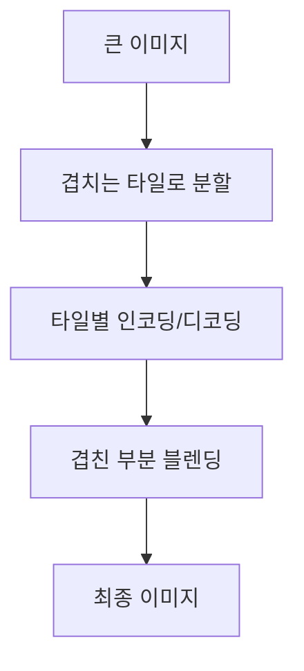
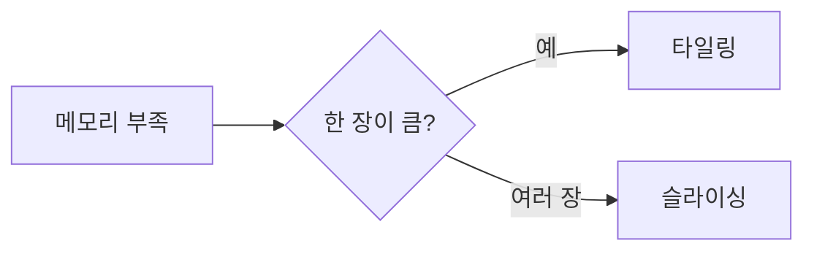

# VAE 타일링

> VAE 타일링은 큰 이미지를 겹치는 작은 타일로 나눠 인코딩·디코딩해서 해상도와 무관하게 메모리 사용을 일정하게 유지하는 기법이다.

## 쉽게 말하면
큰 포스터를 한 번에 스캔할 수 없으면 구역별로 나눠 스캔한 뒤 이어 붙이는 것과 같다. 스캐너(GPU 메모리)는 작아도 되지만 이음새 처리를 잘해야 한다.

## 자세히
HF diffusers 메모리 가이드(v0.42.1) 기준:
- 켜는 법: `pipeline.vae.enable_tiling()`. 타일끼리 겹치게 하고 섞어(blend) 이음새를 줄인다.
- 타일마다 따로 디코딩해서 타일 간 **색조 차이**가 약간 생길 수 있으나 뚜렷한 이음선은 없어야 한다.
- 지정 해상도 미만에서는 꺼져 있다(예: StableDiffusionPipeline의 VAE는 512x512).
- `AutoencoderKLWan`, `AsymmetricAutoencoderKL`은 타일링 미지원.
- 관련: **VAE 슬라이싱**(`enable_slicing()`)은 배치를 이미지 한 장씩 나눠 디코딩(여러 장 생성할 때 효과).
- 타일링 = 한 장 안의 공간 분할, 슬라이싱 = 배치 분할.

## 그림으로 보기



## 예시
```python
pipe.vae.enable_tiling()
pipe.vae.enable_slicing()
```
4K 근처 업스케일 때 디코딩 단계에서 OOM이 날 때 먼저 시도할 설정.

## 헷갈리는 것과 비교
| 개념 | 차이 |
|---|---|
| 타일링 | 한 이미지를 공간적으로 분할 |
| 슬라이싱 | 배치를 한 장씩 처리 |
| CPU 오프로딩 | 모델 부분을 CPU로 이동(느림) |
| [VAE](#vae-latent) | 타일링이 적용되는 모델 |

## 더 읽을거리
- [HF Reduce memory usage](https://huggingface.co/docs/diffusers/optimization/memory) — 타일링·슬라이싱·오프로딩.
- [HF AutoencoderKL](https://huggingface.co/docs/diffusers/api/models/autoencoderkl) — tiled_encode 설명.
