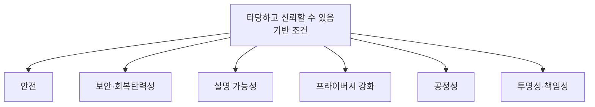

# 타당하고 신뢰할 수 있음

> NIST AI RMF 1.0이 꼽은 신뢰할 수 있는 AI의 특성 중 맨 아래에 놓인 기반 조건. AI가 의도한 용도에 맞게(타당) 기대한 조건과 기간 동안 요구대로 작동하는(신뢰) 것으로, 이것이 없으면 다른 특성이 의미가 없다.

## 쉽게 말하면
체중계가 정확하지 않으면 아무리 디자인이 예쁘고 안전해도 쓸모가 없다. 먼저 "맞게, 꾸준히 작동하는가"가 되어야 공정성·보안·설명 가능성을 따질 수 있다.

## 자세히
출처: NIST AI 100-1(AI RMF 1.0, 2023) §3.1과 Fig. 4(PDF를 내려받아 읽음).
- **기반 조건**: 그림 4 설명은 Valid & Reliable을 다른 특성이 얹히는 필요조건으로 둔다.
- **타당성(validation)**: ISO 9000:2015 정의 인용 — 특정 의도 용도의 요구가 충족됐다는 객관적 증거에 의한 확인. 부정확하거나 훈련 밖 환경에 잘 일반화되지 않는 AI를 배치하면 위험이 커지고 신뢰가 줄어든다.
- **신뢰성(reliability)**: ISO/IEC TS 5723:2022 — 주어진 조건에서 주어진 기간 동안 고장 없이 요구대로 수행하는 능력. 기대 사용 조건과 시스템 수명 전체에 걸친 전반적 정확성을 목표로 한다.
- **정확도(accuracy)**: 결과가 참값에 가까운 정도. 오탐·미탐률 같은 계산 지표뿐 아니라 사람-AI 협업, 훈련 조건 밖에서도 통하는 외적 타당성을 고려하고, **기대 사용 조건을 대표하는 현실적 테스트 세트와 방법론 문서를 항상 짝지어** 적으며, 데이터 구간별 분해 결과를 포함할 수 있다.
- **강건성·일반화**: 다양한 상황에서 성능을 유지하는 능력. 예상치 못한 용도·환경에서도 사람에게 해를 최소화하게 동작해야 한다. NIST는 **정확도와 강건성이 서로 긴장할 수 있다**고 쓴다.
- **운영 중 확인**: 배치된 시스템의 타당성·신뢰성은 지속 테스트·모니터링으로 확인하는 경우가 많고, 어떤 실패는 더 큰 해를 낳으므로 고려해야 한다. 오류를 스스로 못 고치면 사람 개입이 필요할 수 있다.

## 그림으로 보기

## 예시
- 진료 노트 AI: 평균 정확도 95%라는 숫자만으로는 부족하다. 어떤 진료과·억양·소음 조건의 테스트 세트였는지와 구간별 결과가 같이 있어야 타당성 주장이 된다.
- 운영 점검: 출시 3개월 후 새 환자군에서 오류율이 오르는지 월별 모니터링.

## 헷갈리는 것과 비교
| 개념 | 차이 |
|---|---|
| 타당성 | 의도한 용도에 맞는가(목적 적합) |
| 신뢰성 | 시간·조건에 걸쳐 일관되게 작동하는가 |
| 정확도 | 참값과의 근접도, 타당성의 한 부분 |
| 강건성 | 다양한 상황에서 성능 유지, 정확도와 긴장 |
| [신뢰 특성 간 상충](#trustworthiness-tradeoffs) | 특성끼리 균형을 맞추는 문제 |
| [TEVV 문서화](#tevv-docs) | 정확도 주장에 붙이는 테스트 세트·방법 기록 |

## 더 읽을거리
- [NIST AI RMF 1.0 (AI 100-1) PDF](https://nvlpubs.nist.gov/nistpubs/ai/nist.ai.100-1.pdf) — §3.1 정의와 인용 ISO 표준(열어서 확인)
