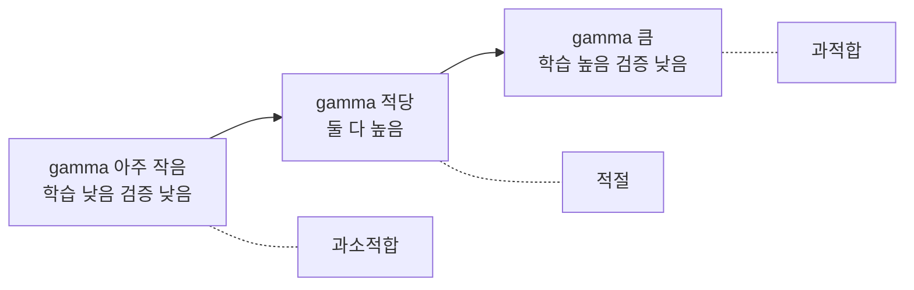
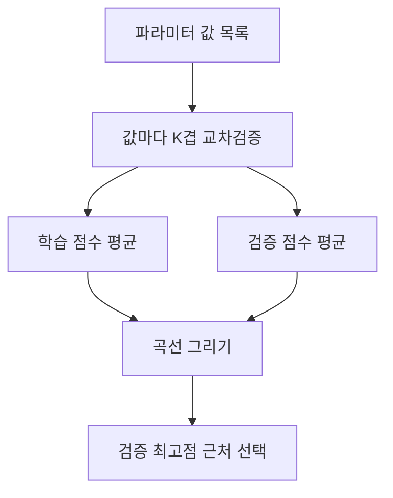

# 검증 곡선

> 검증 곡선은 모델의 하이퍼파라미터 하나를 바꿔 가며 학습 점수와 검증 점수를 나란히 그린 그래프다. 어느 값에서 과소적합이고 어느 값에서 과적합인지 한눈에 보여 준다.

## 쉽게 말하면
라디오 주파수를 돌리며 잡음 크기를 재는 것과 같다. 다이얼을 너무 한쪽으로 돌리면 신호가 안 잡히고(과소적합), 반대쪽으로 너무 돌리면 연습 때만 잘 들리고 실전에서는 잡음이 낀다(과적합). 두 점수 곡선을 같이 보면 가장 또렷한 지점을 찾는다.

## 자세히
- **정의(scikit-learn 학습 곡선 문서, 열람)**: `validation_curve(estimator, X, y, param_name=..., param_range=...)`는 학습 점수와 검증 점수를 `(파라미터 값 수, 폴드 수)` 모양 배열 두 개로 돌려준다. 그림만 필요하면 `ValidationCurveDisplay.from_estimator`가 한 번에 그린다.
- **읽는 법(문서)**: 둘 다 낮으면 과소적합(편향 큼), 학습은 높은데 검증이 낮으면 과적합(분산 큼), 둘 다 높으면 적절. 학습 점수는 낮은데 검증 점수가 높은 경우는 보통 나오지 않는다.
- **직접 해 본 실험(숫자 손글씨 `load_digits` 1,797개, SVC의 `gamma`, 5겹)**:

| gamma | 학습 | 검증 |
| --- | --- | --- |
| 1e-6 | 0.157 | 0.158 |
| 1e-5 | 0.920 | 0.885 |
| 1e-4 | 0.982 | 0.947 |
| 1e-3 | 0.999 | 0.972 |
| 1e-2 | 1.000 | 0.696 |
| 1e-1 | 1.000 | 0.103 |

  gamma 1e-6에서는 둘 다 0.16 안팎으로 과소적합, 1e-3에서 검증 점수가 최고(0.972), 그 이상에서는 학습은 1.000인데 검증이 0.103까지 무너져 전형적인 과적합이다. 검증 점수가 최고인 지점이 고를 값이다.
- **한계(해석)**: 한 번에 파라미터 하나만 본다. 여러 파라미터를 함께 튜닝하면 격자 탐색을 쓰고, 이때 선택에 쓴 검증 점수는 낙관적이므로 최종 평가는 별도 시험 세트나 중첩 교차검증으로 한다(문서도 같은 이유를 든다).
- **로그 간격**: 값 범위가 넓으면 `np.logspace`로 로그 눈금을 쓴다.

## 그림으로 보기

## 예시
- 코드: `train, val = validation_curve(SVC(), X, y, param_name="gamma", param_range=np.logspace(-6,-1,6), cv=5)` 후 `val.mean(axis=1)`의 최댓값 위치를 찾는다.
- 의사결정나무 `max_depth`를 1~20으로 바꿔 깊이가 커질수록 학습은 1.0에 붙고 검증은 떨어지는 지점을 찾는 실습. 교육 활용: 학습자가 "과적합"을 그림으로 처음 이해하는 장면.

## 헷갈리는 것과 비교
| 개념 | 차이 |
| --- | --- |
| 검증 곡선 | x축이 하이퍼파라미터 값 |
| [학습 곡선](#learning-curve) | x축이 학습 데이터 크기 |
| [홀드아웃 vs 교차검증](#holdout-vs-cv) | 각 점수를 어떻게 얻는지 |
| [교차검증 점수 보고법](#cv-score-reporting) | 점수를 어떻게 적는지 |

## 더 읽을거리
- [scikit-learn: Validation curves](https://scikit-learn.org/stable/modules/learning_curve.html) — validation_curve, ValidationCurveDisplay, 과소·과적합 읽는 법
