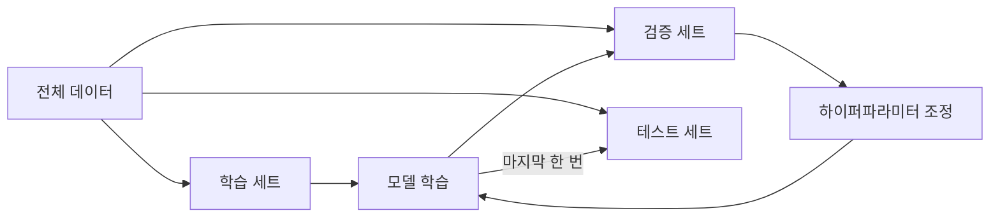

# 검증 세트 (Validation Set)

> 학습 중에 모델 선택·하이퍼파라미터 조정에 쓰려고 따로 떼어 둔 데이터로, 최종 평가용 테스트 세트와 구분한다.

## 쉽게 말하면
모의고사(검증)와 수능(테스트)의 관계다. 모의고사로 공부법을 고치되, 수능 문제를 미리 보고 고치면 점수가 부풀려져 진짜 실력을 모른다.

## 자세히
scikit-learn 교차 검증 문서(2026-11 확인):
- **테스트 세트에서 하이퍼파라미터를 조정하면** 테스트 정보가 모델에 "새어 들어" 일반화 성능을 더 이상 반영하지 못한다.
- 해법인 3분할: 학습 세트로 학습 → **검증 세트로 평가·조정** → 실험이 잘되면 **테스트 세트로 최종 평가**.
- 단점: 데이터를 세 조각으로 나누면 학습에 쓸 표본이 크게 줄고, 어떤 (학습, 검증) 쌍을 뽑았느냐에 결과가 좌우된다 → **교차 검증**이 대안. 테스트 세트는 여전히 따로 두고, 학습 세트를 k개 폴드로 나눠 k−1개로 학습, 나머지로 검증하고 평균한다.
- 누수 주의: 표준화·특징 선택 같은 전처리도 **학습 세트에서만 학습**해 검증·테스트에 적용해야 한다(`Pipeline` 사용). 시계열은 섞으면 점수가 부풀므로 `TimeSeriesSplit`, 같은 환자처럼 그룹이 있으면 `GroupKFold`.
- 딥러닝에서는 검증 손실로 [조기 종료](#early-stopping)와 [체크포인트 선택](#checkpoint-selection)을 한다.

## 그림으로 보기

## 예시
LLM 프롬프트 개선도 마찬가지: 프롬프트를 고치는 데 쓰는 예시 집합(검증)과 최종 성능 보고용 집합(테스트)을 분리해야 과적합을 피한다.

## 헷갈리는 것과 비교
| 개념 | 차이 |
|---|---|
| 학습 세트 | 가중치를 학습 |
| 검증 세트 | 조정·선택에 사용 |
| 테스트 세트 | 최종 1회 평가 |
| [중첩 교차검증](#nested-cross-validation) | 튜닝과 평가를 완전히 분리하는 방식 |

## 더 읽을거리
- [scikit-learn: Cross-validation](https://scikit-learn.org/stable/modules/cross_validation.html) — 3분할·교차 검증·누수.
