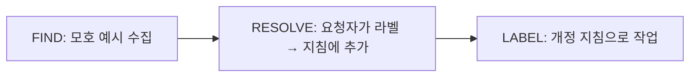
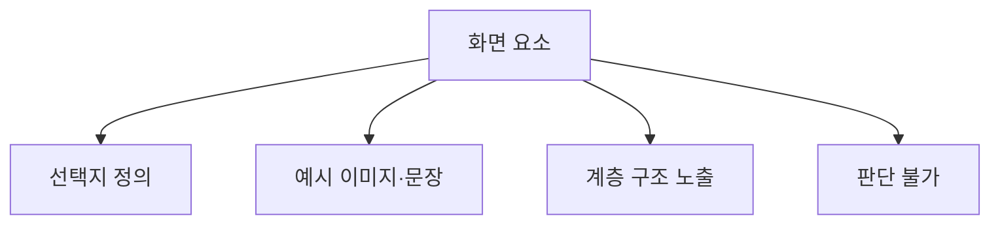

# 검증 화면 설계

> 검증 화면 설계는 작업자(또는 검수자)가 후보 라벨이 맞는지 판정하는 화면을 어떻게 구성할지 정하는 일이다. 선택지 문구, 예시 이미지, 안내문, 계층 구조 노출 방식에 따라 같은 사람이라도 판정 정확도가 달라진다.

## 쉽게 말하면
같은 시험 문제라도 보기가 헷갈리게 쓰여 있거나 예시가 없으면 점수가 낮아진다. 시험지(화면)를 잘 만드는 것도 채점 품질의 일부다.

## 자세히
- **모호한 예시를 안내문에 넣기(Pradhan·Schaekermann·Lease, arXiv 2112.02255 초록)**: FIND-RESOLVE-LABEL 3단계 워크플로. ① FIND: 작업자가 지침상 정답이 모호해 보이는 예시를 찾아 짧은 태그를 붙인다 ② RESOLVE: 요청자가 플래그된 예시 하나 이상에 라벨을 달아 지침에 명확화 예시로 자동 추가한다 ③ LABEL: 개정된 지침으로 라벨링한다(예시만/태그만/둘 다의 세 변형 비교). 이미지 라벨링 MTurk 실험에서 정확도가 개선됐다고 보고하지만 초록에는 수치가 없다. 검색 요약에는 무작위 예시보다 핵심 모호 예시를 보여 줄 때 성과가 좋다고 나온다(본문 미정독).
- **계층 구조 노출(Stureborg·Dhingra·Yang, CHI 2023, 검색 요약)**: 백신 오정보 라벨링에서 계층 라벨용 UI 6종, 18,000건 이상 주석을 비교했고 계층 구조에 명시적으로 접근하게 하면 어려운 질문에서 성능이 오른다고 한다. 본문은 열어 보지 않았다.
- **설계 체크리스트(해석)**: ① 선택지는 서로 겹치지 않게, 정의 한 줄 + 예시 이미지/문장 ② 모호한 쌍(혼동 쌍)은 비교 예시를 나란히 ③ "판단 불가" 선택지 제공([판단 불가 선택지](#cannot-decide-option)) ④ 후보 라벨을 먼저 보여 줄지(확인 속도↑, 닻 효과로 편향↑)와 숨길지 선택 ⑤ 시범 라운드에서 소수 작업자로 먼저 시험.
- **주의(해석)**: UI 개선 효과는 작업마다 달라서 소규모 A/B 비교로 확인한다.

## 그림으로 보기

## 예시
- 감정 분류 화면에 "긍정/중립" 비교 예시 3쌍을 보여 주고, 소규모 A/B로 일치도를 비교한다.
- 교육 활용: 같은 문항을 설명 없이/예시 포함으로 풀어 보게 하고 판정이 어떻게 달라지는지 비교한다.

## 헷갈리는 것과 비교
| 개념 | 차이 |
| --- | --- |
| 검증 화면 설계 | 판정 화면 구성 |
| 라벨 가이드 | 문서로 된 판정 규칙 |
| [작업자 품질 관리](#worker-quality-control) | 사람을 거르는 방법 |
| [판단 불가 선택지](#cannot-decide-option) | 화면의 한 요소 |

## 더 읽을거리
- [In Search of Ambiguity: A Three-Stage Workflow Design to Clarify Annotation Guidelines for Crowd Workers (arXiv 2112.02255)](https://arxiv.org/abs/2112.02255) — FIND-RESOLVE-LABEL
