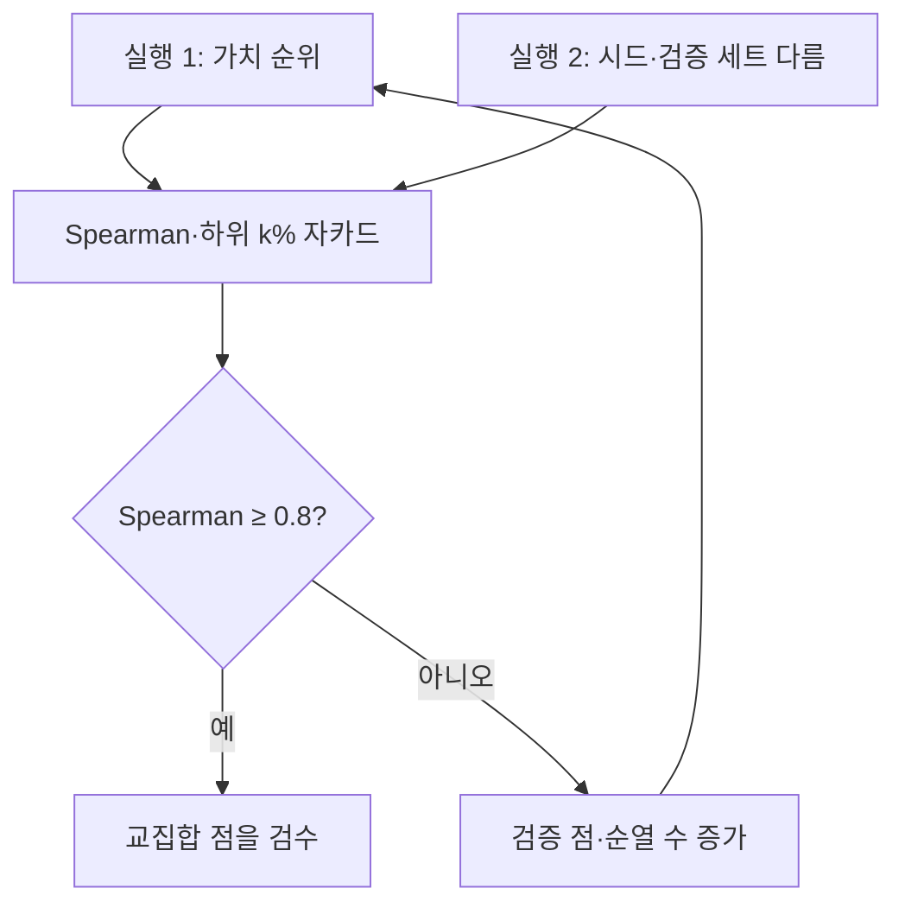
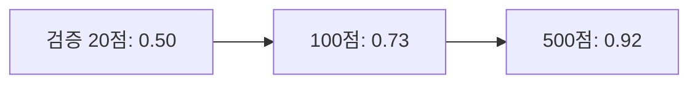

# 가치 순위 안정성

> 데이터 가치는 **어떤 검증(테스트) 점·시드·표본으로 계산했느냐**에 따라 달라진다. 같은 알고리즘을 독립적으로 두 번 돌려도 순위가 크게 다르면, 하위 k%를 검수하거나 삭제하는 결정을 믿을 수 없다.

## 쉽게 말하면
같은 선생님이 다른 날 다른 문제로 학생 순위를 매겼는데 순위가 많이 바뀐다면 그 순위로 장학금을 정하기 어렵다. 가치 순위가 두 번 돌려도 비슷한지 확인하는 일이다.

## 자세히
- **OpenDataVal의 평가 방식(arXiv 2306.10577 본문 확인)**: 노이즈 탐지 결과를 **50회 독립 실험**의 평균과 **95% 신뢰구간 오차 막대**로 보고한다. 알고리즘들의 성능을 세 군으로 나눈 것도 이 반복 측정에 근거한다. 반복하지 않은 단일 결과로는 순위 차이가 잡음인지 알 수 없다.
- **직접 실험(순수 파이썬, KNN-Shapley)**: 2차원 합성 데이터(두 클래스, 학습 400개 중 **10%인 40개 라벨 뒤집기**, K=5)에서 **서로 독립인 두 검증 세트**로 값을 계산해 순위를 비교(6쌍 평균). 검증 점 수 n_test에 따라:
  | 검증 점 수 | 두 실행 순위의 Spearman | 하위 10% 집합의 겹침(자카드) | 하위 10%의 실제 오라벨 정밀도 |
  |---|---|---|---|
  | 20 | 0.499 | 0.334 | 0.40 |
  | 100 | 0.731 | 0.506 | 0.479 |
  | 500 | 0.916 | 0.723 | 0.546 |
  검증 점이 20개일 때는 두 번 돌린 순위 상관이 0.5, 하위 10% 집합이 3분의 1만 겹친다. 500개로 늘리면 순위가 0.92로 안정되고 정밀도도 0.40→0.55로 올랐다(가상 데이터 한 설정). **가치 순위의 안정성은 검증 세트 크기에 크게 좌우된다.** 하위 10% 중 오라벨 비율이 55%에 그치므로 나머지 45%는 정상이다([삭제하지 않기](#valuation-vs-deletion)).
- **불안정의 원천**
  1. 검증 세트가 작아 점마다 성능 잡음 큼([LOO 잡음](#loo-noise-sensitivity)).
  2. 몬테카를로 순열 수 부족([샤플리 수렴](#shapley-convergence-check)).
  3. 학습 모델의 시드·미니배치.
  4. 점 가치 간격이 작음(비슷한 점들이 많을 때).
  5. 데이터 분할(학습/검증)의 무작위성.
- **점검 절차(권장)**
  1. **독립 실행 두 번 이상**: 시드·검증 세트 분할을 달리해 순위 Spearman과 하위 k% 자카드를 계산.
  2. **기준**: Spearman < 0.8 또는 자카드 < 0.6이면 검증 점 수·순열 수를 늘린다(경험 기준, 근거는 위 표의 추세).
  3. 최종 의사결정은 **여러 실행에서 공통으로 하위에 든 점**(교집합)만 대상으로 한다.
  4. 보고 시 "K회 독립 실행, 순위 상관 평균 ± 표준편차"를 함께 적는다.
- **한계**: 위 수치는 KNN-Shapley·가상 2차원 데이터의 한 설정. 다른 알고리즘·데이터에서는 안정성이 다르다.

## 그림으로 보기



## 예시
```python
v1 = compute_values(train, val_split_seed=0)
v2 = compute_values(train, val_split_seed=1)
print("Spearman:", spearman(v1, v2), "하위10% 자카드:", jaccard(low10(v1), low10(v2)))
common = low10(v1) & low10(v2)           # 두 실행 모두 하위인 점만 검수
```
- 사내 문서 가치 평가에서 검증 질의를 100개에서 500개로 늘려 순위 안정성이 0.73→0.92로 개선되는지 보고서에 포함.

## 헷갈리는 것과 비교
| 개념 | 설명 |
|---|---|
| 순위 안정성 | 독립 실행 간 순위 일치 |
| 정밀도 | 하위 k% 중 실제 오라벨 비율 |
| 수렴 | 순열 수 증가에 따른 안정 |
| [알고리즘 선택](#algorithm-selection-by-task) | 안정성도 고려 대상 |

## 더 읽을거리
- [OpenDataVal (arXiv 2306.10577)](https://arxiv.org/abs/2306.10577) — 50회 독립 실험·95% 구간 평가(PDF 본문 확인). 안정성 표는 이 글의 직접 시뮬레이션.
