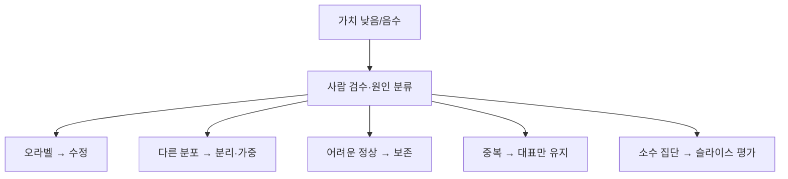
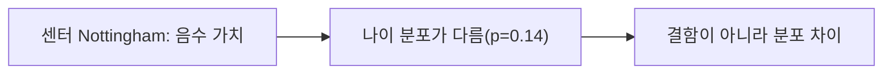

# 가치 평가 결과로 삭제하지 않기

> 데이터 가치가 낮거나 음수라는 것은 **"삭제하라"가 아니라 "검토하라"** 는 신호다. 낮은 값에는 오라벨뿐 아니라 **다른 분포의 정상 데이터, 어려운 예시, 소수 집단, 중복 군집**이 섞여 있어 일괄 삭제하면 모델이 약해질 수 있다.

## 쉽게 말하면
체온계 점수가 낮게 나온 직원을 곧바로 해고하지 않고 "측정기가 다른 부서 기준이었나?" 확인부터 한다. 낮은 값은 의심 목록일 뿐 판결이 아니다.

## 자세히
- **Data Shapley 논문의 실험(Ghorbani & Zou, arXiv 1904.02868 본문 확인)**
  - 가치가 높은 점부터 제거하면 성능이 크게 떨어지고, 가치가 **낮은 점부터 제거하면 오히려 성능이 좋아졌다**(유방암·피부암 예측, UK Biobank, 학습 1,000명 균형 데이터, 로지스틱 회귀 정확도 68.7%·56.4%).
  - 가치를 낮게 평가된 새 환자를 추가하면 성능이 **나빠질 수 있다**(후보 풀 2,000명 중 추정 가치 순 추가 실험).
  - **음수 가치가 데이터 결함이 아닌 사례**: 22개 의료 센터에서 수집한 데이터에서 대장암 예측 시 한 센터(Nottingham)가 뚜렷한 **음수 가치**였다. 저자들은 원인을 그 센터의 표현형 분포가 전체 인구와 다르기 때문이라고 가설을 세웠다. 전체 인구에서는 나이가 대장암 진단의 가장 강한 특징(KS 검정 p=1.5e−6)인데 이 센터에서는 건강인과 환자의 나이 분포 차이가 유의하지 않았다(p=0.14). 즉 **데이터가 틀린 게 아니라 이 모델·검증 분포에 맞지 않았다.**
- **낮은 값이 나오는 이유 목록**
  | 원인 | 삭제해도 되나 |
  |---|---|
  | 오라벨·오염 | 수정 또는 삭제 |
  | 다른 분포(센터·시기·기기) | 삭제 말고 분리·가중·별도 모델 검토 |
  | 어려운 정상 예시 | 보존(가장 가치 있는 경계 사례일 수 있음) |
  | 소수 집단 | 삭제 금지, 슬라이스 평가 |
  | 중복 군집 | 대표 하나만 남기기 |
  | 검증 세트가 해당 분포를 대표하지 않음 | 검증 세트 재검토 |
- **삭제로 생기는 해악**: 소수 집단을 지워 [평균이 가린 약한 집단](#average-masking-weak-groups)을 키우거나, LOO 0의 복제본을 함께 지워 정보가 사라진다([중복 대체](#duplicate-data-substitution)).
- **안전한 절차(권장)**
  1. 하위 k%를 **사람이 검수**해 원인을 분류([노이즈 라벨 탐지](#data-valuation-for-label-noise)).
  2. 원인별 조치: 수정/보존/분리/가중.
  3. 삭제 실험은 **별도 검증 세트**에서 점진적으로 하고 최종 확인은 시험 세트와 슬라이스별로.
  4. 되돌릴 수 있게 원본을 보관하고 삭제 사유를 기록.
- **Data Shapley 논문의 대안**: 음수 값 삭제만이 아니라 **가치로 가중해 재학습**하는 방법(저비용 웹 이미지 학습 시 음수 삭제+가중)도 쓴다. 다만 이것도 목표 분포에 적응하는 맥락에서 평가한 결과다.
- **한계**: 가치는 모델·효용·검증 세트에 의존한다([효용 함수 선택](#utility-function-choice)).

## 그림으로 보기



## 예시
```python
low = np.argsort(phi)[: int(0.05 * len(phi))]
review_table = df.iloc[low].assign(reason="")   # 사람이 reason 열(오라벨/분포/어려움/중복)을 채움
# 삭제는 reason == "오라벨"일 때만, 나머지는 보존·분리
```
- 지점별 고객 데이터에서 한 지점의 가치가 음수라면 삭제 전에 그 지점 고객 특성(연령·상품)이 다른지 먼저 비교.

## 헷갈리는 것과 비교
| 접근 | 위험 |
|---|---|
| 낮은 가치 일괄 삭제 | 소수·어려운 사례 손실 |
| 낮은 가치 검토 후 조치 | 안전 |
| 낮은 가치 가중 학습 | 분포 적응에 유용, 검증 필요 |
| [음수 데이터 가치](#negative-data-value) | 해로운 점 개념 |

## 더 읽을거리
- [Data Shapley (arXiv 1904.02868)](https://arxiv.org/abs/1904.02868) — 제거 실험·센터별 음수 가치 사례(PDF 본문 확인).
