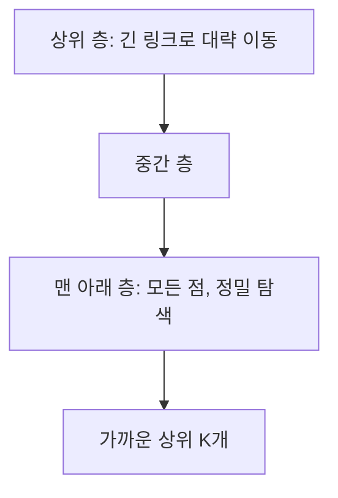
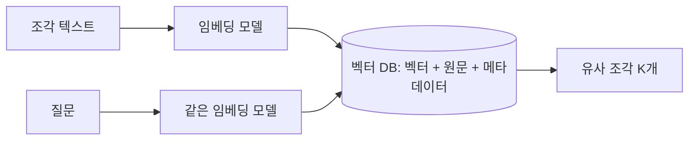

# 벡터 DB

> 임베딩 벡터를 저장하고, 질문 벡터와 가장 가까운 벡터를 빠르게 찾아 주는 데이터베이스.

## 쉽게 말하면
도서관에서 책을 제목 순서가 아니라 "내용이 비슷한 책끼리 가까운 서가"에 꽂아 두었다고 하자. 질문이 오면 사서는 그 질문이 놓일 자리로 가서 근처 책 몇 권만 집어 온다. 모든 책을 하나씩 대조하지 않으므로 빠르다. 대신 가끔 가장 가까운 책을 놓칠 수 있다.

## 자세히
- 저장 대상: 벡터(보통 수백~수천 차원의 숫자 배열) + 원문 조각 + 메타데이터(출처, 날짜 등).
- 핵심 연산은 **최근접 이웃(nearest neighbor) 검색**. 수백만 개를 전수 비교하면 느리므로 **근사(ANN, Approximate Nearest Neighbor)** 인덱스를 쓴다.
- 대표 인덱스 **HNSW**(Pinecone 설명, 확인 2026-11-02): 스킵 리스트처럼 그래프를 여러 층으로 쌓는다. 위층은 긴 링크로 대충 이동, 아래층은 짧은 링크로 정밀 탐색한다. 맨 위에서 가장 가까운 점으로 이동한 뒤 한 층씩 내려온다.
- 주요 파라미터: **M**(노드당 링크 수, 클수록 정확하지만 메모리 증가), **efConstruction**(인덱스 구축 시 후보 수), **efSearch**(검색 시 후보 수, 클수록 정확하지만 느림). 같은 글에서 재현율과 속도는 대략 80%·1ms ↔ 100%·50ms 범위로 오간다고 예시한다.
- 거리 척도는 코사인 유사도, 내적, 유클리드 등. 임베딩 모델이 권장하는 척도를 쓴다.
- 메타데이터 필터(예: 2026년 문서만)와 [하이브리드 검색](#hybrid-search-bm25)을 지원하는지가 제품 선택의 기준이 된다.
- 종류: 전용 서비스(Pinecone 등), 오픈소스(Qdrant, Weaviate, Milvus, Chroma), 기존 DB 확장(PostgreSQL pgvector). 문서가 수만 건 이하면 pgvector나 파일 기반으로도 충분한 경우가 많다.

## 그림으로 보기

## 예시
- 사내 문서 검색: 1만 문서를 청킹해 저장, 질문 벡터로 상위 5개 조각을 찾아 LLM에 전달.
- 튜닝: 답이 자꾸 빠지면 efSearch를 올려 재현율을 높이고, 지연이 문제면 내린다.

## 헷갈리는 것과 비교
| 개념 | 차이 |
| --- | --- |
| 벡터 DB | 의미 유사도로 찾음. 근사 검색이라 일부 놓칠 수 있음 |
| 관계형 DB | 정확한 조건(=, 범위)으로 찾음 |
| 키워드 검색 엔진 | 단어 일치 기반. [BM25](#hybrid-search-bm25) |
| [청킹](#chunking) | DB에 넣기 전 문서를 나누는 단계 |

## 더 읽을거리
- [Hierarchical Navigable Small Worlds (Pinecone)](https://www.pinecone.io/learn/hnsw/) — HNSW 원리와 파라미터.
