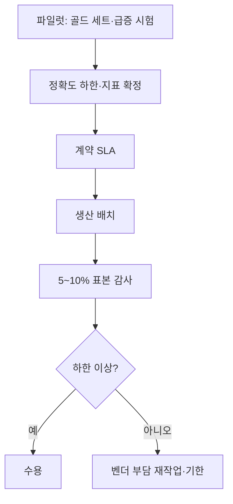
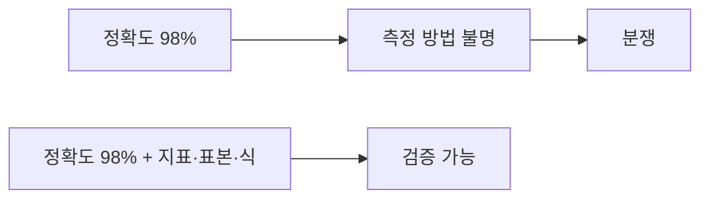

# 라벨링 벤더 SLA

> 라벨링을 외주 업체(벤더)에 맡길 때 **정확도 기준, 측정 방법, 납기, 재작업 조건, 감사 권리, 데이터 삭제**를 계약서에 구체적인 숫자와 방법으로 적어 두는 합의서다. "품질을 보장한다"는 말만으로는 분쟁 때 아무것도 증명되지 않는다.

## 쉽게 말하면
이삿짐센터와 계약할 때 "깨끗이 옮겨 드립니다"가 아니라 "파손이 있으면 며칠 안에 얼마를 배상한다"까지 적는 것과 같다. 무엇을, 어떻게 재고, 기준 미달이면 누가 무엇을 하는지가 숫자로 들어가야 한다.

## 자세히
(Label Studio 학습 센터의 "벤더 파일럿" 글을 직접 열어 확인했고, 계약 항목 개관은 검색 결과의 벤더 글 요약이다. 합격 판정 확률은 직접 계산. 법률 자문이 아니다.)
- **Label Studio 글의 권고(직접 확인)**
  - **골드 세트** 최소 50~100건: 흔한 사례와 오류가 잦은 사례를 포함하고 라벨마다 근거를 문서화. 생산 시작 전 최소 점수를 통과해야 하는 "평가 관문"으로 쓴다(통과 점수는 글에 없음). 일회성 5,000건 미만에 규제 노출이 낮으면 공식 골드 세트가 과할 수 있다고 한다.
  - **측정 방법 명시**: 정확도가 Cohen의 카파인지 단순 일치율인지 적는다. 주관적 과제에서 일치율 98%가 카파로는 80%대 초반일 수 있다고 한다.
  - **감사 표본**: 생산 배치의 5~10%를 골드 세트 기준으로 점검.
  - **정확도 하한(floor)**: 파일럿 결과를 보고 정해 **계약서에 구체적 숫자로 적는다**(일반적인 "SLA 준수"가 아니라). 기본값은 제시하지 않는다.
  - **재작업 조항**: 배치 정확도가 하한 미만이면 벤더가 **추가 비용 없이** 재작업하고, 해당 배치 등급의 원래 납기의 **50% 이내**에 끝낸다(글의 예시).
  - **데이터 파기**: 프로젝트 종료 후 30일 이내 삭제와 파기 증명서, 생산 시작 전에 검증.
  - **급증 시험**: 파일럿 마지막 날 평소 일일 물량의 2배를 맡겨 SLA를 맞추는지 본다. 파일럿 초기 수백 건은 설정 잡음이 있으므로 후반부 표본을 더 엄격히 본다.
  - **진단**: 일관성 오류가 많으면 지침을 고치고, 정확도 오류가 많으면 벤더를 바꾼다.
- **검색 결과의 일반 항목(벤더 글, 권위 있는 표준 아님)**: 정확도 보장은 측정 프로토콜과 표본 비율 없이는 검증이 불가능하다는 경고, 클래스별 점수(안전상 중요한 소수 클래스가 집계에서 가려질 수 있음), 감사 권리, 데이터 IP·거주지. 정확도 목표 수치(단순 분류 98~99%, 복잡·주관 95~97% 등)는 글마다 달라 참고만 한다.
- **직접 계산 1: 일치율과 카파**: 두 라벨러 일치율이 98%여도 양성 비율이 5%이면 카파가 **0.789**, 20%이면 0.937, 50%이면 0.96. 불균형이 클수록 같은 일치율이 낮은 카파가 된다. 계약에서 지표를 못 박아야 하는 이유다.
- **직접 계산 2: 표본 감사의 판정 오류(합격선 95%, 표본 정답수가 합격선 미만이면 불합격, 이항분포)**
  | 표본 크기 | 진짜 97%일 때 불합격 확률 | 95% | 93% | 90% |
  |---|---|---|---|---|
  | 50 | 19% | 46% | 69% | 89% |
  | 100 | 8% | 38% | 71% | 94% |
  | 200 | 4% | 42% | 83% | 99% |
  표본 50건으로는 진짜 정확도 97%인 정상 배치를 19%가 불합격 처리할 수 있고, 93%인 나쁜 배치도 31%는 합격시킨다. **합격선에 오차 허용(예: 표본 정확도 하한을 두고 구간으로 판정)과 표본 크기를 함께 계약**하지 않으면 분쟁이 생긴다(제안).
- **체크리스트(제안)**: ① 지표(정확도·카파·클래스별)와 계산식 ② 표본 크기·추출 방식(무작위)·누가 정답을 정하나 ③ 하한과 판정 규칙(표본 오차 허용) ④ 재작업 기한과 비용 부담 ⑤ 납기와 급증 처리 ⑥ 감사 권리 ⑦ 데이터 보안·삭제([외부 라벨러 비밀 유지](#external-labeler-confidentiality)) ⑧ 지침 변경 절차.

## 그림으로 보기

## 예시
- 고객 문의 의도 라벨링 5만 건 외주: 골드 100건으로 파일럿, 지표는 클래스별 정확도와 카파, 하한 95%, 표본 감사 200건으로 합격선과 오차 허용 구간을 계약에 명시.
- 교육 소재: "AI 데이터 외주 계약서에서 꼭 숫자로 적을 5가지"를 실습 자료로.

## 헷갈리는 것과 비교
| 개념 | 차이 |
|---|---|
| 라벨링 벤더 SLA | 외주 품질·납기·재작업 조건을 계약화 |
| [관리형 인력 라벨링](#managed-workforce-labeling) | 벤더가 인력을 관리하는 방식 |
| [외부 라벨러 비밀 유지](#external-labeler-confidentiality) | 보안·비밀 조항 |
| [골드 문항 노출과 교체](#gold-question-leak) | 골드 세트 관리 시 유출 위험 |

## 더 읽을거리
- [How to run a pilot before committing to an annotation vendor (Label Studio)](https://labelstud.io/learningcenter/how-to-run-a-pilot-before-committing-to-an-annotation-vendor) — 골드 세트, 측정 방법, 정확도 하한, 재작업 조항(직접 확인, 벤더 글).
