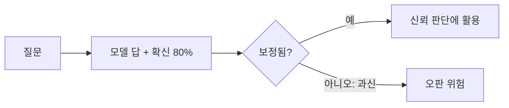

# 말로 표현한 확신

> 말로 표현한 확신(verbalized confidence)은 모델이 "80% 확신합니다"처럼 자기 답의 확신을 문장이나 숫자로 직접 말하게 하는 방법이다.

## 쉽게 말하면
시험 답안에 "이 문제 확신도 70%"라고 적는 것과 같다. 그런데 학생이 늘 자신만만하면 숫자는 참고가 안 된다.

## 자세히
검색으로 확인한 연구 요약(2차 정리, 원문 전부 열람은 아님):
- 핵심 문제는 **과신**: 말한 확신이 평균 정확도를 웃도는 경향이 보고된다(Self-Generated Distractors 연구).
- 보정이 맥락·분야에 따라 들쭉날쭉하고 보정 오차가 최대 44%라는 연구도 있다(의인화된 불확실성 논문 인용).
- 개선 시도: 확신을 말로 표현하도록 미세조정하는 **ConfTuner**(2025), 자기 생성 오답 보기로 보정하는 방법 등. 향상은 과제별이라는 보고.
- 쓰는 법: 확신 숫자를 그대로 믿지 말고, 근거 인용·재질문·여러 번 샘플링의 일치도와 함께 본다.

## 그림으로 보기

## 예시
프롬프트: "답과 함께 확신도를 0~100%로 말하고, 확신이 낮은 이유를 한 줄로 써 줘." 결과를 정답과 비교해 우리 업무에서 맞는지 따로 검증한다.

## 헷갈리는 것과 비교
| 개념 | 차이 |
|---|---|
| 말한 확신 | 모델이 말로 표현 |
| 내부 확률(logit) | 토큰 확률, 말과 다를 수 있음 |
| [헤징 문구의 효과](#hedging-language-effects) | 표현이 사용자 신뢰에 미치는 영향 |

## 더 읽을거리
- [ConfTuner (arXiv 2508.18847)](https://arxiv.org/pdf/2508.18847) — 말로 확신을 표현하도록 학습.
- [Self-Generated Distractors (arXiv 2509.25532)](https://arxiv.org/html/2509.25532v1) — 말한 확신이 정확도보다 높다는 보고.
