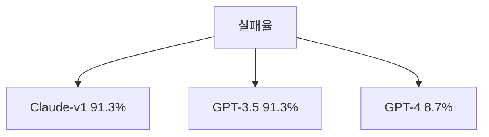

# 장황함 편향

> LLM 심판이 **명확성·정확성이 더 낮아도 길고 장황한 답을 더 좋게 평가하는** 경향.

## 쉽게 말하면
발표에서 말이 길고 항목이 많으면 왠지 성실해 보이는 착시와 같다. 같은 내용을 반복해 길이만 늘려도 점수가 오른다.

## 자세히
Zheng 외 (arXiv 2306.05685, PDF 본문 직접 읽음):
- 시험 방법 — **"repetitive list(반복 목록)" 공격**: MT-bench 답 중 번호 목록이 있는 **23개**를 골라, GPT-4에게 목록을 새 정보 없이 다시 쓰게 한 뒤 원 목록 앞에 붙였다(5항목이면 10항목, 앞 5개는 재서술). 심판이 새(장황한) 답이 낫다고 하면 공격 성공.
- 결과(실패율): **Claude-v1 91.3%, GPT-3.5 91.3%, GPT-4 8.7%**. 모든 모델이 편향에 취약할 수 있으나 GPT-4가 훨씬 잘 방어했다.
- 보정: 동일한 두 답에는 항상 무승부를 냈다. 즉 단순한 동일성 판별은 되는데 이 정교한 공격은 못 넘었다.
- 한계: 2023년 모델 기준 실험이고 인위적으로 만든 공격이라 실제 대화에서 편향의 크기와 같지는 않다(해석).
- 완화(일반 방법, 이 논문에서 검증한 것은 아님): 평가 기준에 "길이에 영향받지 말라"고 명시(논문 부록 프롬프트에 그런 문구가 있다), 길이를 통제한 비교, 정답 참조.

## 그림으로 보기

## 예시
- 같은 조언을 두 번 말하게 늘린 답이 간결한 답을 이김.
- 교육: 짧고 정확한 답과 길고 반복적인 답을 AI 심판에게 비교시키는 실습.

## 헷갈리는 것과 비교
| 개념 | 차이 |
|---|---|
| 장황함 편향 | 길이를 품질로 착각 |
| [위치 편향](#position-bias) | 순서에 영향 |
| [자기 선호 편향](#self-preference-bias) | 자기 스타일 선호 |

## 더 읽을거리
- [Judging LLM-as-a-Judge (arXiv 2306.05685)](https://arxiv.org/abs/2306.05685) — Table 3 반복 목록 공격(읽음).
