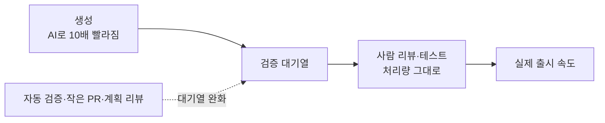
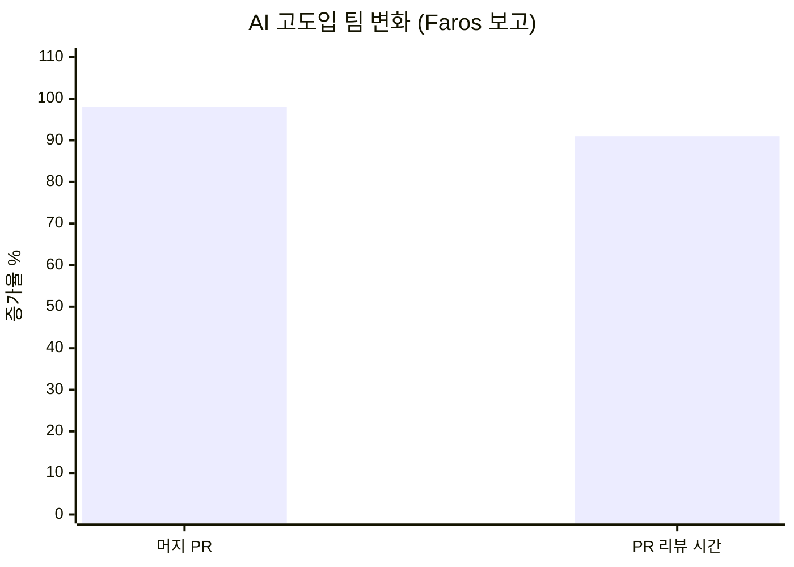

# 검증 병목

> AI가 코드를 만드는 속도가 빨라질수록 **병목은 "생성"에서 "검증(리뷰·테스트·확인)"으로 옮겨 간다.** 만들어진 양이 늘어도 사람이 확인할 수 있는 양은 그대로이므로, 검증을 자동화·구조화하지 않으면 전체 속도는 오르지 않거나 품질이 떨어진다.

## 쉽게 말하면
공장에서 조립 로봇을 10배 빠르게 바꿨는데 검수 담당자는 그대로면, 검수 대기 줄만 길어진다. 속도는 가장 느린 공정이 정한다.

## 자세히
- **보고된 관찰들**(출처별 구분, 대부분 2차 정리를 거친 수치이므로 인용 전 1차 확인 필요):
  - **METR 무작위 대조 실험**(2025-07, 원문 확인): 숙련 오픈소스 개발자 16명이 실제 이슈 246개를 AI 허용/불허로 무작위 배정해 작업한 결과 AI를 쓸 때 **19% 더 오래** 걸렸다. 개발자들은 24% 빨라질 것으로 기대했고, 끝난 뒤에도 약 20% 빨라졌다고 **믿었다**. METR은 이 결과가 오래된 것이며 2026년 초 데이터의 후속 연구를 냈다고 밝힌다(작은 표본·특정 환경이라는 한계).
  - **Faros AI 2025 텔레메트리**(내 지식 기반의 정리, 1차 미확인): AI를 많이 쓰는 팀은 머지된 PR이 +98%였지만 **PR 리뷰 시간은 +91%**, PR 크기는 +154%였고 회사 단위 성과와의 상관은 유의하지 않았다고 보고(벤더 보고).
  - **DORA 2025**(지식 기반 정리, 1차 미확인): AI 도입은 처리량과는 +, **배포 안정성과는 계속 −**. 테스트·버전 관리·빠른 피드백이 약한 팀에서는 변경량 증가가 불안정으로 이어진다고 해석.
- **왜 병목이 되나**: ① AI가 만든 큰 변경은 리뷰하기 어렵고, ② 자신 있어 보이는 오답이 섞이며, ③ 테스트가 약하면 "통과"가 신뢰를 주지 못한다([테스트 조작 방지](#test-tampering)).
- **완화 방법**:
  1. **계획을 먼저 검토**(작은 계획 리뷰가 큰 PR 리뷰보다 싸다 — [SDD](#sdd)).
  2. **작은 작업 단위**로 쪼개 PR을 작게([작업 분해](#tasks-breakdown)).
  3. **기계적 검증**: 린터·구조 테스트·타입·CI([기계적 제약](#mechanical-constraints)).
  4. **에이전트가 앱을 직접 조작해 증거를 남기게**(브라우저 E2E, 스크린샷·영상).
  5. 사람의 검증은 **판단이 필요한 지점**(요구 해석, 위험 변경)에 집중.
- 한계: 생산성 연구는 환경(숙련도·과제·도구·시점)에 따라 결과가 크게 달라 일반화가 어렵다.

## 그림으로 보기

## 예시
- 팀이 AI로 PR을 하루 10개 → 30개로 늘렸는데 리뷰어는 2명 그대로 → 리뷰 대기 증가. 대응: PR 크기 상한, 자동 테스트 필수, 계획 승인 후 구현.
- 교육 포인트: "AI가 얼마나 많이 만들었나"가 아니라 "얼마나 검증했나"를 지표로 삼는다.

## 헷갈리는 것과 비교
| 개념 | 차이 |
|---|---|
| 검증 병목 | 확인 공정이 전체 속도를 제한 |
| [테스트 조작 방지](#test-tampering) | 검증 수단이 속지 않게 지키기 |
| [단위·통합·E2E 테스트](#test-types) | 검증을 자동화하는 수단 |
| [기계적 제약](#mechanical-constraints) | 일부 검증을 린터로 자동화 |

## 더 읽을거리
- [METR: Early-2025 AI experienced open-source developer study](https://metr.org/blog/2025-07-10-early-2025-ai-experienced-os-dev-study/) — 무작위 대조 실험 원문.
