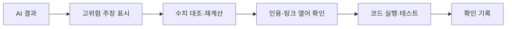
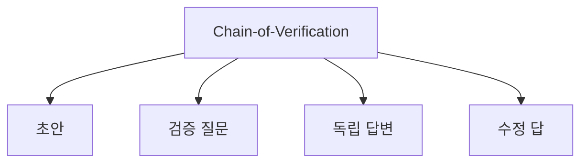

# 검증 체크리스트

> AI 결과를 쓰기 전에 **수치·인용·코드를 어떤 순서로 확인할지** 정해 둔 점검표. 확인 대상을 위험도가 큰 것부터 줄 세우는 것이 요령이다.

## 쉽게 말하면
비행 전 점검표와 같다. 기억에 의존하지 않고 항목을 순서대로 확인하면 중요한 것을 빠뜨리지 않는다.

## 자세히
- 근거 1(책임): AI Fluency 용어 요약(Anthropic, 열람 2026-11-28)은 배포 diligence를 **"쓰거나 공유하는 결과를 검증하고 보증할 책임"**이라 부른다. 결과물 평가는 정확성·적절성·일관성·관련성을 본다([결과물 평가](#product-discernment)).
- 근거 2(모델 스스로 검증하게 하는 방법): Dhuliawala 외 *Chain-of-Verification*(arXiv 2309.11495, 초록 읽음)은 4단계 — **초안 작성 → 초안의 주장을 확인할 질문 나열 → 초안을 보지 않고 그 질문에 답하기 → 수정된 최종 답** — 를 제안하고, Wikidata 목록형 질문·폐쇄형 MultiSpanQA·장문 생성에서 환각이 줄었다고 보고한다(초록에 수치 없음).
- 점검표(내 정리, 검증된 처방 아님):
  1. **고위험 주장 표시**: 숫자, 날짜, 인명, 법·규정 인용, 의료·재무 조언
  2. **수치**: 원 출처의 숫자와 대조, 단위·기간 확인, 직접 재계산
  3. **인용·링크**: 실제로 존재하는지 열어 보고, 말한 내용이 정말 그 문서에 있는지 확인
  4. **코드**: 실행해 보고 테스트를 돌린다. 보안·권한 관련 코드는 별도 검토
  5. **논리**: 결론이 근거에서 나오는지, 반례는 없는지
  6. **기록**: 무엇을 어디서 확인했는지 남긴다(투명성)
- 위험이 클수록 사람이 직접 확인한다. 모델에게 "다시 확인해"라고만 시키는 것은 같은 오류를 반복할 수 있다(일반 지적, 이번 출처에서 검증하지 않음).

## 그림으로 보기

## 예시
- AI가 쓴 보도자료의 통계 4개를 원 보고서 쪽수까지 확인해 표로 기록.
- 교육: 수강생이 AI 답변 하나를 받아 위 6단계 점검표를 채워 보는 실습.

## 헷갈리는 것과 비교
| 개념 | 차이 |
|---|---|
| 검증 체크리스트 | 사람이 따르는 점검 순서 |
| Chain-of-Verification | 모델이 스스로 검증하는 프롬프트 절차 |
| [과정 평가](#process-discernment) | 추론 단계를 점검 |

## 더 읽을거리
- [Chain-of-Verification](https://arxiv.org/abs/2309.11495) — 모델 자체 검증 절차(초록 읽음).
- [AI Fluency 용어 요약(Anthropic PDF)](https://www-cdn.anthropic.com/4396730ed190e691a3712cf2fd6bfe35509deca2.pdf) — 배포 diligence(읽음).
