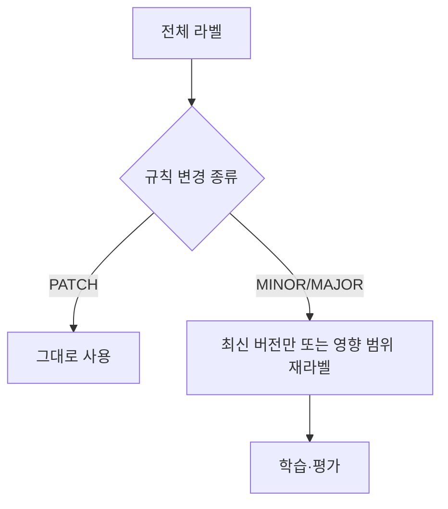

# 버전 기준 학습 데이터 필터

> 라벨 규칙서가 바뀐 뒤에는 옛 버전 규칙으로 붙은 라벨과 새 버전 라벨이 섞여 모델이 모순된 기준을 배운다. 라벨에 저장한 규칙서 버전으로 최신 버전 라벨만 학습·평가에 쓰거나, 옛 라벨을 재검토해 섞어 쓴다.

## 쉽게 말하면
시험 채점 기준이 바뀐 뒤 옛 기준으로 채점한 답안과 새 기준 답안을 섞어서 "정답 예시집"을 만들면, 학생은 헷갈린다. 새 기준 답안만 쓰거나 옛 답안을 새 기준으로 다시 채점해야 한다.

## 자세히
- **직접 실험(scikit-learn 로지스틱 회귀, 가상 1차원 데이터. 규칙 v1: x>0이면 1, 규칙 v2: x>0.8이면 1. 옛 v1 라벨 2,000개, 새 v2 라벨 300개, v2 규칙 기준 시험 5,000개)**:

| 학습 데이터 | v2 기준 시험 정확도 |
| --- | --- |
| v1 + v2 섞음(옛 라벨 그대로) | 0.755 |
| v2 라벨 300개만 | 0.989 |
| v1 2,000개를 v2 규칙으로 재라벨 + v2 300개 | 0.994 |

  옛 기준 라벨 2,000개가 섞이면 새 라벨 300개만 쓴 것보다 정확도가 0.23 낮다. 새 기준 샘플이 적어도 일관된 기준이 중요하다. 재라벨이 가능하면 더 많은 데이터를 일관되게 쓸 수 있어 가장 좋다. 이 실험은 단순화된 합성 설정이며 실제 규칙 변화는 일부 경계에만 영향을 줄 수 있다.
- **필터 방식(해석)**:
  1. **최신 버전만 사용**: 새 라벨이 충분할 때(`guideline_ver >= v2.0.0`).
  2. **영향 범위만 제외·재검토**: 규칙 변경이 일부 클래스·경계에만 해당하면 그 부분만 [재검토 검색식](#relabel-query)으로 찾아 재라벨, 나머지는 유지.
  3. **버전 가중치**: 옛 버전 라벨에 낮은 가중치(비권장, 효과는 직접 검증 필요).
  4. **PATCH 변경은 필터 불필요**([의미 변경 vs 표현 보강 버전](#semantic-vs-patch-version)).
- **평가셋 주의(해석)**: 평가셋도 같은 버전 기준으로 고정한다([평가셋 고정](#evaluation-set-freeze)). 버전이 다른 평가셋으로 잰 점수는 비교할 수 없다.
- **운영(해석)**: 라벨 행에 `guideline_ver`를 숫자 열로 저장해 필터하고([라벨 메타데이터 기록](#annotation-metadata-tracking)), 학습 실행 기록에 사용한 버전 조건을 남긴다.

## 그림으로 보기

## 예시
- 코드: `df[df.guideline_major >= 2]`로 최신 버전만 학습. 평가셋도 `guideline_major == 2`로 고정.
- 교육 활용: 위 실험 코드를 돌려 섞었을 때 정확도 변화를 확인한다.

## 헷갈리는 것과 비교
| 개념 | 차이 |
| --- | --- |
| 버전 필터 | 학습 데이터에서 옛 기준 라벨 제외 |
| 재라벨링 | 옛 라벨을 새 기준으로 고침 |
| [규칙서를 git으로 관리](#guideline-in-git) | 버전의 출처 관리 |
| [재검토 검색식](#relabel-query) | 영향받는 라벨 찾기 |

## 더 읽을거리
- [scikit-learn 사용자 가이드: LogisticRegression](https://scikit-learn.org/stable/modules/linear_model.html#logistic-regression) — 실험에 사용한 모델
