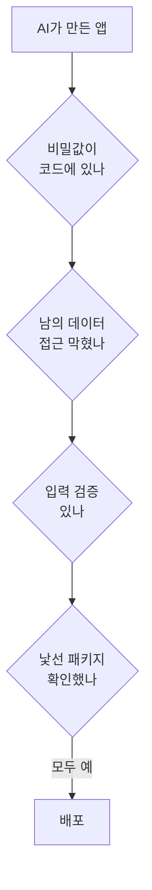

# 바이브코딩 보안·검토

> 코드를 읽지 않고 AI에게 맡겨 만든 앱이 갖기 쉬운 보안·품질 위험과, 배포 전에 점검하는 최소 항목.

## 쉽게 말하면
설계도를 안 보고 지은 집에 입주하는 것과 같다. 겉은 멀쩡해도 현관 열쇠를 문 앞에 두었거나 배선이 엉켜 있을 수 있다. 입주 전 점검표를 한 번 훑으면 사고 대부분을 막는다.

## 자세히
자주 나오는 위험(일반 보안 상식, OWASP 등 웹 보안 지침이 다루는 영역):
1. **비밀값 노출**: 키를 코드·프론트에 넣음 → [환경 변수와 비밀 관리](#secrets-env).
2. **접근 제어 누락**: 로그인만 확인하고 "내 데이터인지"는 검사하지 않음. 남의 주문 번호만 바꿔도 보임.
3. **입력 검증 누락**: 사용자 입력을 그대로 DB 질의·화면에 넣음(SQL 인젝션, XSS).
4. **의존성 위험**: AI가 제안한 낯선 패키지(존재하지 않는 이름을 지어낼 때도 있음). 설치 전 이름·다운로드 수·저장소 확인.
5. **개인정보**: 필요 이상 수집·로그에 평문 저장 → [개인정보와 저작권](#privacy-copyright).
6. **AI 기능 자체의 위험**: 외부 텍스트로 지시를 바꾸는 [프롬프트 인젝션](#prompt-injection).
- 점검 습관: 배포 전 AI에게 "보안 관점으로 이 코드를 리뷰"를 시키되, 결과를 맹신하지 말고 위 6항목은 사람이 직접 확인. 테스트와 [Git](#git-basics) 커밋으로 되돌릴 수단을 확보.

## 그림으로 보기

## 예시
- 점검 프롬프트: "이 앱에서 로그인한 사용자 A가 사용자 B의 데이터를 볼 수 있는 경로를 찾고, 재현 방법과 수정안을 알려 줘."
- 배포 전 `git grep -i "api_key\|secret"`으로 하드코딩 검색.

## 헷갈리는 것과 비교
| 개념 | 차이 |
| --- | --- |
| 인증 | 누구인지 확인(로그인) |
| 인가 | 그 사람이 이것을 해도 되는지 확인 |
| 코드 리뷰 | 사람이 읽고 판단. AI 리뷰는 보조 |

## 더 읽을거리
- [OWASP Top 10](https://owasp.org/www-project-top-ten/) — 웹 앱 보안 위험 인식용 표준 문서(2025판이 최신으로 표기됨)
