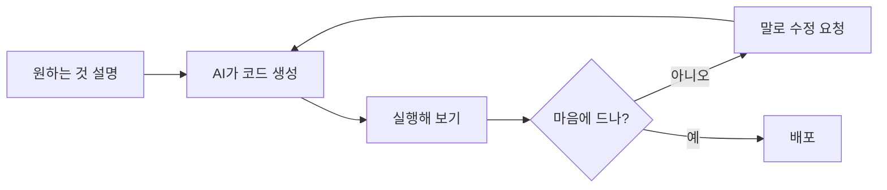
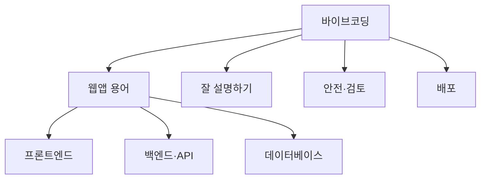

# 바이브코딩

> 코드를 한 줄씩 짜는 대신 AI에게 말로 원하는 것을 설명하고, 나온 결과를 돌려 보며 다듬어 웹앱·도구를 만드는 방식.

## 쉽게 말하면
건축가에게 "채광 좋은 거실, 아이 방은 조용하게"라고 말하면 도면이 나오는 것과 같다. 벽돌 쌓는 법은 몰라도 된다. 대신 완성물을 눈으로 보고 "여기 창을 더 키워 줘"라고 계속 고쳐 달라고 한다.

## 자세히
- 용어는 Andrej Karpathy가 2025년 2월 초 만들었다. 요지는 "분위기(vibes)에 몸을 맡기고 코드가 있다는 사실을 잊는" 것(Willison 블로그 인용).
- 좁은 의미(Simon Willison): **LLM이 쓴 코드를 검토하지 않고** 만드는 것. 검토·테스트·이해까지 했다면 그건 바이브코딩이 아니라 AI 보조 개발이다. 일상에서는 두 가지를 섞어 쓰는 경우가 많다.
- 잘 맞는 곳: 개인 도구, 프로토타입, 내부 업무용 앱. 안 맞는 곳: 결제·보안·개인정보가 걸린 운영 서비스(검토 없이는 위험).
- 입문자가 자주 막히는 이유는 코드가 아니라 **용어**다. 프론트엔드·백엔드·API·DB·배포 같은 웹앱 용어를 알아야 AI에게 정확히 시킬 수 있다.
- 기본 루프: 설명 → 생성 → 실행해 보기 → 오류·불만을 말로 전달 → 반복.

## 그림으로 보기

## 예시
- "한 화면짜리 할 일 앱. 추가·완료 체크·삭제, 새로고침해도 남게 해 줘." → 브라우저 저장소로 동작하는 앱이 나온다.
- 오류가 나면 화면 메시지를 그대로 붙여 "이 오류 고쳐 줘"라고 한다.

## 헷갈리는 것과 비교
| 개념 | 차이 |
| --- | --- |
| 바이브코딩 | 코드 검토 없이 결과 중심 |
| [AI 보조 개발](#ai-assisted-coding) | 전문가가 검토·테스트하며 AI를 도구로 사용 |
| 노코드 | 미리 만든 블록을 조립. AI가 코드를 생성하지는 않음 |
| [웹앱 기본 용어](#webapp-terms) | 바이브코딩을 잘 시키려면 필요한 어휘 |

## 더 읽을거리
- [Simon Willison — Vibe coding](https://simonwillison.net/2025/Mar/19/vibe-coding/) — 정의와 AI 보조 개발과의 구분
- [Vibecoding University 채널](https://www.youtube.com/@VibecodingUniversity/videos) — 사용자 추천 강의. 이번 실행에서는 자막 접근이 막혀 내용은 반영하지 못함(추후 보강)
