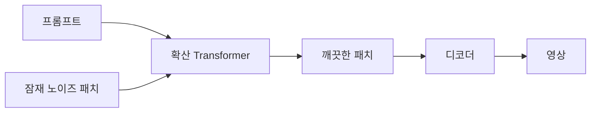
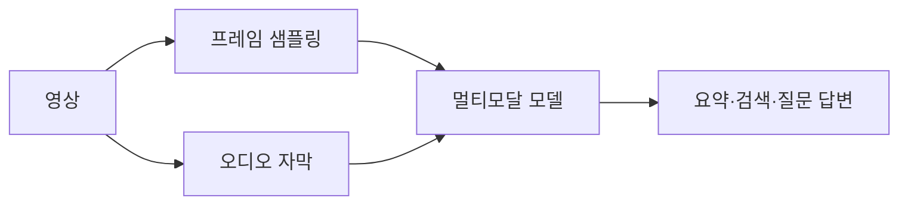

# 영상 이해와 생성

> 영상을 보고 요약·검색·질의응답하는 "이해"와, 글이나 이미지로 새 영상을 만드는 "생성"을 아우르는 AI 분야.

## 쉽게 말하면
영상은 "사진을 시간 순서로 이어 붙인 것"이다. 이해는 영화를 보고 줄거리를 말해 주는 평론가, 생성은 시나리오를 받아 촬영해 오는 감독이다. 사진 한 장보다 훨씬 많은 데이터가 들고, 프레임 사이의 움직임이 자연스러워야 해서 훨씬 어렵다.

## 자세히
- **이해**: 영상을 프레임(과 오디오)으로 쪼개 [멀티모달](#multimodal) 모델에 넣어 요약, 장면 검색, 질문 답변을 한다. 긴 영상은 프레임을 솎아 보내거나 자막(ASR, [음성 인식](#speech-asr-tts))과 함께 쓴다. 이 지도의 자료 수집도 자막 추출 뒤 요약하는 방식이다.
- **생성(Sora 계열)**: OpenAI 설명 기준 텍스트 조건 확산 모델을 영상·이미지에 학습시키며, 영상을 잠재 공간으로 압축한 뒤 시공간 패치(spacetime patches) 단위로 잘라 Transformer가 처리한다. 패치는 영상판 토큰이다. 모델은 노이즈 낀 패치와 프롬프트를 받아 깨끗한 패치를 예측한다. 한 프레임짜리로 만들면 이미지가 된다.
- 주의: Sora의 세부 구조는 OpenAI가 전부 공개하지 않았고, 일부 해설은 공개 자료 기반 추정이다. Veo 등 다른 모델은 이번에 직접 확인하지 못했다.
- 어려운 점: 시간적 일관성(인물·물체가 변하지 않기), 물리 법칙, 긴 길이, 높은 연산 비용, 딥페이크 악용.
- OpenAI는 영상 생성 모델을 "세계 시뮬레이터"로 가는 길로 보는데, 이는 연구자의 주장이다([월드 모델](#world-model)과 연결).

## 그림으로 보기

## 예시
- 이해: 1시간 강의 영상을 자막+핵심 프레임으로 나눠 "챕터별 요약과 시험 문제 5개".
- 생성: "카메라가 천천히 다가가는 비 오는 도시 야경, 8초" 프롬프트로 광고 시안.
- 확인할 점: 생성물 표시(워터마크·AI 표기) 정책.

## 헷갈리는 것과 비교
| 개념 | 차이 |
| --- | --- |
| 영상 이해 | 입력이 영상, 출력은 텍스트 |
| 영상 생성 | 입력이 텍스트·이미지, 출력이 영상 |
| [이미지 생성](#image-generation) | 시간 축 없음 |
| [월드 모델](#world-model) | 행동의 결과까지 예측, 로봇에 활용 |

## 더 읽을거리
- [Video generation models as world simulators (OpenAI)](https://openai.com/index/video-generation-models-as-world-simulators/) — 시공간 패치 설명
- [Sora 리뷰 논문 (arXiv 2402.17177)](https://arxiv.org/pdf/2402.17177) — 기술·한계 정리
