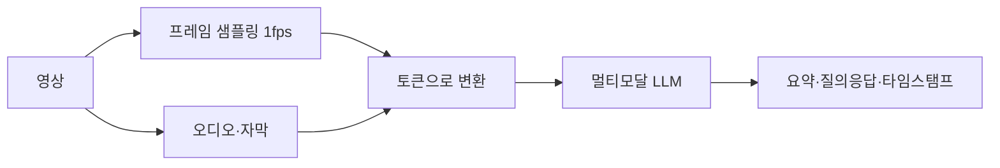
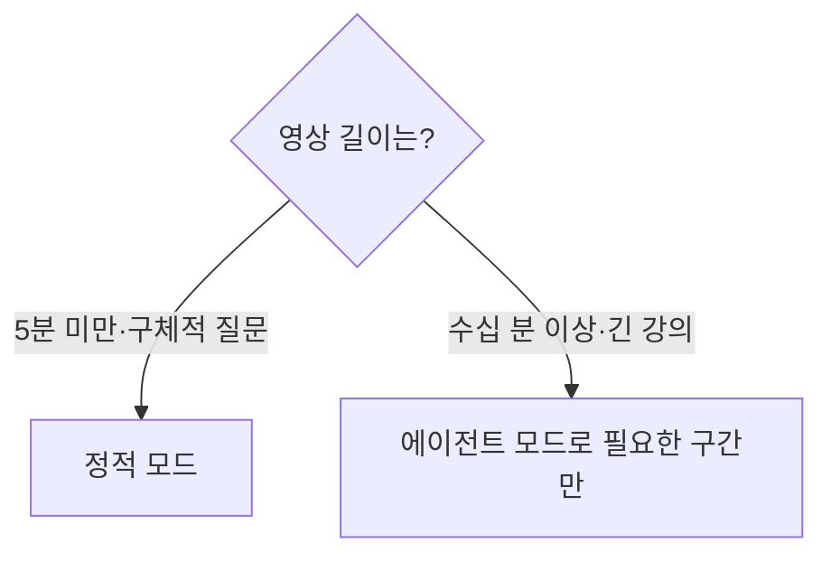

# 영상 이해와 요약

> 영상 이해는 AI가 영상의 장면·음성·자막을 함께 읽고 요약하거나 질문에 답하게 하는 일이다. 영상은 프레임(그림)과 오디오가 시간 순서로 이어진 데이터라, 어떻게 샘플링하고 어떻게 토큰으로 바꾸느냐가 비용과 정확도를 정한다.

## 쉽게 말하면
두 시간짜리 강의를 친구에게 요약해 달라고 맡기는 일이다. 친구가 1초에 한 장씩 스크린샷을 찍고 대사를 받아 적어 읽을 수도 있고(정적 방식), 목차를 보고 필요한 구간만 돌려 볼 수도 있다(에이전트 방식). 빠르게 지나가는 장면은 1초에 한 장으론 놓칠 수 있다.

## 자세히
Gemini API 문서(2026-11 확인) 기준:
- **입력 방법**: File API(유료 20GB·무료 2GB, 큰 파일·재사용), Cloud Storage 등록(2GB), 인라인(100MB 미만), 공개 YouTube URL(프리뷰, 무료).
- **정적 모드(기본)**: 1 FPS로 프레임을 뽑고 1초마다 타임스탬프를 붙인다. 빠른 움직임·장면 전환은 디테일이 손실될 수 있다. 구간 자르기(`start_offset`/`end_offset`)와 `fps` 조절(예: 0.5 = 2초에 1프레임)이 가능하다.
- **에이전트 모드**(일부 최신 모델, `"processing": "agentic"`): 모델이 타임라인을 돌아다니며 자막·프레임·오디오를 필요할 때만 불러온다. 문서는 긴 영상에서 토큰이 최대 88% 줄 수 있다고 하며, 5분 미만 짧은 영상·막연한 질문에는 오히려 지연·토큰이 늘 수 있다고 한다.
- **토큰 비용(정적)**: 낮은 해상도 약 100토큰/초, 높은 해상도 약 300토큰/초. 프레임은 66 또는 258토큰, 오디오는 32토큰/초.
- **한계**: 컨텍스트 1M 모델은 낮은 해상도로 3시간, 높은 해상도로 1시간. Gemini 2.5부터 요청당 영상 10개까지.
- **요령**: 시점은 `MM:SS`로 지칭, 영상 하나일 때 텍스트 프롬프트는 영상 뒤에 둔다.

직접 파이프라인을 짠다면 [Whisper](#whisper)로 자막을 만들고 핵심 프레임만 뽑아 LLM에 주는 방법도 있다(토큰 절약).

## 그림으로 보기

## 예시
- 1시간 교육 영상을 올리고 "12:30 부근의 실습 단계를 목록으로 정리해 줘"라고 질문한다.
- 자막이 없는 시연 영상은 프레임이 핵심이므로 영상 분석을, 말 위주 강의는 자막 요약이 더 싸다.

## 헷갈리는 것과 비교
| 개념 | 차이 |
| --- | --- |
| [영상 AI](#video-ai) | 상위 주제(이해+생성) |
| 영상 생성 | 새 영상을 만드는 쪽. 이해는 읽는 쪽 |
| 자막 요약 | 오디오 텍스트만 사용. 화면 정보는 놓침 |

## 더 읽을거리
- [Gemini API: Video understanding](https://aistudio.google.com/docs/video-understanding) — 입력·토큰·제한·에이전트 모드
