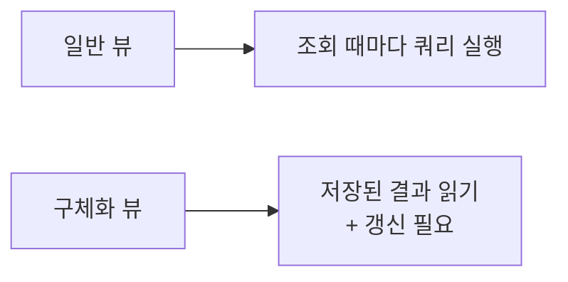
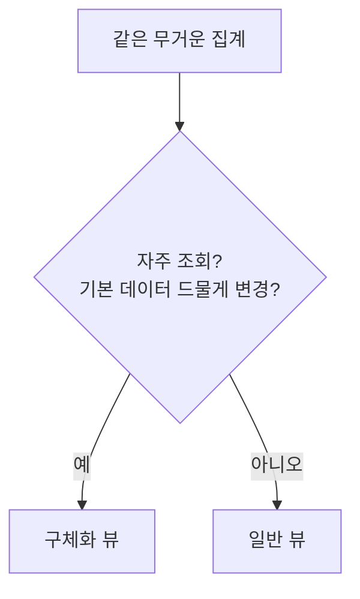

# 일반 뷰 vs 구체화 뷰

> **일반(논리) 뷰**는 쿼리 정의만 저장해 조회할 때마다 실행하고, **구체화 뷰**는 쿼리 **결과를 미리 계산해 저장**해 둔다. 저장 여부가 비용·속도·최신성의 차이를 만든다.

## 쉽게 말하면
일반 뷰는 "회계 담당에게 매번 계산을 시키는 지시서", 구체화 뷰는 "계산 결과를 적어 둔 요약표"다. 지시서는 늘 최신 장부로 계산하지만 매번 시간이 걸리고, 요약표는 즉시 보지만 장부가 바뀌면 고쳐 줘야 한다.

## 자세히
(BigQuery 구체화 뷰 문서 두 편을 직접 읽었다. 입문 문서는 구체화 뷰와 논리 뷰를 직접 비교하지 않고 개요 문서로 링크할 뿐이다. 이 글의 비교는 문서에서 확인한 구체화 뷰의 특성과 이 지도의 [구체화 뷰](#materialized-view) 글에 이미 있는 내용을 정리한 것이며, BigQuery 외 DB는 세부가 다르다.)
- **저장**: 일반 뷰는 쿼리 문장만 저장한다. 구체화 뷰는 결과 데이터를 저장하며, BigQuery에서는 백그라운드에서 기본 테이블의 변경에 맞춰 갱신한다(문서).
- **비용 구조(BigQuery 문서)**: 구체화 뷰는 조회(뷰와 필요한 기본 테이블 부분의 처리 바이트), **갱신**(갱신 중 처리 바이트), **저장**(저장 바이트)에 과금된다. 용량 기반이면 조회·갱신이 슬롯을 쓴다. 일반 뷰는 저장·갱신 비용이 없다(일반 지식).
- **최신성**: 일반 뷰는 조회 시 항상 최신 기본 데이터를 읽는다. 구체화 뷰는 갱신 주기와 [`max_staleness`](#max-staleness)에 따라 낡을 수 있으나, BigQuery 증분 뷰는 뷰 결과에 기본 테이블의 최근 변경분을 합쳐 최신 결과를 돌려준다(문서).
- **제약**: 구체화 뷰는 지원 SQL이 제한적이다(제한된 집계 함수, 중첩·외부 테이블·와일드카드 불가, 생성 후 쿼리 변경 불가, 기본 테이블 삭제 시 뷰가 깨짐 — 문서). 일반 뷰는 일반 쿼리로 자유롭게 정의한다.
- **자동 재작성**: 구체화 뷰는 [smart tuning](#smart-tuning)으로 기본 테이블 쿼리를 뷰로 자동 대체할 수 있다(증분 뷰만).
- **고르는 기준(해석)**
  - 같은 무거운 집계를 **자주** 조회하고, 기본 데이터가 **드물게** 바뀌고, 약간의 지연을 허용한다 → 구체화 뷰.
  - 조회가 드물거나 기본 데이터가 **자주** 바뀌거나, 쿼리가 복잡해 제약에 안 맞는다 → 일반 뷰.
  - 비용은 "조회 절감분 vs 저장+갱신 비용"으로 따진다.

## 그림으로 보기

## 예시
| 상황 | 선택 |
|---|---|
| 대시보드가 하루 수백 번 일별 매출 합계를 조회, 데이터는 시간당 한 번 갱신 | 구체화 뷰 |
| 가끔 쓰는 임시 분석용 필터 쿼리 | 일반 뷰 |
(예시 판단)
- 교육 소재: 요약표를 만들 가치가 있는 질문을 팀에서 골라 보기.

## 헷갈리는 것과 비교
| 항목 | 일반 뷰 | 구체화 뷰 |
|---|---|---|
| 저장 | 쿼리만 | 결과 데이터 |
| 조회 속도 | 매번 계산 | 저장 결과 활용 |
| 추가 비용 | 없음 | 저장+갱신 |
| 최신성 | 항상 최신 | 갱신·허용치에 의존 |
| SQL 제약 | 적음 | 큼 |

## 더 읽을거리
- [Introduction to materialized views (BigQuery)](https://docs.cloud.google.com/bigquery/docs/materialized-views-intro) — 비용·제약·증분(직접 읽음).
- [Create materialized views (BigQuery)](https://docs.cloud.google.com/bigquery/docs/materialized-views-create) — max_staleness와 갱신 설정(직접 읽음).
