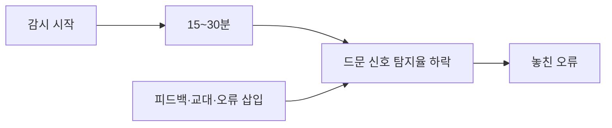
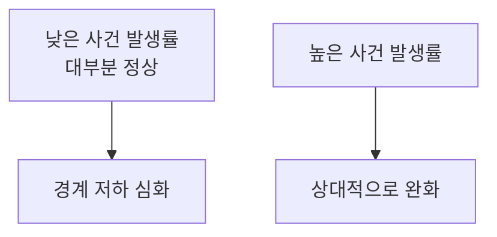

# 경계 저하

> 감시 과제에서 시간이 지날수록 드문 신호를 알아채는 능력이 떨어지는 현상(vigilance decrement). 레이더 감시 연구에서 출발했고, AI 출력을 검수하는 일처럼 "대부분 정상이고 가끔 오류가 섞인" 일에 그대로 적용된다.

## 쉽게 말하면
밤새 보안 카메라 화면을 보는 경비원을 생각해 보자. 처음 30분은 눈이 반짝이지만 아무 일도 안 일어나는 화면을 계속 보면 주의가 흐려진다. 정작 중요한 순간에는 놓치기 쉽다. AI가 만든 결과물을 수백 건 검수하는 사람도 비슷하다. 대부분 맞기 때문에 눈이 미끄러진다.

## 자세히
출처: 위키백과 Vigilance(psychology) 항목(직접 읽음), Mackworth 1948 논문의 서지와 요약은 검색 결과(원문은 열지 못함).
- **정의**: 위키백과가 인용한 Parasuraman(1986)의 정의는 "시간이 지남에 따라 중요한 신호에 경계를 유지하는 능력이 나빠지는 것"이다.
- **기원**: Norman Mackworth가 1948년 *Quarterly Journal of Experimental Psychology* 1권 6–21쪽에 발표한 "The breakdown of vigilance during prolonged visual search". 영국 공군의 2차 대전 레이더 요원 평가용으로 고안된 **Mackworth 시계 실험**: 한 바늘이 작은 걸음으로 움직이다 가끔 큰 점프를 하는데 이를 보고하게 한다. 약 2시간 진행.
- **결과(2차 요약)**: 탐지율이 첫 30분 사이 약 10~15% 떨어지고 이후 90분간 완만히 더 떨어진다(위키백과). 15분 안에 유의한 저하가 나타나기도 하고 과제 요구가 높으면 더 빠르다. 10~15% 수치는 이번에 1차 논문으로 확인하지 못했다.
- **원인 설명**: 옛 관점은 낮은 요구 때문의 각성 저하. 이후에는 경계 자체가 힘들고 스트레스를 주는 정신 노동이라는 관점. 신호탐지 분석상 저하가 감지 민감도 상실이 아니라 **반응 기준(편향)의 이동**일 수 있고, 습관화 설명은 약해졌다(위키백과).
- **영향 요인**: 사건 발생률(한 인용은 분당 24건을 기준으로 제시), 구분의 어려움, 신호의 두드러짐, 비슷한 비표적 신호, 피드백, 연습, 나이(결과 엇갈림). 개인 성적은 같은 과제에서는 일관되지만 과제 간에는 아닐 수 있다.
- **적용 분야**: 레이더·소나, 항공 관제, 제품 검사, 자동 항법, 보안 검색.
- **AI 검수에 대응(이 글의 정리)**: 오류율이 낮을수록 드문 신호 탐지가 어려워진다. 대응: ① 오류 삽입으로 주의 측정([오류 삽입 테스트](#seeded-error-testing)) ② 검수 시간 제한과 교대, 휴식 ③ 피드백(맞춘 오류를 보여 줌) ④ 한 번에 검수할 양 제한 ⑤ 로그로 검수 시간과 무수정 승인 비율 모니터링.

## 그림으로 보기

## 예시
- AI가 작성한 보고서 200건 중 오류가 3건뿐이라면 검수자는 점점 훑어보기만 하게 된다. 일부러 오류가 든 샘플을 몇 건 섞어 놓으면 주의를 유지하고 경계 수준도 측정할 수 있다(제안).
- 공항 보안 검색처럼 근무를 짧게 나누고 모의 위협 이미지를 섞는 방식이 이미 쓰인다(위키백과가 보안 검색 적용을 언급, 구체 방법은 일반 지식).

## 헷갈리는 것과 비교
| 개념 | 차이 |
|---|---|
| 경계 저하 | 시간 경과에 따른 감시 성능 하락 |
| [자동화 안주](#automation-complacency) | 자동 시스템을 믿어 감시를 덜 하는 현상 |
| [자동화 편향](#automation-bias) | 자동화 권고를 맹종 |
| 피로 | 일반적 체력·정신 소진. 경계 저하는 낮은 요구에서도 생김 |

## 더 읽을거리
- [Vigilance (psychology) — Wikipedia](https://en.wikipedia.org/wiki/Vigilance_(psychology)) — 정의·시계 실험·원인 설명(직접 읽음)
- [Mackworth Clock](https://en.wikipedia.org/wiki/Mackworth_Clock) — 실험 개요(검색 결과로만 확인)
