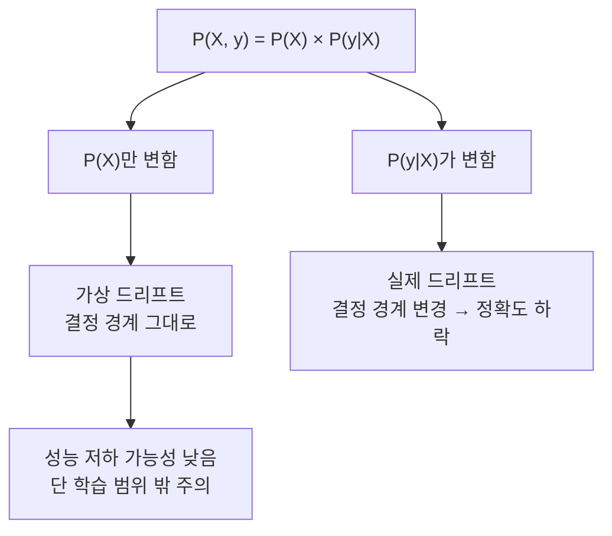

# 가상 드리프트

> 입력 분포 P(X)만 변하고 입력과 정답의 관계 P(y|X)는 그대로인 변화. 결정 경계는 바뀌지 않아 이론상 정확도가 반드시 떨어지지는 않는다. 흔히 말하는 **데이터 드리프트**에 해당한다.

## 쉽게 말하면
시험 문제의 채점 기준(정답 규칙)은 그대로인데 수험생 구성이 바뀐 상황이다. 규칙이 그대로면 모델이 배운 규칙은 여전히 맞다. 다만 모델이 본 적 없는 영역에서 규칙이 어긋날 위험은 남는다.

## 자세히
출처: Lu 외 "Learning under Concept Drift: A Review"(arXiv 2004.05785, 원문 PDF를 내려받아 읽음) + 이 세션의 직접 실험(합성 데이터).
- **정의(논문 2.1절)**: 결합 분포 P(X, y) = P(X) × P(y|X)에서 원인 I은 P(X)만 변하고 P(y|X)는 그대로인 경우로, P(X)의 드리프트는 **결정 경계에 영향을 주지 않아** 가상 드리프트(virtual drift)라 불린다. 반대로 P(y|X)가 변하면 결정 경계가 바뀌어 정확도가 떨어지는 **실제 드리프트**다. 현실에서는 둘이 함께 일어나 원인 III이 되는 경우가 많다고 논문이 적는다.
- **직접 실험(이 세션, 2만 건)**: 정답 규칙 P(y|X)는 고정(y = [x0 + 0.5·x1 + 잡음 > 0]), x0의 평균만 +1 이동한 새 입력 분포로 평가했다.
  - 선형 모델: 기준 정확도 0.768 → 입력 이동 후 **0.82**(오히려 상승)
  - 깊이 3 트리: 0.765 → **0.815**
  - x0 평균을 +4 이동해도 두 모델 모두 0.996
  - 해석: 규칙이 그대로면 입력 이동이 정확도를 떨어뜨리지 않았다. 이동 후 샘플이 경계에서 멀어져 과제가 쉬워졌기 때문으로 보인다. 이 설정은 학습 범위를 벗어나도 규칙이 선형으로 이어지는 단순한 경우이며, 복잡한 모델에서는 학습 범위 밖에서 정확도가 무너질 수 있다(이 실험으로 확인하지 못함).
- **실무 의미**: 입력 분포가 변했다는 경보([데이터 드리프트](#data-drift), [PSI](#psi))가 곧 성능 저하는 아니다. 그러나 가상 드리프트도 모델이 **학습하지 않은 영역**으로 입력이 가면 위험해지고, 분포 변화가 진짜 개념 변화와 함께 올 수 있으므로 라벨이 도착하면 성능을 확인한다.
- **대조**: [개념 드리프트](#concept-drift)(실제 드리프트)는 입력 분포가 같아도 정확도가 급락한다(이 세션의 [예측 드리프트](#prediction-drift) 실험에서 0.768 → 0.351).

## 그림으로 보기

## 예시
- 새 병원에서 환자 연령대가 더 높아져 입력 분포가 변했지만 진단 규칙은 같다면 가상 드리프트. 학습 데이터에 고령 환자가 충분했는지 확인.
- 점검: 분포가 이동한 영역이 학습 데이터가 덮은 범위 안인지(범위 밖이면 외삽 위험).

## 헷갈리는 것과 비교
| 개념 | 차이 |
|---|---|
| 가상 드리프트 | 입력 분포만 변함, 결정 경계 유지 |
| 실제 드리프트 = [개념 드리프트](#concept-drift) | 정답 관계 변화, 정확도 하락 |
| [데이터 드리프트](#data-drift) | 실무에서 가상 드리프트와 거의 같은 뜻으로 쓰임 |
| 공변량 이동(covariate shift) | 같은 현상의 통계 용어(이번 출처에서 직접 확인하지 못함) |

## 더 읽을거리
- [Learning under Concept Drift: A Review (arXiv 2004.05785)](https://arxiv.org/abs/2004.05785) — 드리프트의 세 원인(원문 확인)
