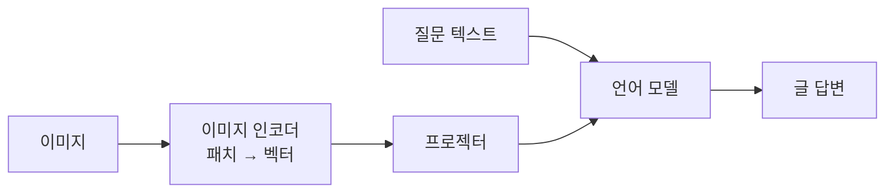
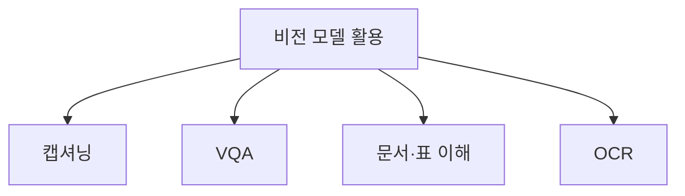

# 비전 모델

> 이미지를 이해하는 AI. 요즘은 이미지와 글을 함께 받아 글로 답하는 비전-언어 모델(VLM)이 중심이다.

## 쉽게 말하면
사진을 보는 눈(이미지 인코더)과 말하는 입(언어 모델)을 통역사(프로젝터)로 이어 붙인 것이다. 눈이 본 걸 LLM이 알아듣는 숫자 말로 바꿔 주면, 입이 "이 사진엔 영수증이 있고 합계는…"처럼 답한다.

## 자세히
Hugging Face "Vision Language Models Explained"(2024-04) 등 기준:
- **구조**: 비전 인코더 + 언어 디코더. 이미지를 패치로 나눠 벡터로 만들고, **프로젝터**가 LLM 임베딩 공간의 차원에 맞춘다.
- **일반 학습 순서**: 프로젝터 사전학습 → 이미지 인코더는 고정하고 디코더와 프로젝터를 함께 학습.
- **하는 일**: 이미지 캡셔닝, 시각 질의응답(VQA), 문서 이해, 이미지 대화.
- **OCR**: 글자 인식. 전통 방식은 OCR로 글자를 뽑아 처리, 최근엔 문서 이미지를 VLM에 바로 넣는 OCR-free 방식이 늘었다.
- 한계(일반론): 작은 글자·복잡한 표·공간 관계에서 틀릴 수 있어 중요한 값은 확인이 필요하다.

## 그림으로 보기

## 예시
- 영수증 사진을 올리고 "항목과 합계를 표로 정리해 줘".
- 대시보드 스크린샷을 올리고 "이상한 지표를 짚어 줘".

## 헷갈리는 것과 비교
| 개념 | 차이 |
| --- | --- |
| 전통 컴퓨터 비전 | 분류·검출 등 정해진 작업 하나 |
| VLM | 질문에 따라 여러 작업을 글로 수행 |
| 이미지 생성 모델 | 글→이미지. 방향이 반대 |
| [멀티모달](#multimodal) | 이미지·음성·영상을 모두 포함하는 큰 개념 |

## 더 읽을거리
- [Vision Language Models Explained (Hugging Face)](https://huggingface.co/blog/vlms) — 구조·학습·과제
- [My Journey Into Vision Models (Hugging Face)](https://huggingface.co/blog/ngxson/my-journey-in-vision-models) — 인코더·프로젝터 구조 설명
