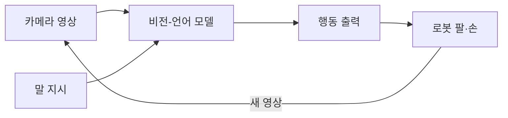
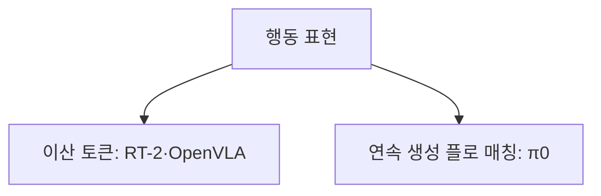

# VLA 모델

> VLA(Vision-Language-Action) 모델은 카메라 영상과 말로 된 지시를 입력받아 로봇의 **행동(action)**까지 출력하는 파운데이션 모델이다. 보고·이해하고·움직이는 것을 한 모델로 묶는다.

## 쉽게 말하면
"책상 위의 파란 컵을 선반에 올려 줘"라는 말을 듣고, 눈으로 컵을 찾고, 손을 어떻게 움직일지까지 한 두뇌가 결정한다. 예전엔 인식·계획·제어를 따로 만들어 이었다면, VLA는 이미 세상 지식을 가진 비전-언어 모델(VLM)에 "행동"이라는 출력만 덧붙인 셈이다.

## 자세히
- **RT-2**(Google DeepMind, 2023): VLM을 웹 데이터와 로봇 데이터로 함께 미세조정. 행동(6자유도+그리퍼+종료 플래그)을 256구간으로 양자화해 **텍스트 토큰**처럼 출력.
- **OpenVLA**(2024-06, 오픈소스): 7B 파라미터, Llama-2 기반 + DINOv2·CLIP 시각 특징. 행동을 구간화해 어휘 속 특수 토큰으로 다음 토큰 예측. RT-2보다 작지만 조작 과제에서 앞섰다고 보고된다.
- **π0**(Physical Intelligence): VLM 위에 "행동 전문가"를 얹고 **플로 매칭**으로 연속 행동 덩어리(chunk)를 생성. 섬세한 조작에 유리하다는 해설이 있으나 2차 자료의 평가다.
- 핵심 트레이드오프: 이산 토큰 방식은 LLM 학습 틀을 재사용하기 쉽고, 연속 생성 방식은 부드러운 궤적에 강하다.
- 수치(파라미터·구간 수)는 2차 자료 기준 — 정확한 값은 원 논문으로 확인할 것.

## 그림으로 보기

## 예시
- "빨래를 접어 줘" 같은 자연어 한 줄로 서로 다른 과제를 시키는 범용 로봇 연구.
- OpenVLA는 공개 가중치라 자기 로봇 데이터로 미세조정해 볼 수 있다.

## 헷갈리는 것과 비교
| 개념 | 차이 |
|---|---|
| VLA | 영상+언어 → 행동 |
| [멀티모달 LLM](#multimodal) | 영상+언어 → 텍스트(행동 없음) |
| [월드 모델](#world-model) | 세상이 어떻게 변할지 예측 |
| [원격조종 데이터](#teleoperation-data) | VLA 학습용 시연 데이터 |

## 더 읽을거리
- [Vision-language-action model (Wikipedia)](https://en.wikipedia.org/wiki/Vision-language-action_model) — 개요와 모델 목록
- [VLA Models Explained (roboticscenter)](https://roboticscenter.ai/en/blog/vla-models-explained) — 입문 해설(2차)
