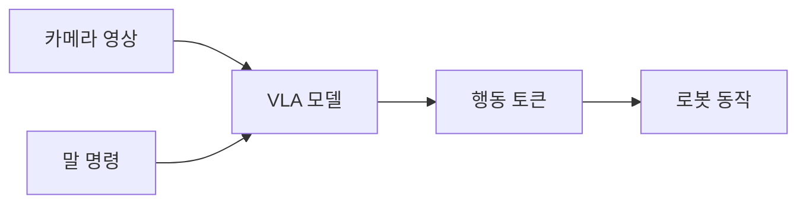
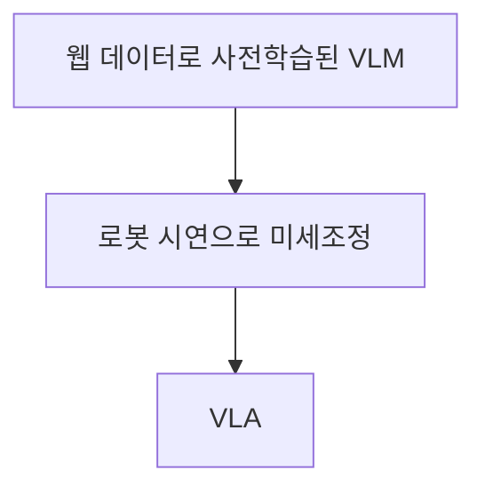

# VLA 모델

> **Vision-Language-Action 모델**. 카메라 영상(시각)과 사람의 말(언어)을 입력받아 **로봇 행동**을 곧바로 출력하는 모델로, 보통 비전-언어 모델(VLM)을 로봇 데이터로 확장해 만든다.

## 쉽게 말하면
말을 알아듣는 비서에게 "손 쓰는 법"까지 가르친 것이다. 이미 사진과 말을 이해하는 모델에, "이 장면에서 팔을 이렇게 움직여"라는 데이터를 더 가르친다.

## 자세히
- **RT-2**(Google DeepMind, arXiv 2307.15818): 기존 VLM을 로봇 궤적 데이터와 웹 규모 과제(VQA 등)로 함께 미세조정. **행동을 텍스트 토큰으로 표현**해 언어와 행동이 한 형식을 공유한다. 6천 번 평가에서 새 물체에 대한 일반화 향상, 훈련에 없던 명령 수행, 기초 추론(가장 작은 물체 집기), 사고 연쇄를 쓴 다단계 의미 추론을 보고했다(논문 초록 기준).
- **OpenVLA**(arXiv 2406.09246): 7B 파라미터, **97만 개 실제 로봇 시연**, Llama 2 기반에 DINOv2+SigLIP 시각 인코더. 저자 보고로 29개 과제·여러 로봇에서 RT-2-X(55B)보다 절대 성공률 16.5% 높고 파라미터는 7분의 1. LoRA로 소비자 GPU에서 미세조정, 양자화해도 성공률 유지(초록 기준).
- 구조적 한계: 큰 모델은 느려서 고속 제어가 어렵다 → [Figure Helix](#figure-helix)처럼 느린 이해와 빠른 제어를 분리하는 설계가 나왔다.
- 데이터가 병목이며 [Open X-Embodiment](#open-x-embodiment) 같은 합친 데이터를 쓴다.

## 그림으로 보기

## 예시
- "가장 작은 물건을 집어 줘"처럼 훈련 때 안 본 표현의 명령.
- 교육: LLM이 "텍스트→텍스트"라면 VLA는 "영상+텍스트→행동"이라는 확장 설명.

## 헷갈리는 것과 비교
| 개념 | 차이 |
|---|---|
| VLM | 영상+언어로 글을 출력 |
| VLA | 영상+언어로 행동을 출력 |
| [모방 학습](#imitation-learning) | VLA 미세조정에 쓰이는 학습 방식 |

## 더 읽을거리
- [RT-2 논문](https://arxiv.org/abs/2307.15818) — 행동을 토큰으로(초록 읽음).
- [OpenVLA 논문](https://arxiv.org/abs/2406.09246) — 공개 7B VLA(초록 읽음).
