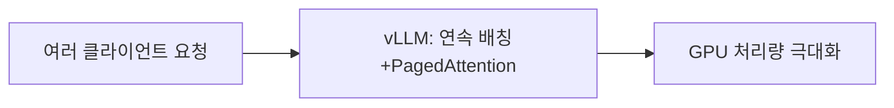
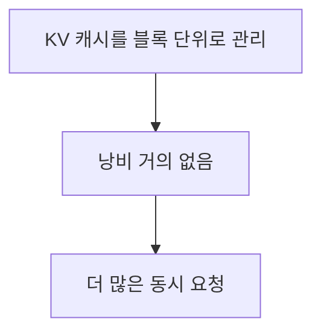

# vLLM

> **vLLM**은 **PagedAttention** 등으로 GPU 메모리를 효율적으로 써서 LLM을 **높은 처리량**으로 서빙하는 오픈소스 추론 엔진이다. OpenAI 호환 API 서버를 제공한다.

## 쉽게 말하면
식당 주방에서 주문이 들어오는 대로 조리대 공간을 낭비 없이 나눠 쓰며 많은 손님을 동시에 받는 운영 방식이다. 같은 GPU로 더 많은 요청을 처리한다.

## 자세히
(vLLM 공식 문서와 논문 초록 확인)
- **논문**(Kwon 외, arXiv 2309.06180, SOSP 2023): KV 캐시 메모리 **낭비를 거의 없애고** 요청 내·요청 간 KV를 유연하게 공유. 같은 지연에서 FasterTransformer·Orca 대비 인기 LLM의 처리량을 **2~4배** 높였다고 주장하며, 시퀀스가 길고 모델이 크고 디코딩이 복잡할수록 이득이 크다.
- **문서**: "빠르고 쉬운 LLM 추론·서빙 라이브러리", UC 버클리 Sky Computing Lab 출신. 연속 배칭, 청크 프리필, 프리픽스 캐싱, 양자화(FP8·INT8·INT4·GPTQ/AWQ·GGUF), 텐서·파이프라인·데이터·전문가 병렬, 추측 디코딩. **OpenAI 호환 API 서버**(Anthropic Messages API·gRPC 포함). NVIDIA·AMD GPU와 x86/ARM/PowerPC CPU 지원.
- 수치는 논문 조건(당시 비교 대상, 하드웨어)에서의 주장이므로 내 모델·트래픽으로 재측정한다(권고).

## 그림으로 보기

## 예시
- 사내 모델 서버를 vLLM으로 띄우고 기존 OpenAI SDK의 `base_url`만 바꿔 연결.
- 같은 시스템 프롬프트가 반복되는 서비스에서 프리픽스 캐싱 활용.

## 헷갈리는 것과 비교
| 도구 | 용도 |
|---|---|
| vLLM | 서버 환경 고처리량 서빙 |
| [Ollama](#ollama) | 로컬 개인용 간편 실행 |
| [llama.cpp](#llama-cpp) | CPU·GPU 경량 추론 엔진 |
| [PagedAttention](#paged-attention) | vLLM의 핵심 메모리 기법 |

## 더 읽을거리
- [Efficient Memory Management for LLM Serving with PagedAttention](https://arxiv.org/abs/2309.06180)
- [vLLM 문서](https://docs.vllm.ai/en/latest/)
