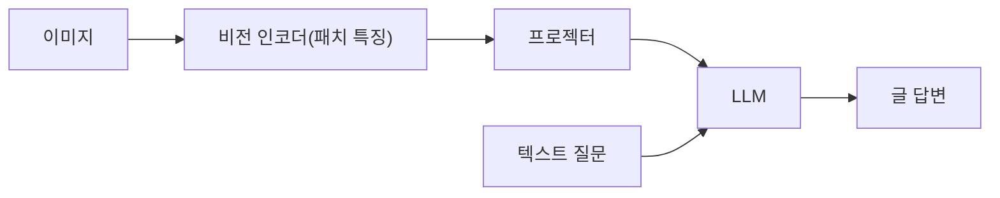
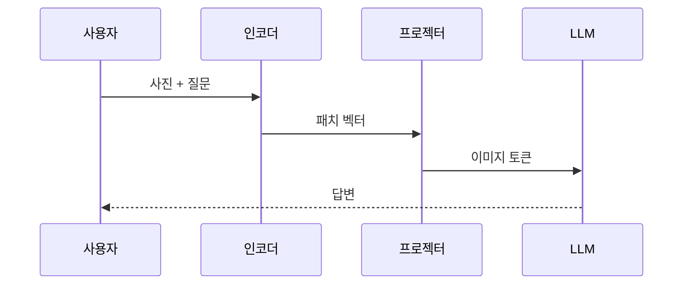

# VLM 구조: 인코더·프로젝터

> **VLM(시각-언어 모델)** 은 이미지를 보는 **비전 인코더**와 말하는 **LLM**을 연결해, 이미지에 대한 질문에 글로 답하는 모델이다. 둘 사이를 잇는 변환부를 흔히 **프로젝터**라 부른다.

## 쉽게 말하면
눈(카메라)과 입(말하는 사람)이 따로 있는 팀이다. 눈이 본 것을 "입이 알아듣는 언어"로 번역해 주는 통역사가 프로젝터다. 이미지를 단어 조각처럼 LLM에 넣어 준다.

## 자세히
- **LLaVA**(Liu 외, arXiv 2304.08485 초록 확인): 비전 인코더와 LLM을 연결해 종단 간 학습한 대형 멀티모달 모델. **언어 전용 GPT-4**로 이미지-언어 지시 따르기 데이터를 만들어 지시 튜닝했다. 합성 멀티모달 지시 데이터셋에서 GPT-4 대비 **상대 점수 85.1%**, ScienceQA 미세조정 시 **92.53%** 정확도(당시 최고라고 주장). 데이터·모델·코드를 공개했다.
- 초록은 프로젝터의 세부 구조를 밝히지 않는다. 일반적으로 이미지를 패치로 나눠 인코더로 벡터를 얻고, 이를 선형층/MLP로 LLM 임베딩 공간에 투영해 텍스트 토큰과 함께 입력한다(일반 지식, 논문 본문 미확인).
- 학습은 보통 ① 프로젝터만 정렬 학습 → ② 지시 데이터로 LLM과 함께 미세조정 순서(일반 지식).

## 그림으로 보기

## 예시
- 영수증 사진을 올리고 "합계 금액이 얼마야?" 묻기.
- 오픈소스 LLaVA로 사내 도면 이미지를 설명시키는 실험.

## 헷갈리는 것과 비교
| 개념 | 차이 |
|---|---|
| VLM | 이미지+글 입력, 글 출력 |
| 이미지 생성 모델 | 글→이미지 출력 |
| [OpenVLA](#openvla) | VLM 구조에 행동 출력을 더한 모델 |
| CLIP | 이미지·글 임베딩 정렬, 글 생성은 안 함(일반 지식) |

## 더 읽을거리
- [Visual Instruction Tuning (LLaVA)](https://arxiv.org/abs/2304.08485) — 논문 초록.
