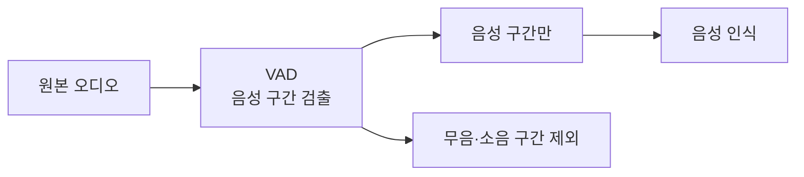
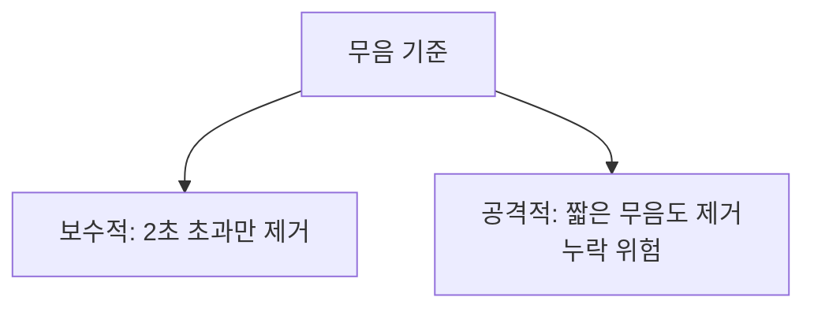

# 음성 구간 검출 (VAD)

> 오디오에서 사람이 말하는 구간만 찾아내고 무음·소음 구간을 걸러 내는 전처리. 음성 인식 앞에 넣어 불필요한 입력을 줄이는 데 쓰며, 무음 구간에서 지어낸 문장(환각)을 줄이려는 용도로도 시도된다.

## 쉽게 말하면
회의 녹음에서 아무도 말하지 않는 구간을 잘라 내고 말한 구간만 받아쓰기 담당자에게 넘기는 것과 같다. 받아쓰기 담당자가 빈 구간에 없는 말을 지어낼 기회가 줄어든다는 기대가 있다.

## 자세히
출처는 Silero VAD GitHub 저장소(열람)와 faster-whisper 저장소(열람)다. 두 출처 모두 VAD가 환각을 줄인다는 결과를 직접 제시하지는 않는다.
- **Silero VAD(저장소의 주장)**: 사전 학습된 음성 구간 검출 모델. JIT 모델 약 2MB, 30ms 이상 오디오 청크를 단일 CPU 스레드에서 1ms 미만에 처리한다고 주장(ONNX는 조건에 따라 4~5배 빠를 수 있다). 샘플링 속도 8000Hz·16000Hz, 6000개 이상 언어 학습, 요구 사양 Python 3.8+, torch 1.12.0+. 사용 흐름은 `load_silero_vad()` → `read_audio()` → `get_speech_timestamps(wav, model, return_seconds=True)`이며 기본 출력은 샘플 단위다. 라이선스는 MIT로 표기되지만 배지에 CC BY-NC 4.0이라는 문구가 있어 LICENSE 파일 확인이 필요하다고 열람 결과에 나왔다. 정확도는 저자 주장이며 독립 수치는 페이지에 없다.
- **faster-whisper의 `vad_filter`(저장소)**: `model.transcribe()` 옵션으로 음성이 없는 구간을 건너뛰는 VAD를 켠다. Silero VAD를 통합했다. 기본값은 보수적이라 "2초보다 긴 무음만 제거"한다. 켜는 법은 `vad_filter=True`이고 `vad_parameters=dict(min_silence_duration_ms=500)`처럼 무음 기준을 낮출 수 있다. 배치 추론 파이프라인에서는 기본으로 켜진다. 세부 파라미터는 `vad.py`에 있다.
- **환각과의 관계(확인 한계)**: faster-whisper 페이지는 `vad_filter`가 무음 구간 환각을 줄이는지 말하지 않고 무음 제거만 설명한다. Whisper 환각 연구(arXiv 2501.11378)는 비음성 소리가 환각을 유도한다고 보고하며 완화책으로 VAD가 아니라 "환각 모음" 후처리를 제안했다([WER의 한계](#wer-limits)). 따라서 "VAD가 환각을 줄인다"는 이 노드의 설명은 합리적 가설이고 이번에 확인한 직접 증거는 없다.
- **트레이드오프(일반 고려)**: 기준이 공격적이면 작은 목소리·말 사이 짧은 침묵의 말까지 잘라 오히려 누락 오류가 늘 수 있다. 우리 녹음으로 시험해야 한다.

## 그림으로 보기

## 예시
- `faster-whisper`로 `vad_filter=True`와 `min_silence_duration_ms=500`을 켜고 긴 침묵이 있는 상담 녹음을 전사해 켠 경우와 끈 경우를 비교(저장소 사용법 기준).
- 교육 실습: 같은 오디오 5개를 VAD 켬/끔으로 전사해 없는 문장과 누락 문장을 각각 센다.

## 헷갈리는 것과 비교
| 개념 | 차이 |
|---|---|
| VAD | 음성 구간을 찾아 입력을 줄이는 전처리 |
| 환각 모음 후처리 | 출력에서 알려진 환각을 제거 |
| [WER의 한계](#wer-limits) | 평균 지표가 환각을 가림 |
| 노이즈 제거 | 소리를 깨끗하게 만드는 처리(음성 구간 검출과 다름) |

## 더 읽을거리
- [Silero VAD (GitHub)](https://github.com/snakers4/silero-vad) — 모델과 사용법(열람)
- [faster-whisper (GitHub)](https://github.com/SYSTRAN/faster-whisper) — `vad_filter` 옵션(열람)
