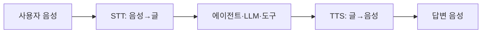
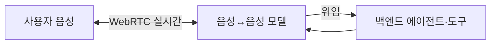

# 음성 에이전트

> 음성 에이전트는 사람과 말로 대화하면서 질문에 답하고 도구까지 실행하는 AI다. 만드는 방식은 크게 ① 음성→글→LLM→음성으로 이어 붙인 파이프라인, ② 한 모델이 음성을 직접 다루는 실시간 방식으로 나뉜다.

## 쉽게 말하면
전화 상담원을 AI로 바꾸는 일이다. 방식 ①은 통역사(받아쓰기)·상담원(생각)·성우(읽어 주기) 세 사람이 릴레이하는 것이고, 방식 ②는 한 사람이 듣고 생각하고 곧바로 말하는 것이다. 릴레이는 중간 기록을 보고 사람을 바꿔 끼우기 쉽고, 한 사람 방식은 더 자연스럽고 빠르다.

## 자세히
OpenAI 음성 에이전트 가이드(2026-11 확인)가 설명하는 세 구조:
- **연쇄 파이프라인(STT→에이전트→TTS)**: 단계마다 앱이 운영한다. 대화 기록 저장, 답하기 전 정책 검사, 부품 교체처럼 "각 단계가 보이거나 바꿀 수 있어야 할 때" 적합. 통제력이 가장 크지만 관리 부담도 크다.
- **Realtime API(음성↔음성)**: 한 모델이 오디오를 이해하고, 행동을 결정하고, 음성으로 답한다. 끼어들기(interruption)·도구 호출·핸드오프를 처리하며, 브라우저·모바일은 WebRTC로 직접 연결한다.
- **GPT-Live(전이중)**: 듣는 동시에 말해서 백엔드 작업 중에도 사용자가 계속 말할 수 있다. 추론·도구 사용은 별도 백엔드(자체 에이전트 또는 OpenAI 호스팅 모델)에 위임한다. 기존 텍스트 워크플로를 유지하기 좋다.
- **지연 시간 측정**: 사용자가 "쓸모 있는 답"을 듣기까지 걸린 시간을 재고, "확인 중입니다" 같은 응답은 따로 잰다. 중앙값과 95퍼센타일을 비교하고, 한 번에 한 요소만 바꾼다. 빨라져도 작업 성공률·도구 정확도가 떨어지면 안 된다. (가이드는 구체 수치를 주지 않는다.)

## 그림으로 보기

## 예시
- 병원 예약 전화: 파이프라인으로 만들어 통화 기록을 저장하고, 답하기 전에 개인정보 정책 검사를 끼워 넣는다.
- 영어 회화 코치: 끼어들기·억양이 중요하므로 실시간 음성 모델이 어울린다.

## 헷갈리는 것과 비교
| 개념 | 차이 |
| --- | --- |
| [Whisper](#whisper) | 파이프라인의 STT 부품 중 하나 |
| [음성 인식·합성](#speech-asr-tts) | 상위 주제. 음성 에이전트는 이를 에이전트와 결합 |
| 챗봇 | 글 입출력. 음성은 지연·끼어들기가 핵심 과제 |

## 더 읽을거리
- [OpenAI: Voice agents](https://developers.openai.com/api/docs/guides/voice-agents) — 세 가지 구조와 지연 측정 방법
