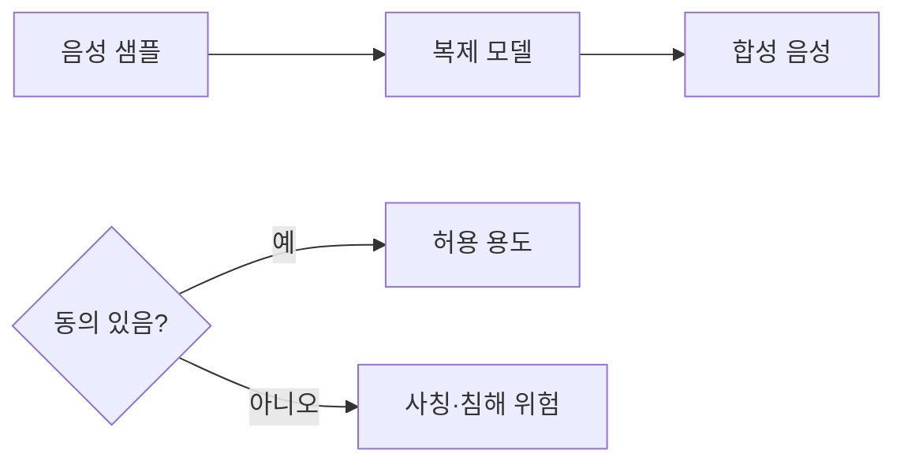
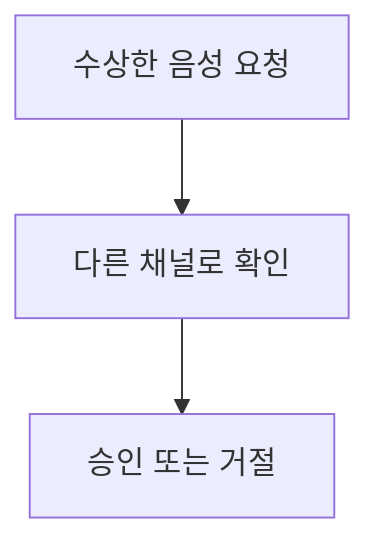

# 음성 복제와 윤리

> **음성 복제**는 짧은 음성 샘플로 특정인의 목소리를 흉내 내는 TTS 기술이다. 유용하지만 **동의 없는 사용과 사칭 사기** 위험이 있어 동의·표시·본인 확인 절차가 핵심이다.

## 쉽게 말하면
성우의 목소리를 계약 없이 복사해 광고에 쓰거나, 가족인 척 전화로 돈을 요구하는 일이 쉬워졌다. 같은 기술이 장애인 보조 음성과 사기 도구가 될 수 있다.

## 자세히
- **긍정 활용**(일반 지식): 발화 장애가 있는 사람의 개인 음성 복원, 동의한 성우의 다국어 더빙, 교육용 내레이션.
- **위험**: 사칭 사기, 가짜 발언, 성우·창작자의 권리 침해.
- **규제 단서**: 미국 FTC 사칭 규칙(2024-04-01 발효)은 정부·기업 사칭을 대상으로 하며, 개인 사칭으로 확대하는 보충 규칙안이 별도로 제안됐다. 해당 페이지는 AI 음성 복제를 직접 다루지 않았다(FTC 보도자료 확인).
- **실천 체크리스트**(권고): ① 음성 주인의 **서면 동의** ② 사용 범위·기간 명시 ③ 합성물 표시 ④ 돈·민감 요청은 다른 채널로 본인 확인 ⑤ 서비스의 음성 보호 정책 확인.
- 국가별 퍼블리시티권·초상권 규정은 이 글에서 다루지 않았다.

## 그림으로 보기

## 예시
- 교육 회사가 강사 동의서를 받고 강사 음성으로 다국어 강의를 제작, 영상에 "AI 합성 음성" 표시.
- "급히 송금해 달라"는 가족 음성 전화는 끊고 직접 다시 걸어 확인.

## 헷갈리는 것과 비교
| 개념 | 차이 |
|---|---|
| 음성 복제 | 특정인의 목소리 모방 |
| 일반 TTS | 불특정 합성 목소리 |
| [딥페이크](#deepfake) | 얼굴·영상까지 포함한 합성 |
| 보이스피싱 | 사기 수법, 합성 음성이 도구가 될 수 있음 |

## 더 읽을거리
- [FTC: 사칭 규칙 발효](https://www.ftc.gov/news-events/news/press-releases/2024/04/ftc-announces-impersonation-rule-goes-effect-today)
- [C2PA](https://c2pa.org/) — 합성물 출처 표시 표준.
