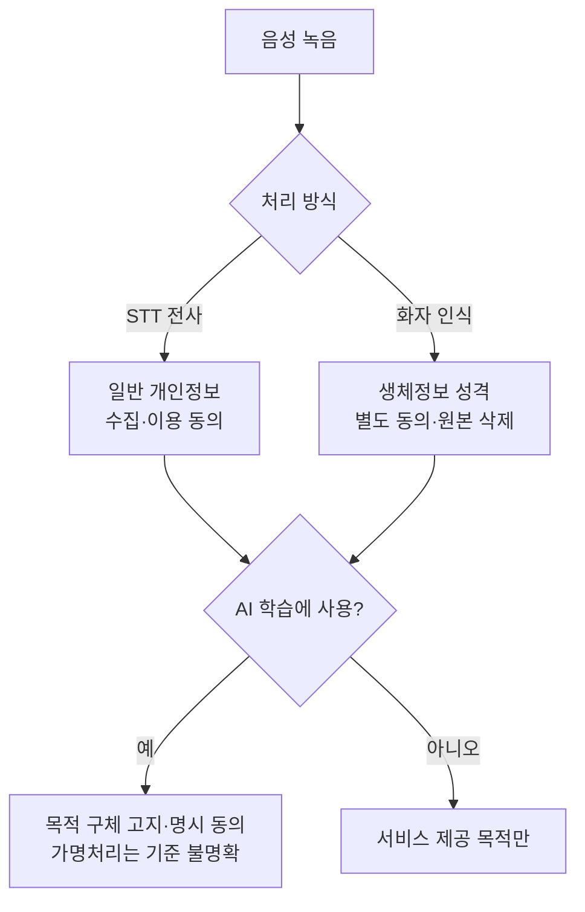

# 음성의 개인정보 성격

> 녹음된 목소리는 사람을 알아볼 수 있는 정보라 한국 개인정보 보호법의 개인정보로 다뤄진다. 화자 인식처럼 목소리로 특정인을 식별하는 처리를 하면 생체정보 성격이 더해져 요건이 무거워진다. (법률 자문 아님)

## 쉽게 말하면
회의 녹음 파일에는 말 내용뿐 아니라 "누구의 목소리인지"도 담겨 있다. 통신비밀보호법이 "몰래 녹음해도 되나"를 묻는다면, 개인정보 보호법은 "녹음한 음성을 어떻게 보관·사용·학습에 쓰나"를 묻는다. 둘은 별개의 문제다.

## 자세히
출처: 네플라 위키 해설(열어서 확인). 개인정보 보호법 조문 원문 페이지는 열었으나 본문이 나오지 않아 조문 인용은 하지 못했다. 현행 법은 시행 2026-09-11 판으로 표시돼 있었다(페이지 머리글).
- **음성 = 개인정보**: 사람마다 고유한 음성 주파수가 있어 특정인을 알아볼 수 있다는 해설.
- **처리 방식에 따라 성격이 다름**: 음성을 글자로 바꾸는 STT는 일반 개인정보, 화자 인식(발화자 식별)을 쓰면 신체적 특성에 관한 생체정보로 민감정보·바이오정보에 해당한다.
- **AI 학습 용도**: 일반 음성도 이용자의 명시적 사전 동의가 필요하다는 설명. 개인정보보호위원회 'AI 개인정보보호 자율점검표'는 목적을 "AI 알고리즘 개발용 학습 데이터 구축"처럼 구체적으로 고지하라고 하며 "신규 서비스 개발" 같은 포괄 문구는 부족하다고 한다(해설 인용).
- **화자 인식 시 추가**: 민감·바이오정보 별도 동의, 특징정보 추출 후 원칙적으로 음성 원본 삭제.
- **가명처리**: 제28조의2 제1항은 가명정보를 과학적 연구 등에 동의 없이 쓰게 하지만, 음성·영상 같은 비정형 데이터는 평가 기준이 없어 당국이 생체인식정보 가명처리 판단을 유보하고 본인 동의 기반 사용만 인정했다는 해설. 최신 지침이 바뀌었는지는 확인하지 못했다.
- **검색으로 확인 못한 것**: AI 회의록 앱에서 개인정보위가 낸 구체 해석. 미국에서는 AI 회의록 앱을 상대로 동의 없는 녹음 집단소송이 제기되고 있다는 기사만 확인했다.

## 그림으로 보기

## 예시
- 회의 AI 노트 서비스가 전사본으로 요약만 제공 → 일반 개인정보 처리 동의·보관 기간 고지.
- 같은 서비스가 "누가 말했는지" 목소리로 자동 구분 → 화자 인식이면 별도 동의 설계 필요.

## 헷갈리는 것과 비교
| 개념 | 차이 |
|---|---|
| [한국 통신비밀보호법](#kr-communication-secrecy-law) | 녹음 행위의 적법성, 이 노드는 녹음 데이터 처리 |
| [당사자 녹음 원칙](#party-recording-rule) | 녹음이 합법이어도 개인정보 처리는 별도 의무 |
| 가명정보 | 추가 정보 없이는 식별 불가하게 처리, 음성은 기준 미확립 |
| [회의 AI 노트테이커](#meeting-ai-notetaker) | 위 요건을 서비스 설계에 적용 |

## 더 읽을거리
- [녹음된 목소리를 AI 학습용으로 활용할 수 있을까 (네플라 위키)](https://www.nepla.ai/wiki/it-정보-방송통신/개인정보-위치정보-신용정보/녹음된-목소리를-ai-학습용으로-활용할-수-있을까-6349gpgz29zx) — 음성의 개인정보 성격과 동의 요건(열어서 확인)
- [개인정보 보호법 (국가법령정보센터)](https://www.law.go.kr/법령/개인정보보호법) — 조문 원문 확인용(이번엔 본문 미확인)
