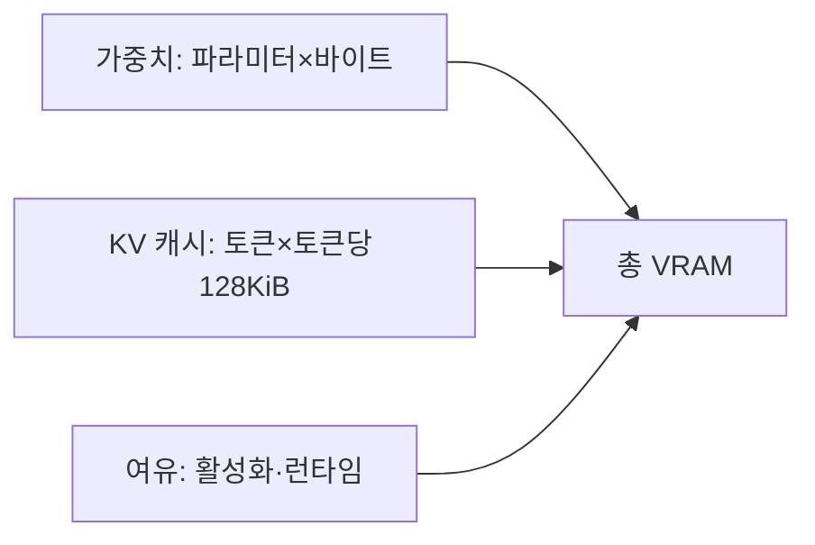
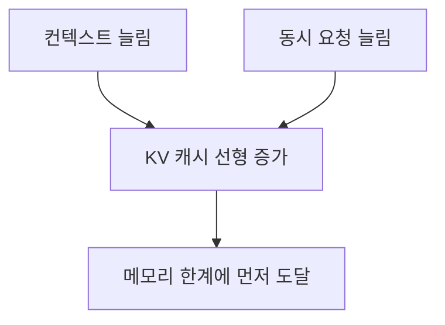

# VRAM 예산 계산

> 모델을 GPU에 올릴 때 필요한 메모리를 **가중치 + KV 캐시 + 여유(활성화·런타임)**로 나눠 미리 계산하는 방법. 모델이 "들어가는지"는 가중치만이 아니라 컨텍스트 길이까지 봐야 안다.

## 쉽게 말하면
이삿짐 트럭에 짐(가중치)만 싣는다고 끝이 아니다. 대화가 길어질수록 늘어나는 메모장(KV 캐시)과 작업 공간도 실어야 한다.

## 자세히
- **가중치**: 파라미터 수 × 파라미터당 바이트. 양자화하면 줄어든다. 직접 계산(Llama 3 8B급 약 80.3억 파라미터 가정): FP16(2바이트) 약 **14.96GiB**, 평균 4.5비트(Q4_K의 bpw, [Q4_K_M 읽기](#quant-naming)) 약 **4.21GiB**.
- **KV 캐시**(검색 결과로 확인한 공식): `2 × 층 수 × KV 헤드 수 × head_dim × 원소 바이트 × 토큰 수`. Llama 3(8B) 형태는 32층, KV 헤드 8개, head_dim 128, bf16이면 토큰당 2×32×8×128×2 = **131,072바이트 = 128KiB**(한 요청 기준).
  - 직접 환산: 컨텍스트 8,192토큰 ≈ **1GiB**, 32,768토큰 ≈ **4GiB**, 131,072토큰 ≈ **16GiB**. 요청이 동시에 N개면 N배.
  - GQA 덕분: 쿼리 헤드 32개에 KV 헤드 8개라 같은 크기의 MHA(KV 헤드 32개)보다 캐시가 **4배 작다**(검색 결과).
- **여유**: 활성화 메모리·런타임·단편화로 추가 필요(일반 설명, 수치는 환경별). 보통 총합에 10~20%를 더해 보라는 식의 경험칙이 쓰이나 이는 이번 출처에서 확인한 값이 아니다.
- 사례(내 계산): 8B Q4_K 가중치 4.21GiB + 32K 컨텍스트 KV 4GiB(bf16) ≈ 8.2GiB + 여유 → 8GB GPU에는 빠듯하다. KV를 줄이는 방법은 [KV 양자화](#kv-quantization).
- 한계: 모델 구조(층·헤드)는 모델마다 다르다. 실제 모델의 `config.json`에서 값을 읽어 계산한다.

## 그림으로 보기



## 예시
```python
per_token = 2 * layers * kv_heads * head_dim * 2   # bf16
kv_gib = per_token * ctx_tokens * n_requests / 2**30
```
- 교육: 후보 모델 3개의 config로 컨텍스트 8K·32K·128K에서 필요한 메모리를 표로 계산.

## 헷갈리는 것과 비교
| 개념 | 차이 |
|---|---|
| 가중치 메모리 | 모델 크기·양자화에 비례, 고정 |
| KV 캐시 | 컨텍스트·동시 요청에 비례, 가변 |
| [어텐션](#attention-mechanism) | KV 캐시가 필요한 이유가 되는 연산 |

## 더 읽을거리
- [KV cache 계산 (Raschka)](https://sebastianraschka.com/llm-architecture-gallery/kv-cache-calculations/) — 공식 설명(검색 결과 확인).
- [Hugging Face: GGUF](https://huggingface.co/docs/hub/gguf) — 비트/가중치 표(읽음).
