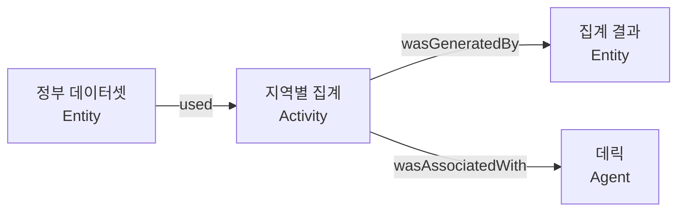
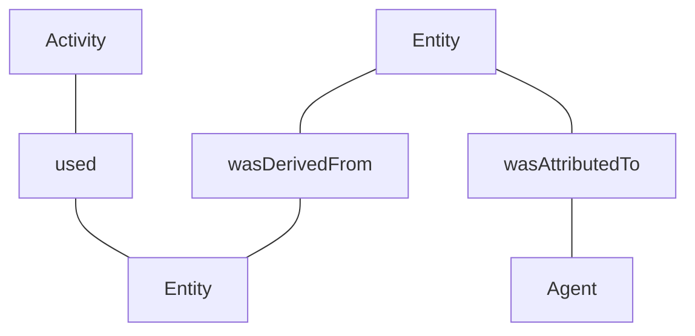

# W3C PROV

> 어떤 데이터나 물건이 **누가·어떤 활동으로·무엇을 바탕으로 만들어졌는지(출처, provenance)** 를 표현하는 W3C 표준 모델이다. Entity·Activity·Agent 세 가지 개념과 이들을 잇는 관계로 이력을 기술한다.

## 쉽게 말하면
신문 기사의 차트에는 "누가(기자 데릭) 어떤 작업(지역별 집계)으로 어떤 자료(정부 데이터셋)를 가공해 만들었다"는 이력이 있다. PROV는 이런 이력을 사람이 쓰는 각주가 아니라 기계가 읽고 따라갈 수 있는 형식으로 적게 해 주는 공용 문법이다.

## 자세히
(W3C PROV 개요 노트와 PROV-Primer를 직접 읽었다.)
- **정의(개요)**: 출처란 어떤 데이터·물건을 만드는 데 관여한 엔티티·활동·사람에 대한 정보로, 품질·신뢰성 평가에 쓰인다.
- **핵심 개념(Primer의 차트·블로그 예)**
  - **Entity**: 출처를 가질 수 있는 모든 것(물리적·디지털·개념적). 예: 기사, 정부 데이터셋, 차트.
  - **Activity**: 엔티티를 만들거나 바꾸는 과정. 예: 지역별 집계(`compose1`), 차트 그리기(`illustrate1`).
  - **Agent**: 활동이나 엔티티에 책임이 있는 사람·조직·소프트웨어. 예: 개인 데릭, 조직 Chart Generators Inc.
- **관계**: `used`(활동이 소비한 엔티티), `wasGeneratedBy`(엔티티를 만든 활동), `wasDerivedFrom`(엔티티가 의존한 다른 엔티티, 인용 등 세분 유형), `wasAssociatedWith`(활동의 책임 에이전트), `wasAttributedTo`(엔티티의 책임 에이전트), `actedOnBehalfOf`(에이전트가 다른 에이전트를 대리).
- **PROV-N 예(Primer)**: `used(exc:compose1, exg:dataset1, -)`, `wasGeneratedBy(exc:composition1, exc:compose1, -)`, `wasAssociatedWith(exc:compose1, exc:derek, -)`.
- **문서 묶음**: PROV-DM(개념 모델), PROV-O(OWL2 온톨로지, RDF 매핑), PROV-N(사람이 읽는 표기), PROV-CONSTRAINTS(유효한 출처의 제약, 검증기 구현용)는 모두 2013-04-30 권고안(Recommendation). PROV-XML은 노트.
- **OpenLineage와의 관계(해석)**: 둘 다 "어디서 왔나"를 기술하지만 OpenLineage는 파이프라인 실행 시 이벤트를 주고받는 데 초점, PROV는 더 일반적인 출처 표현 어휘다. 이 비교는 두 문서에서 직접 확인한 것이 아니라 일반적 이해다.

## 그림으로 보기

## 예시
- AI 학습 데이터셋 카드: "이 라벨 파일(Entity)은 라벨링 작업(Activity)으로 원본 이미지(Entity)에서 만들어졌고 라벨링 업체(Agent)가 책임진다"를 PROV로 기술.
- 교육 소재: "AI 답변의 근거 자료를 PROV 그림으로 그려 보기".

## 헷갈리는 것과 비교
| 개념 | 차이 |
|---|---|
| W3C PROV | 일반적인 출처 표현 표준(어휘·모델) |
| [OpenLineage](#openlineage) | 파이프라인 계보 이벤트 규격 |
| [데이터 신뢰성](#data-credibility) | PROV가 근거를 제공하는 품질 특성 |
| 계보 vs 출처 | 계보는 흐름 중심, 출처는 책임·생성 맥락 포함(느슨한 구분) |

## 더 읽을거리
- [PROV Overview (W3C Note, 2013-04-30)](https://www.w3.org/TR/prov-overview/) — 문서 묶음과 출처의 정의.
- [PROV-Primer (W3C)](https://www.w3.org/TR/prov-primer/) — Entity·Activity·Agent와 관계 예제.
