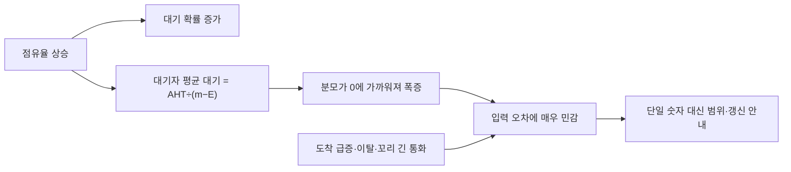

# 대기 시간 추정의 한계

> 사람에게 이관한 고객에게 "약 N분 기다려 주세요"라고 알릴 때, 그 추정이 **부하가 높을수록 급격히 부정확해지는 이유**. 대기열 이론(Erlang C)은 점유율이 1에 가까워지면 대기가 폭증하고 작은 입력 오차가 큰 예측 오차를 만든다는 것을 보여 준다.

## 쉽게 말하면
고속도로가 한산할 때는 5분 오차가 무의미하지만, 꽉 막힌 때는 앞 차 한 대의 사고가 도착 시간을 한 시간씩 바꾼다. 상담 대기열도 직원이 거의 다 바쁠 때 추정이 가장 어렵다.

## 자세히
출처: Wikipedia "Erlang (unit)" 중 Erlang C 확률식과 가정(본문 확인)과 **직접 계산**(2026-11-18). 평균 대기 시간식 `Pw × AHT/(m−E)`는 M/M/c 대기열의 표준 결과이며 이 페이지에는 적혀 있지 않다(일반 이론).
- **Erlang C의 가정**: 도착은 포아송 과정, 통화 시간은 지수분포, 서버 m개, 모두 바쁘면 대기열(무한)에 들어가며 끊지 않는다. 이 틀에서 대기 확률 `Pw = [(E^m/m!)·m/(m−E)] / [Σ_{i<m} E^i/i! + (E^m/m!)·m/(m−E)]`. E는 부하(얼랭), m은 상담사 수.
- **한계(문서)**: 고객이 기다리다 끊지 않는다고 가정해 "실제 필요한 것보다 더 많은 상담사가 필요하다"고 예측하는 경향이 있다.
- **직접 계산(m=10, 건당 처리 시간 300초)**:

| 부하 E | 점유율 | 대기 확률 | 대기하는 사람의 평균 대기 | 전체 평균 대기 |
|---|---|---|---|---|
| 6.0 | 0.60 | 10.1% | 75초 | 7.6초 |
| 8.0 | 0.80 | 40.9% | 150초 | 61.4초 |
| 9.0 | 0.90 | 66.9% | 300초 | 200.6초 |
| 9.5 | 0.95 | 82.6% | 600초 | 495.4초 |
| 9.8 | 0.98 | 92.8% | 1,500초 | 1,392.2초 |

- **민감도**: 점유율 0.9에서 0.95로 5%p 오르면 전체 평균 대기가 약 200초 → 495초로 2.5배가 된다. 부하를 8.5로 잘못 추정했는데 실제가 9.0이면 대기를 약 106초로 예측하지만 실제는 약 201초(절반). 실제 9.5를 9.0으로 추정하면 201초 대 495초.
- **현실과의 차이(해석)**: 실제 상담은 도착이 시간대·행사에 따라 급증하고(포아송 가정 위반), 통화 시간 분포가 꼬리가 길고(지수분포 위반), 고객이 이탈하며, 상담사가 이탈·휴식하고, 우선순위·스킬 라우팅이 있다. 이 모두가 추정을 어긋나게 한다.
- **급증·데이터 부족**: 급증 직후에는 최근 처리 속도 데이터가 과거를 반영하지 못하고, 신규 큐에는 이력이 없다.
- **안내 문구 설계(제안)**: 단일 숫자 대신 **범위**("보통 5~10분")와 "추정" 표기, 임계 초과 시 콜백·다른 채널 제안, 추정치가 틀렸을 때 갱신 안내([예상 대기 안내 메시지](#estimated-wait-message)).

## 그림으로 보기


## 예시
```python
from math import factorial
def erlang_c(E, m):
    top = (E**m / factorial(m)) * m / (m - E)
    return top / (sum(E**i / factorial(i) for i in range(m)) + top)
def mean_wait_all(E, m, aht):
    return erlang_c(E, m) * aht / (m - E)
mean_wait_all(9.0, 10, 300)    # 약 200.6초
```
교육 활용: 상담 센터 관리자가 "점유율 85%에서 90%로 올리면 고객 대기가 얼마나 늘어나는가"를 직접 계산해 보는 실습.

## 헷갈리는 것과 비교
| 개념 | 차이 |
|---|---|
| 대기 시간 추정 | 현재 큐 상태로 예상 시간을 말함 |
| Erlang C | 이탈 없는 M/M/c 이론식 |
| Erlang A | 이탈(인내심)을 반영한 확장 모델(일반 지식, 여기서 확인하지 않음) |
| [예상 대기 안내 메시지](#estimated-wait-message) | 추정을 고객에게 알리는 문구 설계 |

## 더 읽을거리
- [Wikipedia: Erlang (unit)](https://en.wikipedia.org/wiki/Erlang_(unit)) — Erlang C 확률식·가정·한계
