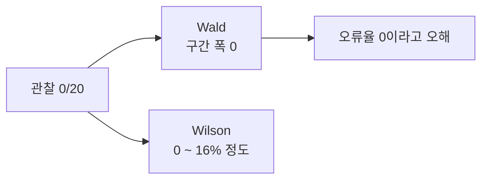
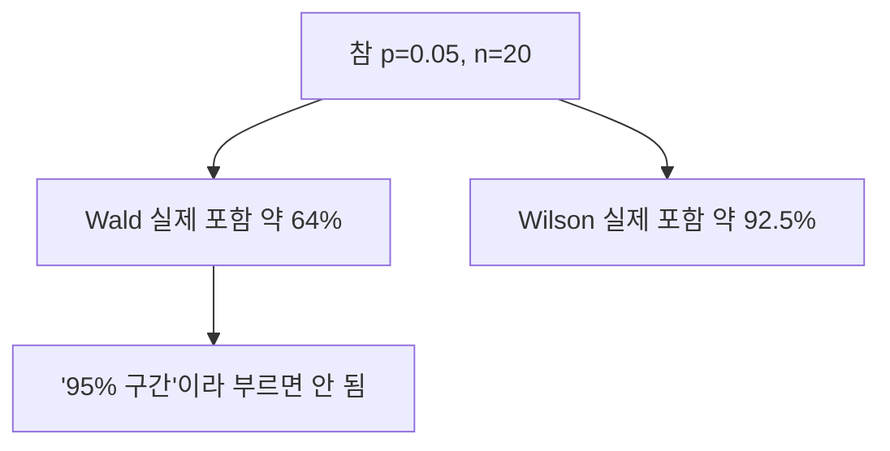

# 정규 근사(Wald) 구간의 실패

> Wald 구간은 비율 p̂ ± 1.96·√(p̂(1−p̂)/n)으로 계산하는 가장 흔한 신뢰구간인데, 표본이 작거나 비율이 0·1에 가까우면 실제 포함 확률이 95%에 한참 못 미치고, 관찰 오류가 0건이면 폭이 0이 되어 "오류율은 정확히 0"이라고 잘못 말한다.

## 쉽게 말하면
대충 맞는 공식을 어디서나 쓰다가 극단적인 상황에서 무너지는 경우다. 동전 20번 중 앞면이 0번 나왔다고 "이 동전의 앞면 확률은 정확히 0"이라고 단정하는 것과 같다. 다음에 한 번만 더 던져도 틀릴 수 있다.

## 자세히
- **문제 1: 폭이 0이 됨(Wikipedia Binomial proportion confidence interval, 열람)**: p̂이 0 또는 1이면 구간 폭이 0이 되어 "확실함을 잘못 암시"한다. 또한 구간이 [0,1]을 넘을 수 있다.
- **문제 2: 포함 확률이 명목에 못 미침(같은 문서)**: Wald 구간의 실제 포함 확률은 큰 표본에서도 명목 수준 아래로 내려갈 수 있다. Wilson 구간은 가장 정확하고 견고한 쪽에 속하고 Clopper-Pearson은 최소 포함을 보장한다.
- **정확한 포함 확률 계산(직접, 이항 분포를 모든 가능한 관찰값에 대해 합산, 95% 명목)**: 참 비율이 p일 때 관찰 가능한 모든 x에 대해 구간이 p를 포함하는 확률을 더했다. 난수 없이 정확한 계산이다.

| n | 참 p | Wald 포함 확률 | Wilson 포함 확률 | x=0이 나올 확률 |
| --- | --- | --- | --- | --- |
| 20 | 0.05 | 63.9% | 92.5% | 35.8% |
| 50 | 0.05 | 92.0% | 96.2% | 7.7% |
| 100 | 0.05 | 87.7% | 96.6% | 0.6% |
| 300 | 0.01 | 79.9% | 96.7% | 4.9% |
| 1000 | 0.01 | 92.7% | 96.4% | 0.0% |
| 20 | 0.5 | 95.9% | 95.9% | 0.0% |

  오류가 드문 상황(p=0.05, n=20)에서 "95% 구간"이라 불리는 Wald의 실제 포함 확률은 64%에 불과하다. 약 36%의 경우 오류가 0건으로 관찰되어 폭 0 구간이 나온다. 반면 p=0.5·n=20에서는 Wald와 Wilson이 비슷하다. n=1000이어도 p=0.01이면 Wald는 92.7%로 명목 95%에 못 미친다. 표는 이 특정 값들의 결과이며 포함 확률은 p와 n에 따라 크게 출렁인다.
- **원인(해석)**: 표준오차를 관찰한 p̂으로 계산해서 p̂이 0이나 1이면 불확실성이 0으로 추정되고, 이항 분포가 비대칭인데 정규 분포로 근사하기 때문이다.
- **대안**: [Wilson 구간](#wilson-interval)(대부분의 경우 좋은 기본값), [Clopper-Pearson](#clopper-pearson-interval)(보수적으로 보장), 관찰 0건이면 [3의 법칙](#rule-of-three) 같은 간단한 상한. 평가 라이브러리의 기본값이 Wald인지 확인한다(해석).
- **교육 활용 포인트(해석)**: "정확도 99%, 신뢰구간 ±0.3%"를 볼 때 표본 크기와 사용한 방법을 같이 묻게 한다.

## 그림으로 보기

## 예시
- 시험 정확도 보고에서 20건 중 오류 1건(5%)을 Wald로 구하면 0 ~ 14.6%지만 Clopper-Pearson은 0.13% ~ 24.9%, Wilson은 0.89% ~ 23.6%다. Wald가 불확실성을 가장 작게 보여 준다.
- 교육 활용: 같은 표를 직접 계산해 보고 작은 표본 보고서의 "±" 표기를 의심하는 훈련.

## 헷갈리는 것과 비교
| 개념 | 차이 |
| --- | --- |
| [Wilson 구간](#wilson-interval) | 상위 주제. Wald의 문제를 고친 대안 |
| [Clopper-Pearson](#clopper-pearson-interval) | 최소 포함 보장, 보수적 |
| Wald | 계산이 가장 쉽지만 작은 n·극단 비율에서 부정확 |

## 더 읽을거리
- [Wikipedia: Binomial proportion confidence interval](https://en.wikipedia.org/wiki/Binomial_proportion_confidence_interval) — Wald의 문제와 대안
