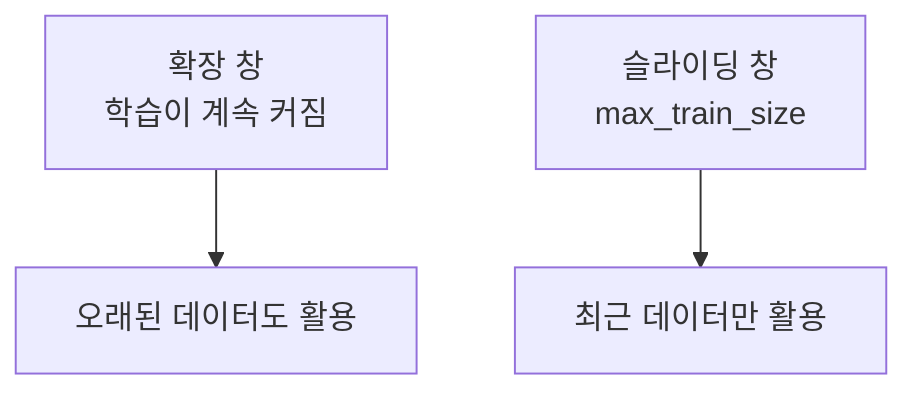

# 워크포워드 검증

> 시험 구간을 **시간 순서대로 한 칸씩 앞으로 밀어 가며** 매번 그 이전 데이터로 학습하고 바로 다음 구간으로 시험하는 반복 검증이다. 운영에서 모델을 주기적으로 다시 학습하며 쓰는 상황을 흉내 낸다.

## 쉽게 말하면
매주 월요일에 "지난주까지의 데이터로 다시 공부해서 이번 주를 예측"하는 일을 과거에 그대로 반복해 보는 것이다. 한 번만 시험 보는 대신 여러 주를 차례로 시험해 평균과 편차를 본다.

## 자세히
(scikit-learn `TimeSeriesSplit` 문서의 매개변수 설명을 앞서 직접 읽었다. 아래 폴드 출력은 문서의 분할 규칙을 이 지도에서 순수 Python으로 다시 구현해 얻은 것이며, 앞서 같은 구현이 문서 예제 출력과 일치함을 확인했다.)
- **구조(문서)**: 폴드마다 **학습 세트는 특정 시점까지의 모든 데이터, 시험 세트는 그 이후**이다. 학습 세트는 폴드가 진행될수록 커지며 이전 폴드의 학습 세트를 포함한다(일반 교차 검증과 다름). `n_splits`(기본 5, 최소 2), `test_size`, `gap`, `max_train_size`로 조절한다.
- **확장 창(expanding window)**: `max_train_size=None`이면 학습이 계속 늘어난다. 직접 구현해 12개 샘플, `n_splits=3`, `test_size=2`로 돌린 결과는 폴드 0 학습 `[0..5]`·시험 `[6 7]`, 폴드 1 학습 `[0..7]`·시험 `[8 9]`, 폴드 2 학습 `[0..9]`·시험 `[10 11]`.
- **슬라이딩 창(sliding window)**: `max_train_size`(문서: "단일 학습 세트의 최대 크기")를 주면 오래된 데이터를 버린다. 같은 설정에 `max_train_size=4`를 주면(직접 구현) 폴드 0 학습 `[2 3 4 5]`, 폴드 1 `[4 5 6 7]`, 폴드 2 `[6 7 8 9]`로 학습 길이가 일정하다. 이 정의는 문서의 매개변수 설명과 이 구현이 일치한다고만 확인했고 scikit-learn 소스와의 동일성은 확인하지 않았다.
- **언제 어느 쪽인가(일반 원칙)**: 오래된 데이터가 여전히 유용하면 확장 창, 분포가 변해 오래된 데이터가 해롭거나 학습 비용이 문제면 슬라이딩 창. 운영의 재학습 정책(전체 재학습 vs 최근 N일)과 맞춘다.
- **문서의 주의**: 폴드 간 지표를 비교하려면 샘플이 **등간격**이어야 한다. 첫 폴드는 학습 데이터가 적다. 폴드마다 재학습이 필요해 복잡한 모델에서는 비용이 크다(검색 요약).
- **지표 해석(제안)**: 폴드별 점수의 **평균과 분산**을 함께 본다. 시간이 갈수록 점수가 떨어지면 드리프트 신호일 수 있다. 앞의 [분할 gap](#split-gap-buffer)으로 지연 특징 누수를 막는다.

## 그림으로 보기



## 예시
```python
from sklearn.model_selection import TimeSeriesSplit
tscv = TimeSeriesSplit(n_splits=3, test_size=2, max_train_size=4)
# 직접 구현 기준: 폴드0 학습 [2 3 4 5], 시험 [6 7] ...
```
- 교육 소재: 폴드별 점수 표를 만들어 시간이 갈수록 변하는지 읽어 보기.

## 헷갈리는 것과 비교
| 개념 | 차이 |
|---|---|
| 워크포워드 검증 | 시험 구간을 시간순으로 밀며 반복 |
| K-겹 교차 검증 | 섞어서 나누므로 시계열에 부적합 |
| [시간 기반 분할 규칙](#time-based-split-rule) | 단일 시간순 분할의 상위 규칙 |
| [분할 gap 완충 구간](#split-gap-buffer) | 폴드 사이 누수 방지 |

## 더 읽을거리
- [sklearn TimeSeriesSplit](https://scikit-learn.org/stable/modules/generated/sklearn.model_selection.TimeSeriesSplit) — 매개변수·학습 세트 증가(직접 읽음).
