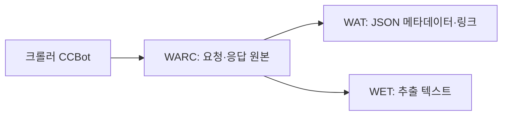
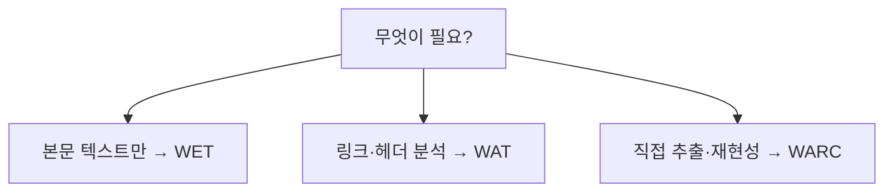

# WARC·WAT·WET 형식

> Common Crawl이 크롤 결과를 내놓는 세 가지 파일 형식이다. WARC는 원본 응답 전체, WAT는 레코드별 메타데이터(JSON), WET는 추출된 본문 텍스트만 담는다. 모두 WARC 컨테이너 형식을 쓰고 gzip으로 압축된다.

## 쉽게 말하면
택배 상자(WARC)에는 물건과 송장과 포장지가 다 들어 있다. WAT는 송장 정보만 모은 장부, WET는 상자 속 알맹이 글만 꺼내 모은 문서철이다. LLM 학습용 텍스트가 필요하면 보통 WET이나 WARC에서 직접 본문을 뽑는다.

## 자세히
(Common Crawl 공식 Get Started 페이지를 열어 확인하고, 2024-10 크롤 파일을 직접 내려받아 확인.)
- **WARC(원본)**: 크롤 과정과 1:1로 대응되는 원자료. HTTP 응답, 요청, 크롤 메타데이터를 담는다.
- **WAT(계산된 메타데이터)**: WARC 레코드마다 JSON 메타데이터. HTML이면 HTTP 헤더와 페이지 링크(링크 유형 포함).
- **WET(추출 텍스트)**: WARC 내용에서 뽑은 평문만. HTML·헤더가 필요 없는 작업용.
- **직접 확인(CC-MAIN-2024-10, 2024-02-20 시작 크롤)**: `wet.paths.gz`에 **90,000개** 파일 경로가 있었다. 첫 파일의 크기는 WARC 1,134,803,864바이트(약 1.1GB), WAT 268,473,596바이트(약 268MB), WET 107,022,614바이트(약 107MB) — 같은 구간에서 WET이 WARC의 10분의 1 미만. WET 파일 앞부분: `WARC-Type: warcinfo` 헤더(소프트웨어, 크롤 설명 "Wide crawl of the web for February/March 2024")에 이어 `WARC-Type: conversion` 레코드가 `WARC-Target-URI`·`WARC-Date`·`WARC-Refers-To`와 함께 나온다. WAT 레코드는 `WARC-Type: metadata`에 `Content-Type: application/json`, 본문은 `Container`·`Envelope` 키를 가진 JSON.
- **접근(문서)**: S3 `s3://commoncrawl/`(us-east-1), 또는 HTTPS `https://data.commoncrawl.org/`(wget·curl, AWS 계정 불필요). 익명 접근은 `aws --no-sign-request s3 cp`. 문서 내 S3 접근 설명이 일관되지 않아 확인이 필요하다고 표시돼 있다. 크롤 이름은 `CC-MAIN-2026-43`처럼 연도-번호 형태.
- **선택 기준(FineWeb 논문 본문 확인)**: WET은 데이터셋 제작의 흔한 출발점이지만 FineWeb 팀은 WET에 **상용구·메뉴 텍스트가 너무 많이 남아 있다**고 봤다. WARC에서 오픈소스 trafilatura로 직접 추출한 텍스트로 학습한 ablation 모델이 WET 기반보다 분명히 더 좋은 성능을 내 이후 모든 실험을 WARC 기반으로 했다. 단, 직접 추출은 계산 비용이 크다. 링크 그래프 분석은 WAT.
- 도구: [datatrove](#datatrove)의 리더가 WARC·WET을 읽는 블록을 제공(제안, 문서 확인 필요).

## 그림으로 보기



## 예시
```bash
# 크롤의 WET 파일 목록 확인
curl -s https://data.commoncrawl.org/crawl-data/CC-MAIN-2024-10/wet.paths.gz | gunzip | head -2
# 첫 WET 파일의 앞부분만 받아 풀어 보기
curl -s -r 0-30000 https://data.commoncrawl.org/<경로> | gunzip | head -25
```
- 크기 감각: 한 파일 약 100MB~1GB, 크롤 하나에 수만 개 파일(2024-10는 WET 경로 9만 개) — 전체를 내려받기보다 일부 샘플로 시작한다.

## 헷갈리는 것과 비교
| 형식 | 담는 것 | 용도 |
|---|---|---|
| WARC | 요청·응답 원본 | 재처리·본문 직접 추출 |
| WAT | 메타데이터·링크 JSON | 링크 분석 |
| WET | 추출 평문 | 간단한 텍스트 수집 |
| [C4 데이터셋](#c4-dataset) | 이를 필터링해 만든 코퍼스 | 학습용 완성본 |

## 더 읽을거리
- [Common Crawl: Get Started](https://commoncrawl.org/the-data/get-started/) — 세 형식 정의·접근 방법(열어 확인).
- [FineWeb 논문 (arXiv 2406.17557)](https://arxiv.org/abs/2406.17557) — WARC 처리 파이프라인 사례(PDF 본문 일부 확인).
