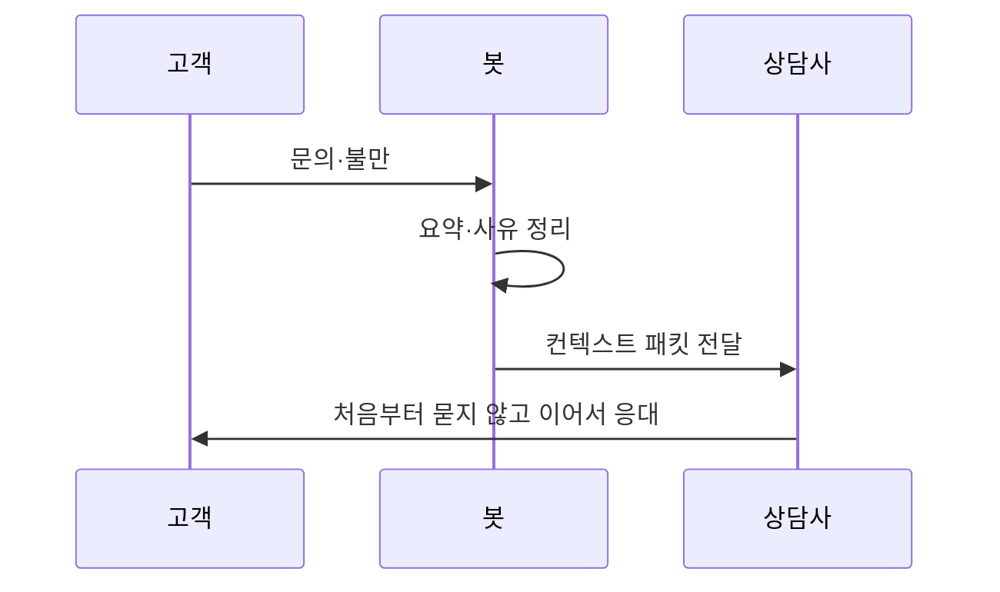

# 웜 vs 콜드 이관

> 봇이 사람에게 대화를 넘길 때 맥락을 같이 넘기면 웜(warm), 빈손으로 넘기면 콜드(cold) 이관이다.

## 쉽게 말하면
병원에서 접수 직원이 진료 메모를 의사에게 건네는 것이 웜, 환자에게 "다시 처음부터 설명하세요"라고 하는 것이 콜드다.

## 자세히
- **콜드 이관**: 상담사가 빈 화면에서 시작. 고객은 같은 말을 반복하고 불만이 커진다.
- **웜 이관**: 요약, 고객 이력, 감정, 감지된 의도, 봇이 이미 시도한 것, 이관 사유를 함께 전달한다.
- **웜을 만드는 요소**: [컨텍스트 패킷](#handoff-context-packet) 형식을 정하고, 상담사 화면에 노출한다.
- **트레이드오프**: 웜은 요약 품질이 나쁘면 상담사를 오도할 수 있어 원문 전체 열람 링크도 둔다. 대기 시간 중 요약을 미리 생성한다.

## 그림으로 보기

## 예시
- 콜드: "안녕하세요, 무엇을 도와드릴까요?" → 고객이 다시 설명.
- 웜: "배송 지연 3일, 환불 원하심. 봇이 주문 조회까지 완료" → 바로 환불 안내.

## 헷갈리는 것과 비교
| 개념 | 차이 |
|---|---|
| 콜드 이관 | 맥락 없음 |
| 웜 이관 | 맥락 전달 |
| [이관 트리거](#escalation-triggers) | 넘기는 시점 |

## 더 읽을거리
- [Hyperleap: Chatbot human handoff best practices](https://hyperleap.ai/blog/chatbot-human-handoff-best-practices) — 웜 이관 실무(벤더)
- [Macha: AI chatbot human handoff](https://www.getmacha.com/blog/ai-chatbot-human-handoff) — 개요(벤더)
