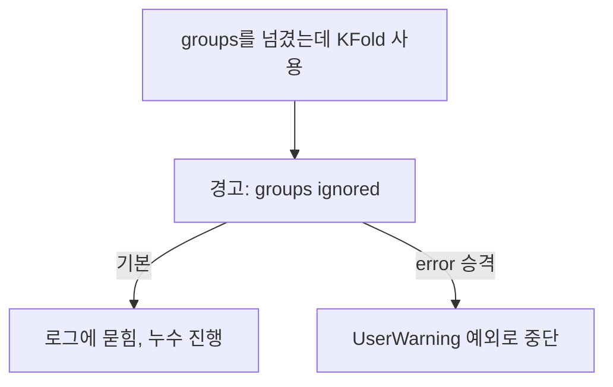

# 경고를 오류로 승격

> 경고는 프로그램을 멈추지 않으므로 로그에 묻혀 지나가기 쉽다. "groups가 무시됨" 같은 누수 위험 경고는 오류로 바꿔 파이프라인이 멈추게 하면 조용히 새는 사고를 막을 수 있다.

## 쉽게 말하면
자동차 계기판의 경고등은 켜져 있어도 운전은 계속된다. 그래서 경고등이 켜지면 시동이 꺼지게 설정해 두면, 무시하고 달리다 사고 나는 일을 막는다. 대신 아무 경고에나 시동이 꺼지면 불편하니 꼭 필요한 경고만 골라 설정한다.

## 자세히
- **방법(Python warnings 문서, 열람)**: ① 실행 옵션 `python -W error script.py` ② 환경 변수 `PYTHONWARNINGS=error` ③ 코드에서 `warnings.simplefilter("error")` ④ 범주·모듈·메시지를 골라 `warnings.filterwarnings("error", message=..., category=...)`. 일시적으로만 적용하려면 `with warnings.catch_warnings():` 안에서 설정하며 나갈 때 원래 필터가 복원된다. pytest의 `filterwarnings` 표시는 pytest 문서에 있고 이 글에서는 확인하지 않았다.
- **직접 확인한 예(scikit-learn)**: 그룹 열을 `groups=`로 넘겼지만 분할기가 일반 `KFold`이면 그룹이 조용히 무시된다. 실행하니 경고 "The groups parameter is ignored by KFold"가 나왔고, `filterwarnings("error", message="The groups parameter is ignored")`를 걸자 같은 호출이 `UserWarning` 예외로 멈췄다. 그룹 누수의 전형적 원인(그룹 분할기를 써야 하는데 일반 분할기를 쓴 실수)을 코드가 스스로 잡는다([분할 단위 테스트](#split-assertion-test)).
- **범위를 좁게(해석)**: 모든 경고를 오류로 바꾸면 무관한 사용 중단(deprecation) 경고에도 멈춰 개발이 불편해진다. 누수·분할·결측에 관한 특정 메시지나 모듈로 한정한다.
- **주의(문서)**: `once`·`default` 규칙에서는 이미 표시된 경고가 새 필터에서 다시 나타나지 않을 수 있다. 필터는 가장 먼저 설정한다.
- **함께 쓸 것**: 경고 승격은 "알고 있는 위험"에 대한 자동 경보고, 모르는 위험은 [정답 섞기 점검](#shuffled-label-sanity-check) 같은 점검으로 찾는다.

## 그림으로 보기



## 예시
```python
import warnings
warnings.filterwarnings("error", message="The groups parameter is ignored")
```
교육 활용: 일반 KFold에 groups를 넘겨 경고가 오류로 바뀌는 것을 확인하고 GroupKFold로 고친다.

## 헷갈리는 것과 비교
| 개념 | 차이 |
| --- | --- |
| 경고 | 실행 계속, 놓치기 쉬움 |
| 오류 승격 | 실행 중단, 즉시 발견 |
| [분할 단위 테스트](#split-assertion-test) | 결과를 assert로 검증 |
| [분할 기록 남기기](#split-report-logging) | 확인 결과를 기록 |

## 더 읽을거리
- [Python: warnings — Warning control](https://docs.python.org/3/library/warnings.html) — 경고 필터와 오류 승격 방법
