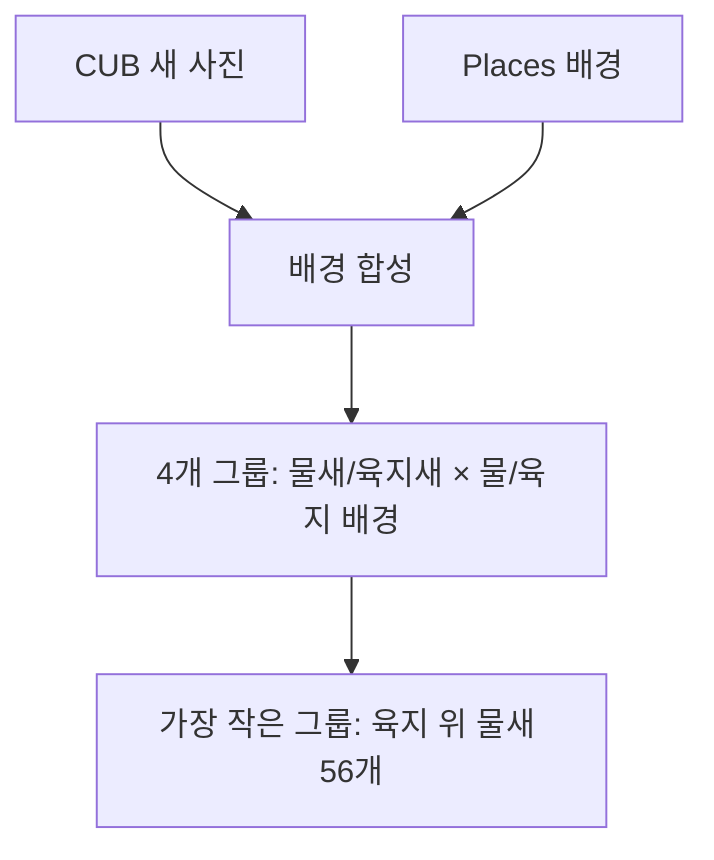
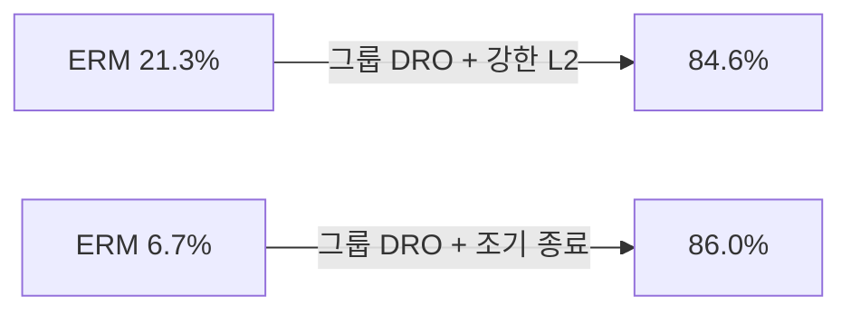

# Waterbirds 벤치마크

> 새 사진에 **다른 배경(물/육지)을 합성**해, 모델이 새가 아니라 배경을 보고 맞히는지(가짜 상관)를 측정하게 만든 이미지 분류 데이터셋. Sagawa 외(ICLR 2020)가 그룹 DRO 연구를 위해 만들었다.

## 쉽게 말하면
"물새는 대체로 물 배경, 육지 새는 대체로 육지 배경"으로 사진을 만들어 둔 시험지다. 배경만 보고 푸는 학생은 평소엔 높은 점수지만, 물 위의 육지 새·육지의 물새 같은 **반대 조합 문제**에서 무너진다.

## 자세히
- **구성(논문 본문 확인)**: Caltech-UCSD Birds-200-2011(CUB)의 새 사진에 Places 데이터셋의 배경을 합성. 라벨 Y = {물새, 육지 새}, 속성 A = {물 배경, 육지 배경}. 물새는 물 배경에, 육지 새는 육지 배경에 더 자주 나온다. **학습 4,795개**, 가장 작은 그룹(육지 위의 물새)은 **56개**. 그룹은 (Y, A) 4가지.
- **평가 지표**: 평균 정확도와 **최악 그룹 정확도(worst-group accuracy)**. 평균은 다수 그룹이 정하므로 최악 그룹이 가짜 상관 의존을 드러낸다([평균 마스킹](#average-masking-weak-groups)).
- **논문의 실험 결과(ResNet50)**
  | 설정 | 방법 | Waterbirds 최악 그룹 시험 정확도 |
  |---|---|---|
  | 강한 L2(λ=1.0) | ERM | **21.3%** |
  | 강한 L2(λ=1.0) | 그룹 DRO | **84.6%** |
  | 조기 종료 | ERM | 6.7% |
  | 조기 종료 | 그룹 DRO | **86.0%** |
  강한 L2에서 ERM은 최악 그룹 *학습* 정확도도 35.7%에 그쳐(CelebA 40.4%) 최악 그룹 시험 정확도 21.3%. DRO는 최악 그룹 학습 정확도 97.5%. 평균 시험 정확도는 ERM·DRO 모두 높고 DRO는 약 1~3%p 낮은 편이다. 논문 결론: 학습 데이터를 완벽히 맞히지 못하게 하는 **규제가 최악 그룹 정확도에 중요**하다.
- **같은 논문의 다른 벤치마크**: CelebA(머리색 vs 성별), MultiNLI(부정어와 모순 라벨). CelebA는 최악 그룹 37.8% → 86.7%(강한 L2), 25.0% → 88.3%(조기 종료)로 향상.
- **후속(arXiv 2306.11957, 초록 확인)**: 가짜 특징이 더 늦게 학습되거나 클래스·그룹 수가 많은 더 어려운 설정을 다루며 새 데이터셋 Animals·SUN을 제안하고, 5개 비전 데이터셋에서 8개 최신 방법을 5,000개 넘는 모델로 비교했다. 그룹이 늘수록 모든 방법이 어려워지고 하이퍼파라미터 튜닝이 중요하다. 코드는 SpuCo 패키지.
- **한계**: 합성 배경이라 인위적이며, 실제 환경의 가짜 상관은 더 복합적이다. 그룹 라벨(배경)이 있어야 평가·일부 완화가 가능하다.
- **교육 활용**: "평균 정확도가 높다 ≠ 올바른 이유로 맞힌다"를 보여 주는 가장 간단한 사례.

## 그림으로 보기



## 예시
```python
# 최악 그룹 정확도 계산
acc = df.assign(ok=df.pred==df.y).groupby(["y","bg"]).ok.mean()
print(acc, "worst:", acc.min())
```
- 자사 비전 모델에 "배경 교체" 테스트셋(제품 사진을 다른 배경에 합성)을 만들어 같은 방식으로 최악 그룹을 점검.

## 헷갈리는 것과 비교
| 데이터셋 | 가짜 단서 | 비고 |
|---|---|---|
| Waterbirds | 배경(물/육지) | 합성 이미지 |
| CelebA 하위 설정 | 성별·머리색 | 실제 얼굴 |
| MultiNLI 하위 설정 | 부정어 | 텍스트 |
| [가짜 상관](#spurious-correlation) | 개념 | 이 데이터셋은 그 예 |

## 더 읽을거리
- [Distributionally Robust Neural Networks for Group Shifts (arXiv 1911.08731)](https://arxiv.org/abs/1911.08731) — Waterbirds 구성과 수치(본문 열어 확인).
- [Challenges and Opportunities in Improving Worst-Group Generalization… (arXiv 2306.11957)](https://arxiv.org/abs/2306.11957) — 더 어려운 설정과 대규모 비교(초록 확인).
