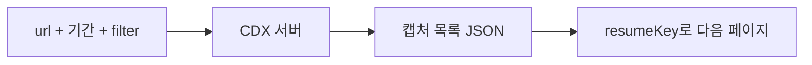
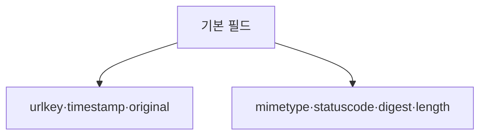

# Wayback CDX API

> Internet Archive 웨이백머신의 캡처 색인을 조회하는 HTTP API다. URL·기간·필터로 캡처 목록(타임스탬프·MIME·상태 코드·해시 등)을 받아 오며 베타로 제공된다.

## 쉽게 말하면
도서관 목록 카드를 URL로 검색하는 창구다. "이 주소를 언제 몇 번 보관했나"를 표로 돌려준다.

## 자세히
(웨이백 CDX 서버 README를 직접 열어 확인.)
- **기본 주소**: `http://web.archive.org/cdx/search/cdx`. 필수 파라미터 `url`(쿼리 문자열이 있으면 URL 인코딩).
- **`matchType`**: `exact`(기본), `prefix`, `host`, `domain`. 와일드카드도 가능(`url=archive.org/*`은 prefix, `url=*.archive.org/`는 domain). domain 모드는 SURT 순서 데이터가 필요.
- **기간**: `from`/`to`는 포함 범위, `yyyyMMddhhmmss`를 1~14자리로 줄여 쓸 수 있다.
- **출력**: `output=json`이면 JSON 배열(첫 행이 필드명). 기본 필드는 `urlkey, timestamp, original, mimetype, statuscode, digest, length`. `fl`로 필드 선택, `gzip=false`로 gzip 끄기.
- **개수**: `limit`이 양수면 처음 N개, **음수면 마지막 N개**, `offset`으로 앞 M개 건너뛰기.
- **필터·중복**: `filter=[!]field:regex`(Java 정규식, `!`는 반전, 여러 개 가능), `collapse=field` 또는 `field:N`로 인접 중복 제거(앞 N글자만 비교 가능).
- **페이지 나누기**: `showResumeKey=true`로 결과 뒤에 재개 키를 받고(더 있을 때만), 다음 요청에 `resumeKey=`로 전달. `page`·`showNumPages`는 보조(ZipNum) 색인이 필요한 병렬 방식.
- **예**: `...cdx?url=archive.org&limit=5&showResumeKey=true&output=json`.
- **주의(제안)**: 큰 필터는 서버 부하를 준다([CDX 서버 부하 예절](#cdx-server-load-etiquette)). cdx-toolkit은 이 API를 감싸 준다([cdx-toolkit](#cdx-toolkit)).

## 그림으로 보기



## 예시
```
http://web.archive.org/cdx/search/cdx?url=example.com&from=2020&to=2021&filter=statuscode:200&output=json&limit=10
```
- 교육 활용: 한 사이트의 연도별 캡처 수를 collapse로 세어 보기.

## 헷갈리는 것과 비교
| 개념 | 차이 |
|---|---|
| Wayback CDX API | IA의 캡처 색인 조회 |
| [CC 컬럼형 색인](#cc-columnar-index) | Common Crawl의 색인 |
| [cdx-toolkit](#cdx-toolkit) | 두 색인을 같은 방식으로 조회 |

## 더 읽을거리
- [Wayback CDX Server README](https://github.com/internetarchive/wayback/tree/master/wayback-cdx-server) — 파라미터·페이지 나누기.
