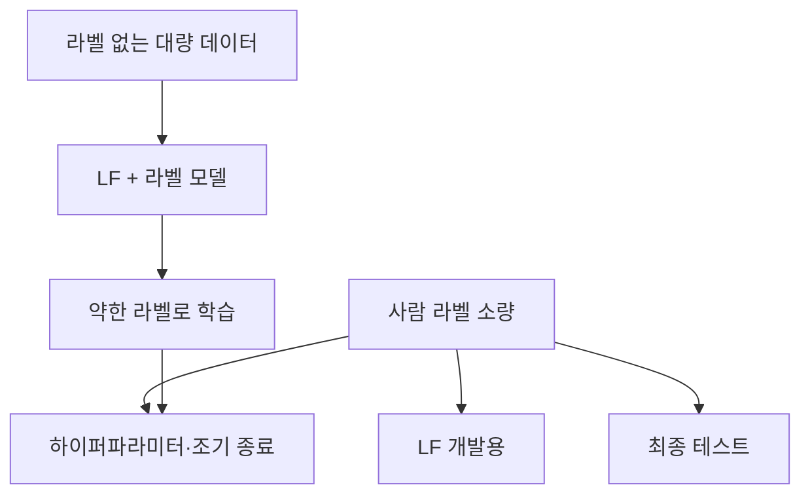
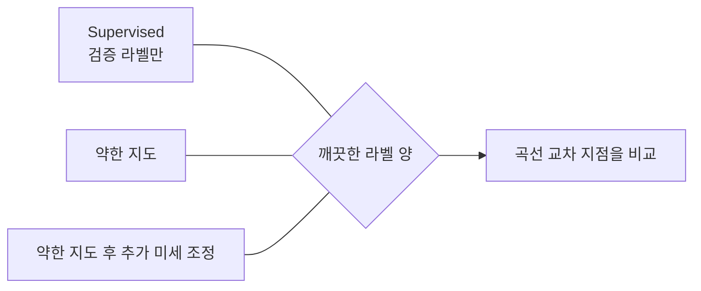

# 약한 지도의 검증 세트

> 약한 지도(weak supervision)에서 **사람이 정확히 라벨한 소량의 데이터**를 따로 두고, 하이퍼파라미터 선택·조기 종료·최종 점검에 쓰는 세트다. "라벨 없이 만든다"는 약한 지도도 실제로는 이런 깨끗한 라벨이 조금 필요하다.

## 쉽게 말하면
여러 사람이 대충 채점한 답안으로 학생을 가르치더라도, 선생님이 직접 채점해 둔 시험지 몇 장은 있어야 "이 가르침이 잘 되고 있나"를 알 수 있다. 그 몇 장이 검증 세트다. 그런데 그 몇 장을 직접 가르치는 데 쓰는 편이 더 나을 수도 있다는 것이 최근 논쟁이다.

## 자세히
(WRENCH 논문 arXiv 2109.11377과 후속 벤치마크 "Stronger Than You Think" arXiv 2501.07727의 PDF를 직접 내려받아 확인.)
- **역할(WRENCH)**: 모든 비교 방법이 **검증 세트 성능으로 하이퍼파라미터를 격자 탐색**한다. 데이터셋은 train/valid/test json 세 파일로 제공되며, train에는 정답 없이 LF 출력만 쓴다.
- **실제 크기(WRENCH 데이터셋 설명)**: Youtube 스팸 검증 120건·테스트 250건, TREC(6 클래스) 학습 4,965건 대비 검증 500건, IMDb 학습 20,000건 대비 검증 2,500건, SemEval(9 관계 유형) 학습 1,749건 대비 검증 200건, CDR 학습 8,430건 대비 검증 920건. 검증 세트가 수백 건 규모인 경우가 많다.
- **논쟁: 검증 라벨을 학습에 쓰면?** 후속 논문에 따르면 Zhu 등은 **정답 라벨 약 50개로 미세 조정**만 해도 일부 약한 지도 방법과 비슷하거나 더 낫다고 보였고, 이를 약한 지도의 이점이 과대평가되었다는 근거로 든다. 후속 논문은 세 방식을 비교한다: ① **Supervised**(검증 라벨만으로 학습) ② **Weakly Supervised**(약한 라벨로 학습, 검증 라벨은 조기 종료용) ③ **Continuous Fine-Tuning**(약한 학습 후 같은 검증 라벨로 추가 미세 조정). 깨끗한 라벨 양을 바꿔 가며 곡선이 교차하는 지점을 본다. 구체적 교차 지점 수치는 이 글에서 확인하지 못했다.
- **LF 설계용 개발 세트와 구분**: 후속 논문은 LF를 설계할 때 학습 세트에서 **깨끗한 라벨 표본을 무작위로 뽑아 별도 개발 세트**를 만든다고 적고, LF의 커버리지·충돌은 라벨 없이, 정확도는 원래 검증 세트로 계산한다.
- **운영 규칙(제안)**: ① 세 용도를 분리: LF 개발용, 하이퍼파라미터·조기 종료용 검증, 최종 보고용 테스트 ② 소수 클래스가 충분히 들어가도록 층화 추출 ③ 같은 데이터를 보고 LF를 고치고 점수도 보고하면 낙관적이다([개발 세트 오염](#dev-set-contamination)) ④ 라벨이 정말 비싸면 50~수백 건 규모에서 "검증 라벨로 바로 미세 조정" 기준선을 꼭 비교.

## 그림으로 보기

## 예시
- 문의 분류 프로젝트: 라벨 없는 문의 3만 건에 LF를 적용하고, 전문가가 문의 300건을 라벨해 개발 100·검증 100·테스트 100으로 나눠 사용.
- 교육 소재: "라벨이 거의 없다"는 상황에서도 소량의 정답 라벨은 가장 값진 자산이라는 것을 설명.

## 헷갈리는 것과 비교
| 개념 | 차이 |
|---|---|
| 약한 지도의 검증 세트 | 사람 라벨 소량을 튜닝·평가용으로 확보·분리 |
| [합친 라벨 검증](#label-model-validation) | 그 세트로 합친 라벨 정확도를 재는 절차 |
| [약한 지도](#weak-supervision) | 불완전한 라벨 출처를 합치는 방법 전체 |
| [LF 커버리지와 충돌](#lf-coverage-conflict) | 정답 없이 계산하는 LF 지표 |

## 더 읽을거리
- [WRENCH (arXiv 2109.11377)](https://arxiv.org/abs/2109.11377) — 22개 데이터셋, 검증 세트 사용 방식과 규모(PDF 직접 확인).
- [Stronger Than You Think: Benchmarking Weak Supervision on Realistic Tasks (arXiv 2501.07727)](https://arxiv.org/abs/2501.07727) — 검증 라벨 양별 Supervised/WS/CFT 비교 설계(PDF 직접 확인, 결과 수치는 미확인).
